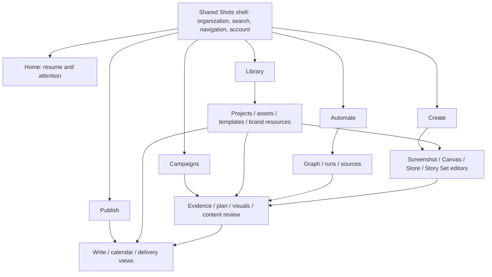
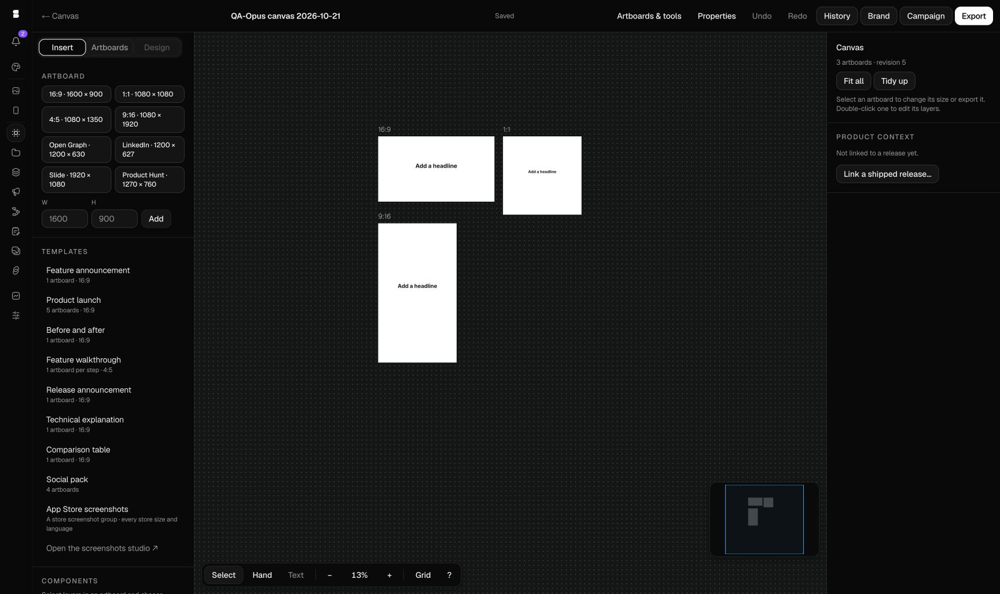
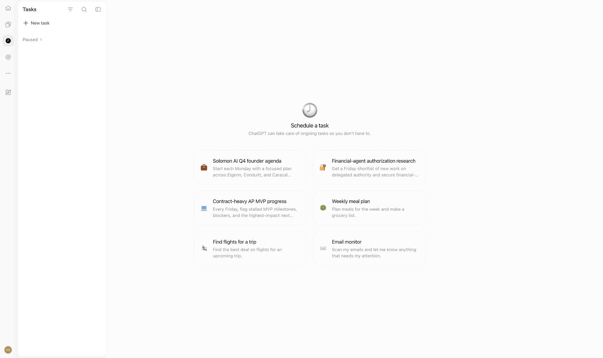
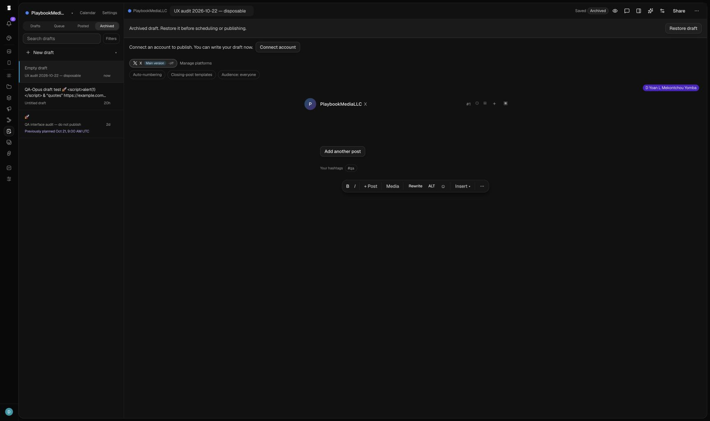

# Shots: UI/UX and information architecture redesign

**Status:** research and implementation specification; no production UI changes made.
**Audit date:** October 22, 2026. **Source baseline:** `main`, `e795377bc234b9e08797b7de9f1e235face04631`.
**Targets:** authenticated [Shots](https://shots.playbookmedia.io/) and [ChatGPT](https://chatgpt.com/) in the connected Chrome account.

This document separates **Observed** (live interaction or rendered DOM), **Source** (repository inspection), **Inference** (interpretation), and **Proposal** (recommended future behavior). A source implementation is not proof of the deployed revision. ChatGPT observations describe this account's experience on this date, not universal availability or its internal architecture.

## 1. Executive assessment and primary recommendation

**Organize Shots around five jobs: Create, Campaigns, Publish, Library, and Automate. Put them in one shared, labeled application sidebar, with Home for resuming work. Give complex editors their own contextual workspaces inside that shell. Adopt Lucide as the single primary interface icon library.**

Shots already has the foundations of a coherent platform: native visual documents, campaign evidence and approvals, publishing brands and calendars, workflow validation, reusable assets, tenant permissions, and recovery/versioning patterns. The problem is how those capabilities are exposed. Today's rail mixes editors, collections, coordinated processes, and diagnostic utilities as peers. “Projects” means cloud screenshot projects in one place and browser-local App Store projects elsewhere. “Brand” can mean a publishing identity, writing defaults, or a versioned visual kit. These are different concepts that need clear labels and visible scope.

The best transferable ChatGPT principle is **a stable application boundary with a changing task environment**. In the inspected account, Space uses a library, Tasks uses a scheduler, Plugins uses a directory, and Home uses a composer. They share identity, navigation, and interaction conventions without forcing all work into one layout. Shots should follow that principle while retaining visual editors, explicit approval gates, and precise export controls.

| Decision                     | Recommendation                                                                                                                                                      |
| ---------------------------- | ------------------------------------------------------------------------------------------------------------------------------------------------------------------- |
| Iconography                  | Lucide, using the installed `lucide-react` initially; no package upgrade bundled with the shell redesign                                                            |
| Product pillars              | Create; Campaigns; Publish; Library; Automate                                                                                                                       |
| Global sidebar               | Workspace selector; Search; + New; Home; five pillars; Activity, Settings, account utilities below                                                                  |
| Dedicated workspaces         | Screenshot editor, Canvas, App Store studio, eligible Story Sets, writing composer, campaign detail, workflow builder                                               |
| Shared components            | Navigation, headers, identity/scope controls, buttons, menus, dialogs, forms, status/save feedback, search presentation, collection controls, recovery patterns     |
| Growth rule                  | Add capabilities within an existing job and contextual navigation first; a new pillar must have a distinct recurring job and substantial workflow                   |
| First fixes                  | Readable management sizing, labeled navigation, clear storage/brand scope, preview failure recovery, mobile settings navigation, explicit handoffs                  |
| Future shell                 | One global navigation owner; one task header; optional contextual tools/list; workspace; optional inspector                                                         |
| Best low-effort improvements | Group existing links, expose useful labels, reuse settings search, standardize headers/states, clarify local-versus-cloud saving, link directly to prerequisites    |
| First engineering slice      | Navigation grouping on existing URLs plus accessible labels and scope indicators; establish size/icon tokens in parallel. Keep persistence and renderers unchanged. |

Do not begin with a wholesale editor rewrite, a new component framework, a new document schema, a mandatory AI prompt on Home, or an analytics product. None is necessary to resolve the observed organizational problems.

## 2. Current Shots UI/UX audit

### Method and scope

The audit clicked the global rail, opened menus and dialogs, followed saved-content links, inspected a Canvas and workflow definition, explored campaign creation and archived campaign review, tested a public URL in Link preview, and created then archived one disposable writing draft. Settings, integrations, and brand configuration were inspected without changing values. Responsive checks used browser viewport overrides. Source inspection followed an advisory code-graph lookup with direct reads because the graph was older than the current checkout.

One test record remains recoverably archived: **“UX audit 2026-10-22 — disposable”**, draft `cmvjmzewj000r0ayot3h30834`, publishing set `c9cb2c928e36e9562ce619f37`. Its title saved successfully; no body was published, no schedule was confirmed, and no sharing or connector authorization occurred. See [archived result](ux-audit-evidence/2026-10-22/10-shots-draft-archived.jpg).

### Findings, classified by evidence and impact

Priority means recommended order, not an assertion of incident severity. P1 is structural or trust-related work to do first; P2 improves a working experience; P3 is optional refinement.

| ID  | Finding and evidence                                                                                                                                                                                                                                                                                                            | Type / priority                    | Consequence and response                                                                                                                                    |
| --- | ------------------------------------------------------------------------------------------------------------------------------------------------------------------------------------------------------------------------------------------------------------------------------------------------------------------------------- | ---------------------------------- | ----------------------------------------------------------------------------------------------------------------------------------------------------------- |
| S01 | **Observed:** compact icon rail exposes Editor, Canvas, Projects, Story Sets, Campaigns, Workflows, Write, Assets, Link preview, Activity, Settings. Editor expands into two further entries. [01](ux-audit-evidence/2026-10-22/01-shots-editor-desktop.jpg), [20](ux-audit-evidence/2026-10-22/20-shots-mobile-navigation.jpg) | IA / P1                            | Users must learn tool names and icons before understanding the platform. Group by job; labels default on for new users.                                     |
| S02 | **Observed:** root opens the existing editor session. **Source:** authenticated root renders `EditorWorkspace`; `/editor` redirects to root.                                                                                                                                                                                    | IA / P1                            | No neutral place to resume writing, campaign, or automation work. Add `/home`; preserve root editor links.                                                  |
| S03 | **Observed:** Projects has saved cloud entries; App Store “All projects” explicitly describes browser-local saving. **Source:** separate IndexedDB stores. [03](ux-audit-evidence/2026-10-22/03-shots-projects.jpg), [23](ux-audit-evidence/2026-10-22/23-shots-local-projects.jpg)                                             | Trust / P1                         | Same noun implies common availability. Show document type and storage scope. Do not promise cloud synchronization.                                          |
| S04 | **Observed:** management text/controls are markedly smaller than editors. **Source:** desktop management root font is 80%, with `--app-zoom: .8` and a PostCSS pixel transform.                                                                                                                                                 | Visual/accessibility / P1          | Readability and perceived consistency suffer. Replace whole-page shrinkage with explicit density tokens after coordinated CSS testing.                      |
| S05 | **Observed:** several project previews and one asset preview were unavailable. **Source:** project preview uses the same fallback for unreadable document and failed source resolution.                                                                                                                                         | Rendering/state / P1 investigation | Preview failure does not prove lost work. Keep Open available, distinguish loading/unsupported/failure, provide retry and diagnostic context.               |
| S06 | **Observed:** Canvas landing and Projects are separate collections; Projects offers “Open in Canvas.” **Source:** Canvas import creates a lossless copy with origin/revision/hash, not a live connection.                                                                                                                       | IA/data semantics / P1             | “Open” can suggest editing the original. Use “Create Canvas copy”; show origin and explain independent edits.                                               |
| S07 | **Observed:** Write already has a substantial local library and editor; Calendar lives in that area. Global rail gives neither publishing nor planning a clear umbrella. [08–11](ux-audit-evidence/2026-10-22/08-shots-write.jpg)                                                                                               | IA / P1                            | Promote the job to Publish and retain Write as the composer. Drafts, Calendar, delivery state, and channels become related views.                           |
| S08 | **Observed:** Workflows landing combines ten metric tiles, definitions, validation, runs, campaigns, and sources. Builder has a graph and Node/Workflow/Test/Versions inspector. [06–07](ux-audit-evidence/2026-10-22/06-shots-workflows.jpg)                                                                                   | IA/density / P1                    | Split local navigation into Workflows, Runs, Sources. Make definition status and next blocking prerequisite more prominent than zero-count tiles.           |
| S09 | **Observed:** Story Sets creation is design-partner restricted in this account, yet has a global destination. [04](ux-audit-evidence/2026-10-22/04-shots-story-sets.jpg)                                                                                                                                                        | Discovery / P2                     | Keep the useful eligibility explanation in Create. Existing saved sets must remain reachable when creation is restricted.                                   |
| S10 | **Observed:** mobile settings puts a long settings navigation before the form; tablet also spends substantial vertical space on navigation. [18–19](ux-audit-evidence/2026-10-22/19-shots-settings-mobile.jpg)                                                                                                                  | Responsive / P1                    | Replace stacked navigation with “Settings / section” chooser and searchable sheet; content first.                                                           |
| S11 | **Observed:** editor account is top-right; management account is bottom-left. Account dialog mixes identity, Create workspace, Assets, Activity, Settings.                                                                                                                                                                      | Shell consistency / P2             | Fix account placement and separate organization switching from personal controls. Existing multi-workspace switching was not proven.                        |
| S12 | **Observed:** Link preview has useful One link/Batch/Compare modes but many diagnostic tabs after checking. [15–16](ux-audit-evidence/2026-10-22/16-shots-link-preview-results.jpg)                                                                                                                                             | Task organization / P2             | Put it under Publish → Link checks; show result, affected previews, and fixes first. Advanced tags/raw/crawlers remain available.                           |
| S13 | **Observed:** Activity exposes releases, archived campaign, announcements, and scheduled posts; a long release list pushes other sections below the fold. Empty scheduled-post copy says posts are scheduled through the API despite Write having a scheduling UI. [42](ux-audit-evidence/2026-10-22/42-shots-activity.jpg)     | IA/content / P1                    | Keep Activity as a filtered utility; expose release evidence in Campaigns; repair stale empty-state links and language.                                     |
| S14 | **Observed:** archived campaign has explicit read-only state, approved spec/plan, six visuals and twelve posts; Copy shows approvals, claim references, length warning, and missing approved visual. [43–44](ux-audit-evidence/2026-10-22/43-shots-campaign-detail.jpg)                                                         | Strength + state clarity / P1      | Preserve review provenance. Separate “approved” from “ready to schedule”; do not infer approval revocation or publishing failure from this archived sample. |
| S15 | **Observed:** Brand kit page explains workspace voice → publishing-set overrides → draft instructions; visual kits publish immutable versions. Publishing “Brands” is a separate settings item. [46](ux-audit-evidence/2026-10-22/46-shots-brand-kit.jpg)                                                                       | Vocabulary / P1                    | Use “Publishing brand,” “Brand voice,” and “Visual brand kit” consistently. Show applied source/version near the work.                                      |
| S16 | **Observed:** integrations explain Available, Connected, Requires setup, Unavailable. Slack connected; Notion/Figma require administrator setup; Zapier/Notion Agents/Raycast have explicit limitations. [45](ux-audit-evidence/2026-10-22/45-shots-integrations.jpg)                                                           | Strength / P2                      | Retain truthful readiness states. Add filters/details to this directory before inventing an app marketplace.                                                |
| S17 | **Observed:** shortcut dialog closes with Escape; one focus check returned body rather than its launcher. **Source:** Projects explicitly restores action-menu focus; Write scopes shortcuts and guards navigation.                                                                                                             | Accessibility risk / P1 validation | Reproduce focus restoration in targeted tests. Do not describe all dialogs as broken. Reuse the stronger existing patterns.                                 |
| S18 | **Source:** Write owns a command palette; root editor exposes AI at ⌘K.                                                                                                                                                                                                                                                         | Interaction conflict / P2          | One shell-level command dispatcher, with scoped actions and explicit AI entry. A global search shortcut must not trigger two overlays.                      |

### Successful patterns to preserve

- Canvas has native artboards, source provenance, saved revision, history, presence, contextual properties, and explicit export validation. Preserve its working mental model.
- App Store studio has an appropriate specialist environment: slide strip, languages, device sizes, checks, store preview, exact export options, and mobile tool/inspector sheets.
- Write clearly distinguishes draft/archive state, shows saving feedback, exposes platform connection prerequisites, and presents both schedule timezone and local-time interpretation.
- Campaigns already communicate a sequence from evidence to plan to production to review. Claim references and version approval matter more than cosmetic simplification.
- Workflow validation links a problem to the relevant node. Activation is distinct from saving a draft. Human review remains explicit.
- Projects has search/sort, empty/error distinctions in source, pagination, contextual actions, and focus-return handling. Consolidate presentation without discarding these.
- Settings already has searchable categories, Save/Discard feedback, and useful explanatory copy. Improve its layout rather than replacing its form infrastructure.

### Functional evidence boundary

The completed disposable workflow was **create draft → rename → saved → inspect schedule prerequisites → cancel → archive → confirm Archived/Restore**. Canvas export and workflow activation were inspected but not executed. Campaign creation was opened but not submitted; the live campaign detail inspected was archived. Public URL checking completed and displayed diagnostics.

The Link preview tool reported a redirect to sign-in, dropped UTM parameters, and a redirecting canonical for the tested Shots URL. Those are **diagnostics produced by the application**, not an independently captured HTTP trace. Console warning/error retrieval returned an empty array in two sampled checks. The browser interface exposed console logs but no network-recording API; an attempt to open native developer tools timed out. No HAR, request/response body, failed HTTP status, server root cause, or performance timing is claimed here.

## 3. ChatGPT reference analysis, by inspected route

All five requested routes were visited directly and rendered in the authenticated account. No access denial or entry redirect was observed on these visits. The account showed a broad product rollout including Space, Tasks, Plugins, and Sites; do not assume all customer accounts have this shell.

### Route and interaction record

| Route                           | Directly observed and interacted with                                                                                                                                                                | Boundary / outcome                                                                                                                                                                                                                                                                         | Transferable principle                                                                                                |
| ------------------------------- | ---------------------------------------------------------------------------------------------------------------------------------------------------------------------------------------------------- | ------------------------------------------------------------------------------------------------------------------------------------------------------------------------------------------------------------------------------------------------------------------------------------------ | --------------------------------------------------------------------------------------------------------------------- |
| `https://chatgpt.com/`          | Global rail; contextual ChatGPT sidebar; New chat; Search; projects, pinned items and recents; Chat/Work choice; composer. Opened Search, entered a query, dismissed with Escape, collapsed sidebar. | Search Escape restored focus to Search. A deliberately unlikely query returned an audio item, so a clean no-results state was not established. No prompt submitted. [25–27](ux-audit-evidence/2026-10-22/25-chatgpt-home.jpg)                                                              | Stable navigation plus context-specific working area. Search is an alternate entry, not a replacement for navigation. |
| `https://chatgpt.com/space`     | All page; Suggested/Favorites/Your items/Shared with you; list/grid; search; filters; template examples; item menus. Opened Space navigation and Create menu; inspected file-type filter.            | Create offers Page, Slides, Site, Image, Folder, Space, upload, plugin connection; Sheet was “Coming soon” and disabled. Context navigation includes Pages/Slides/Sites/Images/Drive, recents/spaces/trash. No content created. [28–29](ux-audit-evidence/2026-10-22/28-chatgpt-space.jpg) | Content types share a library while retaining different authoring experiences. Capability availability is explicit.   |
| `https://chatgpt.com/tasks`     | Schedule-a-task landing with suggestions; rail click reveals task sidebar with New task, filter, search, Paused. Opened new-task dialog and Advanced.                                                | Instructions, recurrence, time, timezone, end condition, model/effort/new-chat configuration. Create disabled with no instructions; cancelled. No task or run created. [30–32](ux-audit-evidence/2026-10-22/32-chatgpt-task-form.jpg)                                                      | Task-specific lifecycle and settings sit locally; advanced choices are progressively disclosed.                       |
| `https://chatgpt.com/plugins`   | Searchable directory, Public/Personal, category navigation, Manage/Add. Opened GitHub detail.                                                                                                        | Detail has Plugins breadcrumb, usage examples, Manage/Try chat, apps and provenance/policy information; an enterprise variant was administrator-disabled. No installation or authorization. [33–34](ux-audit-evidence/2026-10-22/34-chatgpt-plugin-detail.jpg)                             | Integration discovery scales as a directory rather than one global item per provider.                                 |
| `https://chatgpt.com/sites`     | Sites collection, search, grid/list, “No sites yet,” Create Site.                                                                                                                                    | Create Site moved to root Work composer with a Sites mention and creation intent already inserted. It did not immediately create a site. No Send action. [35–36](ux-audit-evidence/2026-10-22/36-chatgpt-sites-work-handoff.jpg)                                                           | A cross-area handoff can carry intent and tool context without making the user reconstruct it.                        |
| Explore popover                 | Opened rail Explore; viewed capability list and pin/unpin controls; Sites pinned.                                                                                                                    | No pins changed. Includes first-party and connected capabilities, with account-specific availability. [37](ux-audit-evidence/2026-10-22/37-chatgpt-explore.jpg)                                                                                                                            | Secondary discovery protects primary navigation from every new capability.                                            |
| Profile → Settings → Appearance | Profile menu, full-page settings, searchable grouped contextual nav; appearance/theme controls.                                                                                                      | Global rail retained. Mobile opens navigation as overlay; tablet shows contextual column. No settings values changed. [38–41](ux-audit-evidence/2026-10-22/38-chatgpt-settings.jpg)                                                                                                        | Personal/global preferences and local task settings have distinct homes.                                              |

### Shell and information hierarchy

**Observed:** Home, Space, Tasks, Plugins, Explore, and pinned Sites occupied a stable rail with profile at its base. Contextual navigation changed with the product area. Collapsing Home's sidebar retained the rail and expanded the working area; clicking some rail entries exposed contextual navigation as an overlay. It was not always an additional permanently open column.

Home's history is hierarchical and sometimes dense. Space uses a content table with name/source/activity and row actions. Tasks begins with a task-oriented empty/creation experience. Plugins uses a catalog/detail pattern. Sites is a collection that hands creation to a different workspace. Search, local filters, breadcrumbs, selected rows/tabs, and contextual overflow menus reduce the need to expose every operation globally.

**Inference:** these patterns lower the number of concepts visible at once while maintaining a reliable way to switch product areas. The evidence supports the behavior, not a claim about shared React components, internal route registries, or OpenAI's product strategy.

### Visual and interaction observations

| Aspect     | Observed reference                                                                                                                                            | Implication for Shots                                                                                      |
| ---------- | ------------------------------------------------------------------------------------------------------------------------------------------------------------- | ---------------------------------------------------------------------------------------------------------- |
| Geometry   | Sampled rail: 52 CSS px; rail button: 36 × 36; SVG: 20 × 20 with a 20-unit viewBox. Sampled settings context column: 288 CSS px.                              | Use explicit region tokens, but choose sizes for Shots' editors and label needs.                           |
| Icons      | Mostly simple monochrome geometry, restrained detail, rounded-looking joins/ends; some selected icons filled. Not every SVG exposed a stroke-width attribute. | Match optical weight and consistency. Do not claim a precise universal stroke or a public icon dependency. |
| Type       | Sampled settings body: 16 CSS px, system-oriented sans-serif stack. Headings use modest weight/size differences.                                              | Readability comes from stable type and spacing, not shrinking the application.                             |
| Color      | Neutral surfaces, dark text, soft gray selection; sampled Appearance showed background #FCFCFC and foreground #0D0D0D with black accent.                      | These are observed theme values, not extracted internal tokens. Preserve Shots light/dark identity.        |
| Edges      | Few strong borders; subtle rounded selections, larger composer/dialog radii; shadows concentrated on floating surfaces.                                       | Use borders for structure, elevation for overlays, not a separate card around every row.                   |
| Density    | Sidebar dense; composer spacious; library table efficient; settings bounded; specialist task form compact.                                                    | Let the task determine density within a shared scale.                                                      |
| Actions    | Main create/compose action visible; details and secondary actions in menus. Advanced task choices expand within the form.                                     | Put configuration next to its task; keep common action labels visible.                                     |
| Keyboard   | Search dismisses on Escape with focus return; skip-to-content link exposed in DOM.                                                                            | Adopt explicit focus contracts and skip links. Full keyboard/screen-reader compliance was not established. |
| Responsive | Narrow settings view shows content and a Show sidebar control; overlay contains navigation. Wider tablet retains rail/context column.                         | Avoid stacking all navigation above the form.                                                              |

Hover animations, transition durations, destructive confirmations, broad disabled-state consistency, and every menu's keyboard behavior were not exhaustively measured. No destructive reference action was performed. The source of ChatGPT's icons remains unknown.

### Reference patterns to reject or adapt

- **Do not copy a conversational home as the sole entry.** Visual creation benefits from thumbnails, typed starters, dimensions, and direct editing.
- **Do not copy an indefinitely growing chat-history sidebar.** Shots needs stable projects and campaign provenance; recents belong mainly on Home and in search.
- **Do not make unlabeled rail icons the default for new users.** ChatGPT's familiar Home and conversational model do not eliminate Shots' discoverability problem.
- **Do not route every creative action through AI.** The Sites handoff is useful inspiration for preserved intent; a screenshot crop or export should stay direct and deterministic.
- **Do not treat every integration as a product pillar.** A searchable directory plus local prerequisite links is enough.
- **Do not treat spaciousness as a universal goal.** Canvas layers, publishing schedules, and workflow nodes need efficient, task-specific density.

## 4. Comparative UX findings

| Dimension          | Shots now                                                    | Reference principle                              | Shots decision                                                                 |
| ------------------ | ------------------------------------------------------------ | ------------------------------------------------ | ------------------------------------------------------------------------------ |
| Product entry      | Root is an editor; rail enumerates tools and collections     | Home and specialized areas share a shell         | Add Home and job-level pillars; retain editors                                 |
| Feature growth     | More peer rail items                                         | Directory/discovery plus contextual navigation   | Fixed primary jobs; local feature lists; no provider-per-rail                  |
| Persistent context | Mixed account placement and separate local sidebars          | Stable rail/profile, contextual second layer     | One global owner and explicit context slots                                    |
| Content management | Projects, Canvas, Assets, local store projects separated     | Space groups content types                       | Library provides typed entry points, not a forced common data model            |
| Creation           | New project, New draft, Canvas starters, studio project menu | Contextual create plus cross-area intent         | + New routes to existing creation flows; local primary actions remain          |
| Scheduling         | Write calendar, campaign scheduling, workflow automation     | Tasks owns recurrence/configuration              | Publish owns calendar/delivery; Automate owns rules/runs; both preserve origin |
| Settings           | Useful groups, long forms and mobile navigation              | Searchable context nav and content-first mobile  | Keep forms; constrain widths and use section chooser                           |
| Visual consistency | Two main icon systems; 80% management scale                  | Restrained neutral chrome and stable icon weight | Lucide, semantic tokens, explicit density                                      |
| Cross-area work    | Existing Canvas copy/handoff; many settings detours          | Sites preserves creation intent in handoff       | Explicit source/destination, return target, save guard                         |
| Trust              | Good validation and approvals but storage vocabulary unclear | Consistent context cues                          | Make scope, revision, review and delivery independent visible states           |

## 5. Current feature and navigation inventory

**Source architecture:** Next.js ^16.3.0 with the App Router and locale-prefixed route tree; React 19.2.5; Tailwind 4 and semantic CSS variables; shadcn New York plus Radix primitives; Zustand 5 and TanStack Query; a workspace Plate editor; React Flow 12 for workflows; Zod 4 contracts; Go-backed product data accessed through the backend SDK/RPC boundary. These existing systems support the proposed shell without a new UI framework.

**Availability is not just navigation:** campaign rollout includes `PLATFORM_CAMPAIGN_WORKFLOW=enabled` or workspace feature evaluation; Story Set creation depends on `creative-sets:create`; content drafts independently require `PLATFORM_CONTENT_DRAFTS=enabled`, with off-state pages/API returning 404. Organization, operational status, plan and role checks also vary by page. Build navigation from these existing access results; never expose a link as proof that an action is authorized.

Legend: **G** = recommended global pillar/utility; **C** = contextual destination; **W** = dedicated workspace inside a pillar. Routes below omit optional locale prefixes. Source-only entries are marked; they were not all exercised live.

| Feature / purpose              | Existing route or entry; current navigation                                                   | Primary workflow and UI                                                        | Relationship / issue                                                          | Recommended placement                                                 |
| ------------------------------ | --------------------------------------------------------------------------------------------- | ------------------------------------------------------------------------------ | ----------------------------------------------------------------------------- | --------------------------------------------------------------------- |
| Screenshot composition         | `/`, `/?project=…`; Editor → Screenshot                                                       | Compose, frame/background/layers, 3D/motion, save/share/export                 | Native screenshot project; root monopolizes entry                             | Create → Screenshot **W**                                             |
| Cloud screenshot projects      | `/projects`; global Projects                                                                  | Search/sort → open; menu rename/duplicate/delete/Open in Canvas                | Saved documents/version history; preview failures; narrower than noun implies | Library → Projects **C**                                              |
| Canvas                         | `/canvas`, `/canvas/new`, `/canvas/[id]`; global Canvas                                       | Starter/import → artboards/layers/properties → history/export/campaign handoff | Reuses native documents; copy semantics must be clear                         | Create → Canvas **W**, Library type filter                            |
| App Store studio               | `/?editor=app-store`; Editor child; `/store-screenshots` also exists in source                | Local project → slides/languages/device profile/checks/store preview/export    | Browser-local documents/assets/templates/kits; distinct renderer              | Create → App Store screenshots **W**                                  |
| Story Sets                     | `/creative-sets`, detail in source; global                                                    | Coordinated stories/outputs; live landing explains restricted creation         | Shares source/copy across outputs; account gate                               | Create → Story Sets **W** when eligible; Library for existing sets    |
| Code/tweet and image utilities | `/code`, `/tweet`, `/tools`, conversion/crop/resize/compress routes; source inventory         | Focused source/composition or file operation                                   | Not distinct enduring workspaces; not all live-tested                         | Create → Tools **C**, search and contextual Insert                    |
| Campaign brief                 | `/campaigns/new`; Campaigns create prompt                                                     | Select product → title/value/audience/sources → saved draft                    | Coordinates an outcome; form not submitted                                    | Campaigns **G**, new campaign flow                                    |
| Campaign production/review     | `/campaigns/[id]` and `spec/plan/assets/copy`                                                 | Approve evidence/spec/plan → visuals/channel copy → review/schedule            | Strong workflow; live sample archived, guards visible                         | Campaigns → campaign **W**                                            |
| Release evidence               | `/releases/[id]`; Activity links; source-backed read-only page                                | Read brief, notes, changes, source links, asset count                          | Input to campaigns/workflows, buried in Activity                              | Campaigns → Release inbox **C**; Automate source links                |
| Writing library/composer       | `/write`, `/write/[id]?set=…`; global Write                                                   | Brand → drafts → compose variants → preview/review/share/schedule              | Own local sidebar; shared editor package; completed test archive              | Publish → Drafts / Write **W**                                        |
| Planning/calendar              | `/write/plan?set=…`; Write Calendar                                                           | Week navigation, slot/planned post, schedule timezone                          | Related to drafts, queues and connected channels                              | Publish → Calendar **C**                                              |
| Draft lifecycle                | Write Drafts/Queue/Posted/Archived, filters, pin/menu                                         | Save, queue, archive/restore; backups and focus mode                           | Existing lifecycle should stay coherent                                       | Publish local states **C**                                            |
| Campaign publishing            | Copy scheduling dialog; source inspected                                                      | Approved copy + approved visual + channel → schedule/reschedule/cancel         | Distinct source object from a freeform draft; cannot silently convert         | Publish delivery views with campaign origin; edit/review in Campaigns |
| Workflow definitions           | `/workflows`, new/detail; global Workflows                                                    | Template/definition → graph → validation/test/version → activate               | Draft/active distinction; activation blocked in sample                        | Automate **G**, builder **W**                                         |
| Workflow runs                  | `/workflows/runs`, run detail; source + dashboard                                             | Inspect run and outcomes                                                       | Operational diagnosis; not general creative analytics                         | Automate → Runs **C**                                                 |
| Workflow sources               | Workflows dashboard Sources                                                                   | Repository/release intake configuration                                        | Needs integrations; current legacy source visible                             | Automate → Sources **C**                                              |
| Asset/media library            | `/assets`; global Assets                                                                      | Search/filter → inspect/use image/download/delete                              | Workspace assets reused by design; draft/campaign reuse hard to discover      | Library → Assets **C**                                                |
| Built-in/saved templates       | Editor Templates; Canvas starters; studio Project menu                                        | Select template → editable document                                            | Several document formats/storage scopes                                       | Create starters + Library → Templates **C**; label compatibility      |
| Link preview diagnostics       | `/link-preview`; global                                                                       | URL/batch/compare → previews/issues/fixes/technical details                    | Publish readiness utility, not a primary creative product                     | Publish → Link checks **C**                                           |
| Activity/notifications         | `/activity`; global; notification button                                                      | Inspect work and events, open source objects                                   | Aggregates domains; not performance analytics                                 | Shared Activity utility **G**, contextual deep links                  |
| Brand voice/visual kits        | `/workspace/brand-kit`; Brand & content settings                                              | Voice defaults + forbidden terms; draft/publish visual kit                     | Cross-cutting resource with versioning; no cloud kits in sampled account      | Library → Brand resources **C**; same editor via settings alias       |
| Product facts/pages            | `/workspace/product`, `product-pages`; settings/source                                        | Product context for release content, product pages                             | Not equivalent to publishing brand; detailed edit not live-tested             | Library → Brand resources → Products **C**                            |
| Publishing brands/channels     | `/workspace/social-sets`, `channels`, brand subsettings                                       | Choose brand, connect channels, queue/defaults/assistant                       | A publishing scope, not organization switch                                   | Publish context selector/configuration **C**; settings links          |
| Sharing/collaboration          | Editor Share; Write comments/details; `/s/[token]`, `/d/[token]`, `/review/[token]` in source | Share/review/comment; Canvas presence/history                                  | Public tokens and permissions cannot inherit authenticated shell assumptions  | Contextual Share/Review **C**; shared controls                        |
| Integrations/AI agents/API     | `/workspace/integrations`, `ai-agents`, `developers`                                          | Discover readiness → configure service/agent/webhook                           | Directory is already useful; provider capabilities differ                     | Settings → Integrations **C**, contextual setup links                 |
| Organization/admin             | `/workspace`, billing/members/roles/SSO/audit/etc.                                            | Manage tenant and access; account menu                                         | Global workspace versus personal preferences needs clarity                    | Shared Settings utility **G**                                         |
| Personal preferences/security  | workspace account/appearance/notifications/security/install                                   | Preferences, shortcuts/sidebar/calendar direction settings                     | Existing values must survive migration                                        | Account + Settings **C**                                              |

The source route inventory also contains public marketing, pricing, documentation, onboarding, authentication, render-only, OAuth, and share routes. These are **not new primary pillars**. Keep public and render-only layouts outside the authenticated app shell. No standalone performance analytics screen was established by the live audit; do not relabel Activity or zero-count workflow metrics as analytics.

## 6. Recommended icon library and migration strategy

### Current implementation evidence

`package.json` declares `hugeicons-react ^0.4.0`, `@hugeicons/react ^1.1.5`, `lucide-react ^0.562.0`, and `react-icons ^5.5.0`. A static import scan of TS/TSX/JS/JSX in `app`, `components`, `lib`, `packages`, and `hooks` found **139 importing files for hugeicons-react and 88 for lucide-react**, with no direct importers for the other two packages in that scope. These are file counts, not icon counts or measured bundle costs.

`components.json` already selects Lucide for shadcn's New York style. The Plate workspace also uses Lucide. Installed Lucide 0.562.0 declares TypeScript types, React 19 compatibility, and `sideEffects: false`. This is a consolidation decision, not a new framework dependency.

### Library comparison

Similarity and coverage below are design judgments against the observed reference and Shots' inventory; they are not claims that ChatGPT uses any of these libraries.

| Library                                   | Visual fit / feature coverage                                                                                                     | React, customization, variants                                                                                                                                                                                                                                               | Migration decision                                                                                                                                                      |
| ----------------------------------------- | --------------------------------------------------------------------------------------------------------------------------------- | ---------------------------------------------------------------------------------------------------------------------------------------------------------------------------------------------------------------------------------------------------------------------------- | ----------------------------------------------------------------------------------------------------------------------------------------------------------------------- |
| **Lucide**                                | Strong neutral outline fit; consistent 24-unit geometry; broad creative/navigation coverage. Some reference filled shapes differ. | Typed components; size/color/stroke; named imports tree-shake. Primarily outlines; selected UI need not fill icons. [React guide](https://lucide.dev/guide/react/), [stroke guide](https://lucide.dev/guide/react/basics/stroke-width)                                       | **Choose.** Already installed and integrated with shared UI. Lowest additional dependency and migration burden.                                                         |
| Phosphor                                  | Strong alternative, particularly when balanced outline/fill pairs matter; more expressive geometry. Broad feature coverage.       | Six weights including fill/duotone, size/color, RTL mirroring; typed React; SSR-specific entry. Named imports tree-shake; maintainer documents development import overhead. [Official React repository](https://github.com/phosphor-icons/react)                             | Reject as primary because the extra weights do not justify replacing existing Lucide consumers and adding another system.                                               |
| Tabler                                    | Strong outline fit; very broad specialized and provider coverage; some icons more detailed than desired at 16px.                  | 24-unit grid, default stroke 2, React/TS, size/color/stroke, outlined and filled sets; ESM tree-shaking. [Official repository](https://github.com/tabler/tabler-icons), [documentation](https://docs.tabler.io/icons)                                                        | Best fallback for unusual coverage, but no demonstrated core gap warrants installing it.                                                                                |
| Heroicons                                 | Clear rounded shapes and excellent small solid variants; narrower specialist/editor vocabulary.                                   | React/TS; 24 outline/solid, 20/16 solid; color/size via SVG; outline stroke adjustable. Separate variant imports. [React documentation](https://github.com/tailwindlabs/heroicons/blob/master/react/README.md)                                                               | Reject as primary: enough for a shell, less complete for the whole creative platform; project does not generally accept new icon requests.                              |
| Iconoir                                   | Refined, lighter outlines; default 1.5 stroke can feel fragile at Shots' current reduced sizes. Useful creative vocabulary.       | React/TS, standard SVG props and provider; 24-unit designs. Solid options exist in the family, but exact parity needs checking per icon. [React package](https://github.com/iconoir-icons/iconoir/tree/main/packages/iconoir-react), [catalog](https://iconoir.com/)         | Reject: new migration cost and no material advantage over existing Lucide.                                                                                              |
| Radix Icons                               | Crisp at native 15px; excellent small control/editor symbols; less suitable as a broad 20px product navigation language.          | Individual typed React components; currentColor/size; many path-based shapes, not one globally adjustable stroke/weight family. [Official catalog](https://www.radix-ui.com/icons)                                                                                           | Keep Radix primitives, not a second icon system. Different native grid and limited product vocabulary weaken whole-app fit.                                             |
| Hugeicons, current and successor packages | Existing rounded language is viable; visual difference alone is not a reason to migrate.                                          | Legacy package typed/tree-shakable. Official successor uses renderer + icon-data pack; free Stroke Rounded and separately licensed premium styles. [Legacy notice](https://github.com/hugeicons/hugeicons-react), [current packages](https://github.com/hugeicons/hugeicons) | Legacy repository archived September 14, 2026. Consolidating on installed Lucide is simpler than migrating all callers to another Hugeicons API while retaining Lucide. |

### Maintenance, compatibility, licensing, and bundle assessment

Registry metadata was checked on the audit date. “Latest published” describes package release timing; a quiet stable library is not necessarily abandoned. All seven sampled package versions declare `sideEffects: false`; this does not establish actual application bundle savings. React peer ranges include React 19. Heroicons supplies types through variant entry points rather than a root `types` field.

| Package                 | Latest registry version / publication | Maintenance/community signal                                                                       | License position                                                                                                                                                                           |
| ----------------------- | ------------------------------------- | -------------------------------------------------------------------------------------------------- | ------------------------------------------------------------------------------------------------------------------------------------------------------------------------------------------ |
| `lucide-react`          | 1.61.0 / 2026-10-21                   | Recent release; active community project; installed version is older 0.562.0                       | ISC; retain copyright/license notices; derived Feather notices also documented in [license](https://lucide.dev/license)                                                                    |
| `@phosphor-icons/react` | 2.1.10 / 2025-05-22                   | Established multi-framework family; current React repository includes SSR and performance guidance | MIT                                                                                                                                                                                        |
| `@tabler/icons-react`   | 3.49.0 / 2026-10-05                   | Recent release; broad framework ecosystem and catalog                                              | MIT                                                                                                                                                                                        |
| `@heroicons/react`      | 2.2.0 / 2024-11-18                    | Maintained by Tailwind Labs; deliberately conservative catalog contribution policy                 | MIT                                                                                                                                                                                        |
| `iconoir-react`         | 7.12.1 / 2026-08-12                   | Recent package; multi-framework community project                                                  | MIT                                                                                                                                                                                        |
| `@radix-ui/react-icons` | 1.3.2 / 2024-11-14                    | WorkOS-backed Radix family; mature small control set                                               | MIT                                                                                                                                                                                        |
| `hugeicons-react`       | 0.4.0 / 2026-01-24                    | Legacy repository archived; successor maintained separately                                        | **Metadata discrepancy:** installed/registry package says CC0-1.0; bundled LICENSE.md and repository say MIT. Preserve bundled notices during migration; do not extrapolate to Pro assets. |

Sources: official [npm registry](https://registry.npmjs.org/) metadata for the named packages, their linked official repositories, and installed package manifests. ISC/MIT allow commercial use subject to their notices; brand marks remain subject to their owners' rules. No paid icon pack is required for this proposal.

All candidates can support accessible UI, but none supplies the accessible name, keyboard behavior, or target size of the **button using the icon**. Decorative SVGs should be hidden from assistive technology; icon-only controls need an explicit localized label and visible tooltip on hover/focus.

### Shots icon contract

| Use                    | Size / stroke                                       | Treatment                                                                                            |
| ---------------------- | --------------------------------------------------- | ---------------------------------------------------------------------------------------------------- |
| Global navigation      | 20px / Lucide strokeWidth 2                         | Same icon expanded/collapsed; neutral foreground; selected row surface + label weight + aria-current |
| Page primary action    | 18px / 2                                            | Icon supplements a verb label; never substitutes for it                                              |
| Editor toolbar         | 18px normally, 16px in genuinely dense controls / 2 | Consistent hit area at least 32px desktop, 44px touch                                                |
| Menus, inline metadata | 16px / 2                                            | Avoid decorative icons in every metadata row                                                         |
| Empty state            | 32px / 2                                            | One relevant symbol, no competing illustration required                                              |
| Warnings/success       | 16–20px / 2                                         | Text + shape + semantic color; never color alone                                                     |

StrokeWidth is in the SVG's coordinate system and scales with rendered size. Do not apply a global fixed CSS stroke to every SVG, including partner logos. Start with the library default and review 16/18/20px optical weight at 100% and 200% zoom.

Outlined is the default. Active navigation uses surface, text, and selection semantics; **do not fill arbitrary Lucide paths**. Filled Star/Heart-style states are allowed only where the shape supports it and the action is a real toggle. Do not add a filled-icon library for selected navigation.

| Feature                                                  | Lucide mapping                                                               |
| -------------------------------------------------------- | ---------------------------------------------------------------------------- |
| Home / Create / Campaigns / Publish / Library / Automate | House / Palette / Megaphone / Send / FolderOpen / Workflow                   |
| Screenshot / Canvas / Store screenshots / Story Sets     | Image / PanelsTopLeft / Smartphone / Layers                                  |
| Drafts / Calendar / Queue / Posted / Archive             | SquarePen / CalendarDays / ListOrdered / CircleCheck / Archive               |
| Assets / Templates / Brand resources / Product facts     | Images / LayoutTemplate / SwatchBook / Package                               |
| Link checks / Integrations / Activity / Settings         | Link2 / Plug / Activity / Settings2                                          |
| Search / New / Collapse / Expand / More                  | Search / Plus / PanelLeftClose / PanelLeftOpen / Ellipsis                    |
| Save status / History / Comments / Export                | CloudCheck or Check with explicit scope / History / MessageSquare / Download |
| Warning / Failure / Retry / Restricted                   | TriangleAlert / CircleAlert / RotateCw / LockKeyhole                         |

Verify every export name against the pinned installed version before implementation. Custom work is limited to the Shots brand mark, official provider marks, and genuinely domain-specific editor glyphs such as a projection/3D transform that no existing symbol communicates. Put custom SVGs under a documented fork-owned icon directory; use the same grid and optical weight. Provider identity assets are not a second general-purpose UI library.

Illustrative use with the installed API, not a production change:

```tsx
import { Download } from 'lucide-react'
import { Button } from '@/components/ui/button'

export function ExportAction({ onExport }: { onExport: () => void }) {
  return (
    <Button onClick={onExport}>
      <Download size={18} strokeWidth={2} aria-hidden="true" />
      Export
    </Button>
  )
}
```

### Migration sequence

1. Establish the approved mapping and size conventions in the platform shell/shared primitives. Keep static named imports; no runtime import of the entire catalog or giant universal icon registry.
2. Convert fork-owned shell, settings, library, publishing, and workflow components by surface. Preserve labels, tooltips, test selectors, and control semantics.
3. Preserve upstream editor internals unless the replacement belongs upstream too. Temporary legacy imports are an explicit migration exception, not permission for new Hugeicons usage.
4. Sweep every workspace, lazy route, test/demo, and dynamic import before removing packages. Zero importers in the bounded scan is insufficient to remove `@hugeicons/react` or `react-icons` today.
5. Measure route bundles before/after; validate SSR/RSC, layout, and icon accessibility. Do not promise a numerical bundle reduction without a build.
6. Handle a Lucide 1.x upgrade separately. Current upstream docs use APIs such as `nonScalingStroke` that differ from older installed versions; the redesign does not require that upgrade.

## 7. Recommended product pillars

These are product destinations, not backend services. A pillar earns its place through a recurring user job, its own meaningful state, and several connected tasks. Editors remain specialized even when they share the same pillar.

### Create

| Requirement               | Specification                                                                                                                                         |
| ------------------------- | ----------------------------------------------------------------------------------------------------------------------------------------------------- |
| Purpose / core job        | Turn a screenshot, idea, or existing design into a finished visual                                                                                    |
| Includes                  | Screenshot composition, Canvas, App Store studio, eligible Story Sets, visual templates, code/tweet composition, focused image tools                  |
| Excludes                  | Asset administration, campaign approvals, channel scheduling, workflow execution                                                                      |
| Workspace decision        | One Create landing; separate document workspaces because their editing models differ                                                                  |
| Sidebar / default landing | **Create** → proposed `/create`; job-based starters and recent creative work                                                                          |
| Internal navigation       | Landing: Start / Recent / Templates / Tools. Inside a document: its native layers/artboards/slides and inspector                                      |
| Frequent actions          | Start from screenshot; open recent; choose template; insert asset; change format; export                                                              |
| Relationships             | Library supplies media/kits/templates; Campaigns supplies brief and receives review candidates; Publish consumes explicitly selected rendered outputs |
| Shared components         | Starter cards, recent-item cards, asset picker, document header, save state, history/share/export presentation                                        |
| Extension rule            | Add a starter/tool to a supported document workflow before adding another editor. New renderers require an explicit format label and save contract    |
| Landing empty state       | Four concise task starters, a sample/template entry, and an explanation of saving. Avoid a wall of every editing feature                              |

Starter copy should distinguish intent: **Polish a screenshot**, **Compose a Canvas**, **Build store screenshots**, **Create a Story Set**. A short subtitle explains each output. Story Sets eligibility is attached to that card, not represented as a broken route. A saved item always opens its original editor; choosing Canvas copy is a separate action.

### Campaigns

| Requirement               | Specification                                                                                                                                           |
| ------------------------- | ------------------------------------------------------------------------------------------------------------------------------------------------------- |
| Purpose / core job        | Coordinate a product announcement from evidence through approved deliverables                                                                           |
| Includes                  | Campaign list, release inbox, product/source brief, versioned spec and plan, generated visuals, channel copy, review and campaign status                |
| Excludes                  | Generic file browsing, freeform writing without a campaign, global provider setup, recurring workflow graph editing                                     |
| Workspace decision        | Yes: each campaign has durable identity, approvals, provenance, and a multi-stage workflow                                                              |
| Sidebar / default landing | **Campaigns** → existing `/campaigns`; active campaigns with status and next useful action                                                              |
| Internal navigation       | Collection: Campaigns / Release inbox / Archived. Detail: Overview / Brief & evidence / Plan / Visuals / Content & review                               |
| Frequent actions          | Start brief; inspect source; approve a revision; review visuals/copy; resolve blockers; open delivery schedule                                          |
| Relationships             | Automate can create campaign drafts from release sources; Create refines visuals; Library supplies product facts/kits; Publish owns delivery visibility |
| Shared components         | Page header, progress summary, version/status indicators, review controls, source links, asset picker, schedule presentation                            |
| Extension rule            | Add production outputs under Visuals or Content & review. New output types do not receive global navigation entries                                     |
| Landing empty state       | “Create your first campaign” with brief entry; separate “Connect a release source” link. Filter-empty state offers Clear filters                        |

Keep existing `spec`, `assets`, and `copy` paths while improving labels. “Brief & evidence” contains the current spec lifecycle; do not collapse authored brief, source evidence, and approved spec revision into one unversioned form. Overview's existing pipeline cards work well. On deep detail pages use a compact progress summary rather than repeating full cards above every task.

### Publish

| Requirement               | Specification                                                                                                                                     |
| ------------------------- | ------------------------------------------------------------------------------------------------------------------------------------------------- |
| Purpose / core job        | Write, review, plan, and track content for a publishing brand                                                                                     |
| Includes                  | Write composer; Drafts/Queue/Posted/Archived; Calendar; channel readiness; publishing defaults; link checks; delivery status with origin links    |
| Excludes                  | Campaign evidence approval, general workflow builder, organization billing, visual document editing                                               |
| Workspace decision        | Yes for composer and planning; library/list and calendar are alternate views of publishing work                                                   |
| Sidebar / default landing | **Publish** → existing `/write`; selected publishing brand's draft list and resume affordance                                                     |
| Internal navigation       | Drafts / Calendar / Queue / Posted; Archived in secondary filter/menu; Link checks and Publishing settings in local utilities                     |
| Frequent actions          | New draft; resume writing; choose platforms; preview; review; schedule; inspect failed delivery                                                   |
| Relationships             | Campaign content keeps campaign provenance; Create/Library supply renderable media; Automate can prepare work but cannot erase human review rules |
| Shared components         | Writing editor retained, contextual library, brand selector, save/review state, media picker, calendar controls, timezone display                 |
| Extension rule            | New destinations are channel options and previews. New distribution types enter as supported content/delivery types, not global pillars           |
| Landing empty state       | Write first draft or plan content; show channel setup as a next step without blocking drafting                                                    |

Use **Publishing brand** above the selector, because it represents the current social set. Do not present it as a second organization switch. Preserve `set` in every draft/calendar link. In the composer, one primary action follows lifecycle: Schedule when eligible; Review when required. Publish now is an explicit reviewed action with destination confirmation, not an ambient global button.

Campaign posts and freeform drafts currently use different source objects and scheduling paths. A combined calendar may show both, but editing a campaign post returns to campaign review. The first release can retain existing calendar coverage and display a clearly labeled Campaign deliveries view; expand aggregation only when the read model and permissions are proven.

### Library

| Requirement               | Specification                                                                                                                             |
| ------------------------- | ----------------------------------------------------------------------------------------------------------------------------------------- |
| Purpose / core job        | Find, organize, and reuse saved creative work and brand resources                                                                         |
| Includes                  | Typed project discovery, assets/media, compatible templates, visual brand kits, writing voice, product context                            |
| Excludes                  | Campaign lifecycle management, draft inbox/queue, workflow definitions, organization administration                                       |
| Workspace decision        | Collection/detail workspace, not another editor                                                                                           |
| Sidebar / default landing | **Library** → proposed `/library`; default Projects collection, with remembered type/filter                                               |
| Internal navigation       | Projects / Assets / Templates / Brand resources; Projects filters: Screenshot, Canvas, Story Set, Store screenshots                       |
| Frequent actions          | Search; preview; open original editor; reuse asset; create a copy; manage kit/version; inspect storage scope                              |
| Relationships             | Shared resources support all pillars; direct links to each object's canonical editor                                                      |
| Shared components         | Collection toolbar, cards/table, type/scope badges, empty/error states, preview, menus, permission-aware picker                           |
| Extension rule            | Register a new resource type with owner/editor, preview, scope, and supported actions. Do not manufacture a generic editable “file” model |
| Landing empty state       | Explain that saved creative work appears here; link to Create. Store projects explicitly say “On this browser”                            |

Library is a **unified discovery surface over existing stores**, not a data migration. Initially its type tabs can reuse existing collection components and queries. Do not claim one cross-type chronological sort, one bulk delete, or shared folders until the backend supports correct paging and permissions. Local store projects are visible only on this browser and must never appear as cloud-owned resources to another user.

Brand resources groups **Visual kits**, **Brand voice**, and **Products**. Reuse current editors through contextual links/aliases initially; avoid two editable copies of the same settings. Existing kit publication/version pinning and prohibited-term inheritance stay authoritative.

### Automate

| Requirement               | Specification                                                                                                           |
| ------------------------- | ----------------------------------------------------------------------------------------------------------------------- |
| Purpose / core job        | Set up repeatable release/content work and understand each execution                                                    |
| Includes                  | Workflow definitions/templates, graph builder, validation, testing, versions, activation, runs, source intake           |
| Excludes                  | Manually scheduling one post, general campaign review, full integration marketplace, unrelated business analytics       |
| Workspace decision        | Yes: graph builder and run diagnosis need specialized tools                                                             |
| Sidebar / default landing | **Automate** → existing `/workflows`; definitions and actionable status                                                 |
| Internal navigation       | Workflows / Runs / Sources; graph inspector: Node / Workflow / Test / Versions                                          |
| Frequent actions          | Create from template; configure node; resolve validation; test; save; activate/pause; inspect run                       |
| Relationships             | Sources feed campaign drafts; published kits and channels are prerequisites; run outcomes deep-link to produced objects |
| Shared components         | Status/save feedback, prerequisite links, form controls, dialog/error primitives, version presentation                  |
| Extension rule            | New triggers/actions are graph palette entries and templates. New providers are source/integration types                |
| Landing empty state       | One suitable template with explanation; Create workflow secondary. No dashboard of ten empty metrics                    |

Retain archive, which exists in the current interface. Separate definition status, validation status, and latest run outcome. A saved draft is not active; a connected repository is not proof that a workflow is ready. Local setup links should carry a return target and selected node so configuration does not strand the user.

### Home and administration are shared support, not extra product pillars

Home resumes work across the five jobs. Show recent items with type/scope and at most a few actionable blockers derived from existing data. Do not invent aggregate metrics. Activity remains a utility with filters and source links. Settings contains account, organization, integrations, and advanced administration. Collaboration is embedded in objects through comments, review, sharing, presence, and roles; it is not a separate “Team” product.

## 8. Proposed information architecture

### Current versus proposed navigation

| Current visible entry                       | Proposed primary home     | Secondary access                              |
| ------------------------------------------- | ------------------------- | --------------------------------------------- |
| Editor → Screenshot / App Store Screenshots | Create                    | + New; recent work                            |
| Canvas                                      | Create → Canvas           | Library → Projects → Canvas                   |
| Projects                                    | Library → Projects        | Home recents                                  |
| Story Sets                                  | Create → Story Sets       | Library type filter; eligible starter         |
| Campaigns                                   | Campaigns                 | Home needs-review links                       |
| Workflows                                   | Automate                  | Campaign source/run links                     |
| Write                                       | Publish → Drafts          | + New → Post; Home recents                    |
| Assets                                      | Library → Assets          | Contextual Insert/Attach picker               |
| Link preview                                | Publish → Link checks     | Scheduling readiness, command search          |
| Activity                                    | Utility: Activity         | Home attention items                          |
| Settings                                    | Utility: Settings         | Task-specific configuration links             |
| Brand kit/Product buried in Settings        | Library → Brand resources | Settings aliases; contextual applied-kit link |
| Releases primarily in Activity              | Campaigns → Release inbox | Automate → Sources and run outcomes           |

### Complete navigation tree

This is the target hierarchy. It does not require all new aggregation endpoints in the first release.

```text
Shots / Organization workspace selector
├── Search / commands
├── + New → Screenshot, Canvas, Store screenshots, Post, Campaign, Workflow
├── Home
│   ├── Continue working (typed recent items)
│   └── Needs attention (only supported, actionable data)
├── Create
│   ├── Start / Recent / Templates / Tools
│   ├── Screenshot editor → compose, layers, effects, export
│   ├── Canvas → artboards, layers, properties, history, export
│   ├── App Store studio → slides, languages, checks, store preview, export
│   └── Story Sets → stories and outputs (eligibility respected)
├── Campaigns
│   ├── Campaigns / Release inbox / Archived
│   └── Campaign → Overview / Brief & evidence / Plan / Visuals / Content & review
├── Publish [Publishing brand]
│   ├── Drafts → Write composer / Preview / Comments / Details
│   ├── Calendar
│   ├── Queue / Posted / Archived
│   ├── Link checks → One link / Batch / Compare
│   └── Publishing settings → Channels / Queue defaults / Brand overrides
├── Library
│   ├── Projects → Screenshot / Canvas / Story Set / Store screenshots
│   ├── Assets → Images / Videos; source filters
│   ├── Templates → Compatible editor and storage scope
│   └── Brand resources → Visual kits / Brand voice / Products & product pages
├── Automate
│   ├── Workflows → graph, node, test, versions
│   ├── Runs → result, steps, outputs
│   └── Sources → release intake and source health
├── Activity / Notifications
├── Settings
│   ├── My account → Account / Notifications / Appearance / Security / Install
│   ├── Workspace → General / Billing / Members / Roles
│   ├── Integrations → Connected services / AI agents / Developer API
│   ├── Sharing → Shared links
│   └── Advanced → SSO / Audit log / Experimental
└── Account → Profile / Preferences / Help / Sign out
```

Do not render this entire tree expanded. Global navigation shows only Home and the five pillars plus utilities. Local navigation shows the active area's immediate children. Deep object tabs and editor controls belong to the workspace.

### Routing and compatibility

| Existing contract                                           | Migration rule                                                                                                                                                                      |
| ----------------------------------------------------------- | ----------------------------------------------------------------------------------------------------------------------------------------------------------------------------------- |
| `/` screenshot editor; `/?project=id`; `/?editor=app-store` | Preserve. Add Home at `/home`; do not repurpose root during the shell release. Change post-login default only when no explicit return target exists.                                |
| `/editor` alias                                             | Preserve existing redirect behavior; add regression coverage for query-bearing legacy links before changing it. Current source alias does not explicitly forward search parameters. |
| `/canvas/[id]`, `/creative-sets/[id]`                       | Same canonical IDs and URLs; navigation selection becomes Create.                                                                                                                   |
| `/projects`, `/assets`                                      | Remain direct collection URLs; show Library selected. New Library landing can link/reuse them before introducing unified URL filters.                                               |
| `/write/[id]?set=…`, `/write/plan?set=…`                    | Keep canonical paths and publishing scope; label global destination Publish. A `/publish` alias is optional and not needed for the first implementation.                            |
| Legacy `/drafts` routes                                     | Retain compatibility redirects and `socialSet` → `set` translation.                                                                                                                 |
| Campaign tabs and hashes                                    | Preserve IDs, `spec/plan/assets/copy`, section hashes and approval links while updating display labels.                                                                             |
| Workflows and run URLs                                      | Preserve graph/run identity; new local tabs can initially link to existing routes and dashboard sections.                                                                           |
| `/workspace/*`                                              | Keep settings links. Resource editors may gain alternate entry points; exactly one data owner/save path. Preserve release-automation redirect to Workflows.                         |
| Locale, filters, return target                              | Preserve locale and supported query/hash values. Validate return paths as same-origin destinations, not arbitrary redirects.                                                        |
| Public share/review/render/OAuth                            | Keep outside app navigation and enforce existing token/tenant boundaries. Do not turn private library URLs into share links.                                                        |

No destructive database migration is implied. Moving files into an authenticated route group may later provide shared layout persistence without changing URLs. Follow the **installed Next.js guide**, not remembered framework APIs; its layout guidance was read during this audit. Revalidate tenant/permission state at the data/action boundary even if the shell persists.

## 9. Global and contextual navigation specifications

### Global sidebar

**Expanded width: 240px. Compact width: 56px.** Navigation items are 40px high with 20px icons and visible labels; 8px side inset. New users start expanded on management screens. Existing explicit compact/dynamic preferences must be migrated, not silently overwritten. Editors may enter compact focus mode with a visible expand control; remember this per workspace type.

Order: workspace selector; Search; + New; Home; Create; Campaigns; Publish; Library; Automate. Activity and Settings sit below a divider near the bottom, with account last. Notifications can badge Activity or use one adjacent button; avoid duplicating unread counts in unrelated regions.

Selection is based on a declared route-to-pillar mapping, not substring matching. Query-driven root editor modes and legacy aliases need explicit cases. Use `aria-current="page"` on the selected destination. A compact icon has a full accessible name and tooltip on hover/focus. Hover never changes the active workspace or expands content unexpectedly.

The organization selector is always labeled with the active workspace. Its menu lists only authorized organizations returned by the existing identity layer, plus Create workspace where permitted. If the account has only one organization, show its identity without implying other choices. Switching must resolve dirty work, clear tenant-scoped cached results, and reopen a valid target in the new organization; an object ID from the previous tenant is not reusable context.

### Contextual navigation rules

| Area                               | Persistent context                           | Navigation form                                                          |
| ---------------------------------- | -------------------------------------------- | ------------------------------------------------------------------------ |
| Create landing / Library           | Type, filters, sort                          | Header tabs and collection toolbar; no second global sidebar             |
| Screenshot / Canvas / Store studio | Document, selection, save state              | Tools/layers left; workspace center; properties right                    |
| Campaign detail                    | Campaign identity, archived/review state     | Header tabs; local source/revision controls                              |
| Publish                            | Publishing brand, selected draft, list state | Local library column on desktop; composer or calendar main area          |
| Automate list                      | Filter/status                                | Workflows/Runs/Sources tabs                                              |
| Workflow editor                    | Definition, save/validation/activation       | Palette + graph + contextual inspector                                   |
| Settings                           | Section and permissions                      | Searchable contextual navigation; content-first chooser on small screens |

Only one global navigation instance is mounted. A local asset picker is an action within the document, not a replacement Library page. A contextual breadcrumb leads back to the correct collection with filters restored. Do not put a full Settings navigation beside an editor inspector merely because the user opened brand configuration; use a focused drawer or a guarded link with return context.

### Global action model

| Mechanism                | Decision and reason                                                                                                                                                                                                                                            |
| ------------------------ | -------------------------------------------------------------------------------------------------------------------------------------------------------------------------------------------------------------------------------------------------------------- |
| Universal + New          | **Yes**, a short typed chooser that routes to existing flows. It solves scattered creation entry points. Six common choices; templates/Story Sets/tools remain under Create. Local New draft/New campaign buttons remain useful and should call the same flow. |
| Command search           | **Yes, staged.** Extend the existing Write command presentation into shell navigation/actions first. Add cross-object search only through tenant-safe, bounded queries.                                                                                        |
| Keyboard shortcut        | One ⌘/Ctrl+K owner for Search/commands. Move AI entry to a clearly labeled contextual control; choose any replacement shortcut only after conflict review with editor/Plate/browser bindings. Document the transition.                                         |
| Recent items             | **Yes**, on Home and in command search, capped and typed. Preserve the original object URL/scope. No endless global history column.                                                                                                                            |
| Favorites                | Reuse existing draft pinning locally. Defer universal favorites until discovery testing shows a need and a tenant-scoped persistence contract exists.                                                                                                          |
| Pinned product areas     | **No initially.** Five stable jobs already fit. ChatGPT-style product pinning would hide rather than solve unclear grouping.                                                                                                                                   |
| Contextual quick actions | **Yes**, for reuse, export, schedule, copy, archive, and prerequisites, subject to permissions and object lifecycle.                                                                                                                                           |

Global search initially returns destinations and existing recent items. Display the scope (“This workspace”) and result type. Partial endpoint failures must show “Some results could not load,” not “No results.” Keep draft search debouncing/abort handling, and preserve the existing unsaved-change guard. Never load every record in every collection into the client to implement search.

### State preservation

Store filters/sort/selected publishing brand in URLs where already supported. Store ephemeral panel width/collapse and per-area last location in preferences/session state scoped to user and organization. Keep editor content in its existing persistence mechanism. Before switching:

1. If saving, wait for confirmation or show clear save failure.
2. If dirty and not safely persisted, offer Stay, Save and leave, or Discard where that editor supports it.
3. Preserve selection/view state separately from document data; returning should not reapply an old document over a newer revision.
4. Restore collection scroll/filter and focus to the item that opened the workspace.
5. Revalidate archived/deleted/revoked access and offer a safe collection fallback.

## 10. Application shell and workspace layout

### Regions and responsibilities

| Region                  | Responsibility                                                              | Must not contain                                          |
| ----------------------- | --------------------------------------------------------------------------- | --------------------------------------------------------- |
| Global navigation       | Workspace identity, job switching, global search/create, account            | Editor property controls or provider-specific lists       |
| Task header             | Breadcrumb/back, object title/type, save/scope/review state, primary action | Repeated account menus and unrelated promotions           |
| Context panel, optional | Draft library, layers/artboards, workflow palette, settings sections        | Another copy of global navigation                         |
| Main workspace          | Actual creative/content/management task                                     | Full-page overlays that obscure orientation unnecessarily |
| Inspector, optional     | Selected object/node properties, comments/details                           | Organization billing or all application settings          |
| Overlay layer           | Menus, focused pickers, short forms, confirmations                          | Entire long-lived workspaces hidden behind a modal        |
| Feedback layer          | Save progress, actionable error, toast/live-region announcement             | Sole record of a failed save or schedule                  |

**Management mode:** expanded global sidebar + header + bounded/full-width content depending on task. Collection grids can use available width; reading/form content should not stretch edge to edge.

**Document mode:** compact global sidebar by remembered preference + 56px document header + editor-specific tools and inspector. Aim for a minimum 640px useful central editing region before docking both panels. Below that, convert one panel at a time to a sheet. Do not simultaneously squeeze a global expanded sidebar, draft library, canvas, and inspector into a tablet.

**Writing mode:** keep the useful local draft list; central text measure approximately 680–760px. Preview or comments can open contextually. A focus action can hide the list without changing the current draft.

**Workflow mode:** use the existing dedicated route as a full workspace within the shell. The current dialog presentation is appropriate for a short edit but weaker for a durable graph session. Retain Save draft, Test, Activate separation and validation-to-node navigation.

### Save, review, and delivery contract

These states must never be collapsed into a single green “Done” badge:

| Dimension | Examples                                                                     | UI rule                                                               |
| --------- | ---------------------------------------------------------------------------- | --------------------------------------------------------------------- |
| Storage   | Saved to workspace / Saved on this browser / Saving / Save failed / Conflict | Name destination; pending state cannot look successful                |
| Review    | Draft / In review / Changes requested / Approved / Archived                  | Show source revision and approver where available                     |
| Readiness | Missing channel / Invalid length / Missing approved visual / Ready           | Current validation is independent of historical approval              |
| Delivery  | Planned / Queued / Scheduled / Publishing / Published / Failed / Cancelled   | Preserve actual backend distinctions; avoid “published” after enqueue |

The archived campaign sample displaying Approved alongside a length warning makes this separation especially important. It is evidence of overlapping states, not enough evidence to declare a broken approval backend.

## 11. Visual design-system recommendations

These are **proposed Shots tokens**, not measured ChatGPT tokens. Retain the existing semantic CSS-variable approach and Tailwind/shadcn primitives.

### Foundations

| Token family        | Recommendation                                                                                                                                                              |
| ------------------- | --------------------------------------------------------------------------------------------------------------------------------------------------------------------------- |
| UI font             | Use the already configured Geist sans stack consistently across light/dark UI; system fallback. Keep document/export typography independent. No new font download required. |
| Type scale          | Body 14px/20; comfortable/readable content 16px/24; metadata 12px/16; section 18px/24; page title 24px/32; major landing title 28px/36. 400 body, 500 labels, 600 emphasis. |
| Minimum readable UI | Do not use 10px text for recovery/errors; 12px metadata minimum. Mobile inputs 16px. Respect browser zoom and user text settings.                                           |
| Space               | 4, 8, 12, 16, 24, 32, 48px. 8–12 within controls; 16 between related fields; 24–32 between sections.                                                                        |
| Surfaces            | Canvas/background, navigation/subtle, panel, overlay, selected; map to existing background/card/popover/muted/accent variables                                              |
| Text                | Primary, secondary, disabled; muted text still meets contrast requirements                                                                                                  |
| Accent              | Preserve Shots' restrained primary action treatment. Color belongs to selection, important action, status, and user content—not every nav item                              |
| Status colors       | Success, warning, error, information; always paired with text/icon. Avoid green meaning saved, approved, and published without a label                                      |
| Radii               | 6px small controls; 8px standard buttons/nav/menu items; 12px cards/popovers; 16px dialogs. Full pill only for badges/chips                                                 |
| Borders             | 1px semantic divider/border; avoid doubled card+ring+panel outlines. Stronger boundary where controls must be discoverable                                                  |
| Elevation           | None for ordinary content; one small popover shadow and one dialog shadow. Dark theme relies on surface separation plus border                                              |
| Motion              | 120–180ms for small state changes; no ornamental page transition. Respect reduced motion; do not animate canvas zoom as navigation feedback                                 |
| Widths              | Global 240/56; contextual list 280–320; inspector 288–320; readable form 760–880; large collections fluid                                                                   |

**Remove the blanket 80% management scale as a coordinated change.** `app/globals.css`, `postcss-app-zoom.cjs`, `postcss.config.mjs`, and `PlatformShell` participate. Replacing only root font-size would leave inconsistent pixel/rem/icon lengths. Establish intended token values first, then remove the transform/marker together and validate management pages, overlays, breakpoint boundaries, and exports. Editor document dimensions must not change.

### Component behavior

| Component       | Standard                                                                                                                                                     |
| --------------- | ------------------------------------------------------------------------------------------------------------------------------------------------------------ |
| Navigation item | 40px desktop, 44px touch; 8px radius; selected neutral surface plus weight/aria-current; same tooltip label in compact mode                                  |
| Button          | Primary/secondary/ghost/destructive; 36px standard desktop, 32px dense editor, 44px touch; verb label; pending retains width                                 |
| Toolbar         | Group related actions with space/dividers; one main action; rare options in More; preserve selection through menu dismissal                                  |
| Menu/popover    | 8px padding, 36–40px rows; keyboard navigation; label destructive item; width based on content within viewport                                               |
| Dialog          | Short, bounded decision/form; title/description; sensible initial focus; Escape unless unsafe pending operation; return focus                                |
| Drawer/sheet    | Selection properties, pickers, contextual details; visible Close; mobile full-height where required; no stacked focus traps                                  |
| Tabs            | For peer views of the same object; selected underline or neutral segment, consistent within a surface; proper tab semantics only when panels are in-page     |
| Page links      | Use navigation links for routes, even when visually styled as tabs; expose active page semantics                                                             |
| Cards           | Use for visual previews, templates, campaign summaries; avoid cards for every simple setting label                                                           |
| Tables/lists    | Prefer for runs/activity/assets metadata; row action always reachable by keyboard; predictable sort/filter; responsive details view                          |
| Forms           | Persistent label, adjacent help/error, bounded line length; label/control remain near each other. Keep Save/Discard when current forms require explicit save |
| Empty state     | Distinguish first use, filter-empty, unavailable permission/feature, and failed load; each has an appropriate action                                         |
| Loading         | Layout-shaped skeleton for collection; meaningful progress for export/generation; aria-busy; no spinner replacing the entire shell                           |
| Errors          | Inline durable explanation + Retry/resolve action; preserve entered work; toast only supplements it                                                          |
| Success         | Persist save/delivery status in header or item; toast for brief confirmation, with Undo only when recovery exists                                            |
| Tooltips        | Hover and focus, text alternative to icon; never the only place explaining a blocked consequential action                                                    |
| Focus           | Visible 2px ring with offset; no focus hidden behind sticky headers/sheets; text/canvas selection unaffected by theme changes                                |

Keep dark/light layout geometry identical. Color changes should not switch font family or radius scale. Existing `SF Pro Display` declarations are not a reason to rebuild typography around another asset; this proposal uses the already configured UI stack and does not change canvas/export fonts.

## 12. Component reuse and consolidation opportunities

Paths are relative to repository root. The first implementation should extend these owners before creating replacements.

| Existing owner                                                                       | Decision / implementation seam                                                                                                                                                  |
| ------------------------------------------------------------------------------------ | ------------------------------------------------------------------------------------------------------------------------------------------------------------------------------- |
| `components/platform-shell/PlatformShell.tsx`                                        | Retain as shell owner; standardize page/editor modes and preferences. Later mount once in appropriate authenticated layout, while keeping authorization in data/page boundaries |
| `components/platform-shell/PlatformSidebar.tsx`                                      | Replace flat feature list with job-level entries, explicit route mapping, labeled defaults and stable account placement                                                         |
| `components/platform-shell/SidebarLink.tsx`                                          | Preserve intent-based prefetch behavior and locale handling; grouping is not permission to prefetch every expensive page                                                        |
| `components/platform-shell/EditorWorkspace.tsx`                                      | Keep query-based editor compatibility; expose mode identity and contextual Create placement                                                                                     |
| `components/platform-ui/index.tsx`                                                   | Reuse Page, Section, Group, Row, Pill, EmptyState. Add variants only for repeated needs; constrain forms rather than styling every settings page separately                     |
| `components/ui/*`                                                                    | Retain Radix/shadcn Button, Dialog, AlertDialog, Sheet, DropdownMenu, Tooltip, Input, Select, Table, Skeleton, Sonner and related primitives                                    |
| `components/projects/ProjectLibrary.tsx`                                             | Reuse search/sort/pagination/action handling and focus restoration as Library's screenshot collection                                                                           |
| `components/projects/ProjectPreview.tsx` and `components/design/DocumentPreview.tsx` | Keep native preview rendering; distinguish failures and add recovery without altering document data                                                                             |
| `components/canvas-workspace/*`                                                      | Keep Canvas library/header/panels/dialogs/presence; align header and panel tokens; expose provenance in copy/reuse UI                                                           |
| `components/write/WriteFrame.tsx`, library/composer components                       | Retain successful list/editor model; introduce Publish contextual navigation and scope label                                                                                    |
| `components/write/CommandPalette.tsx`, `shortcuts.ts`                                | Reuse command presentation, scoped shortcut logic, search cancellation and before-leave guard. Consolidate ownership before globalizing                                         |
| `packages/platejs-editor`                                                            | Preserve rich-text editing, selection, comments, shortcuts and existing Lucide usage; no unrelated editor rewrite                                                               |
| `components/launch/CampaignSubnav.tsx`, `components/launch/copy/*`                   | Retain campaign lifecycle and schedule guards; improve labels/status clarity and connect delivery views                                                                         |
| `components/workflows/*`                                                             | Keep React Flow builder and validation; move dashboard sections into contextual views, preserve archive/version/run behavior                                                    |
| `components/workspace/settings-sections.ts` and settings components                  | Reuse searchable registry and permissions. Add contextual resource aliases; improve mobile section selector and form width                                                      |
| `components/settings/PreferencesProvider.tsx`                                        | Preserve appearance/sidebar/calendar/direction values; explicit preference migration and safe defaults                                                                          |
| `components/workspace/WorkspaceActivity.tsx`                                         | Reuse loaders/source links for Activity; fix stale copy and cap/filter sections. It is not a ready-made full analytics dashboard                                                |
| `lib/canvas/import.ts`, `lib/canvas/schema.ts`                                       | Preserve snapshot provenance and revision-bound handoff. Canvas storage uses a creative-set kind; UI grouping need not mirror that technical fact                               |
| `lib/store-screenshots/persistence/db.ts`                                            | Preserve IndexedDB projects/assets/versions/kits/templates; do not migrate storage as part of navigation                                                                        |
| `lib/backend/sdk.ts`, tenant/RPC/API layers                                          | Preserve web/database boundary, Zod contracts, permissions and source types. New aggregation must use existing backend boundary                                                 |

Consolidate **presentation contracts**, not unrelated lifecycle engines. Shared Schedule UI can expose destination/timezone/readiness consistently while calling different campaign/draft APIs. Shared Library cards can show type/scope while preserving different documents, archival capabilities, and permissions.

## 13. Representative wireframes and Mermaid diagrams

These low-fidelity layouts specify hierarchy and behavior, not final pixel compositions. Bracketed content is illustrative, not measured product data.

### A. Home: resume and choose a job

```text
┌────────────────────────┬─────────────────────────────────────────────────┐
│ Shots   Workspace ▾    │ Home                                  + New    │
│ Search            ⌘K  │ Continue working                               │
│ + New                  │ [Thumbnail] [Thumbnail] [Draft] [Campaign]     │
│                        │ title       title       title    title         │
│ Home              ●   │ Canvas      Store       Post     In review     │
│ Create                 │ Workspace   This browser Publishing brand      │
│ Campaigns              │                                                 │
│ Publish                │ Needs attention                                │
│ Library                │ [Campaign] Review content          Open review │
│ Automate               │ [Workflow] Missing brand kit        Resolve    │
│                        │ (Only show real, permitted actionable items)   │
│                        │                                                 │
│                        │ Start something                                │
│                        │ Polish screenshot · Write post · Plan campaign │
│ ────────────────────── │                                                 │
│ Activity       [count] │                                                 │
│ Settings               │                                                 │
│ Account ▾              │                                                 │
└────────────────────────┴─────────────────────────────────────────────────┘
```

No fabricated “productivity score” or empty analytics grid. Recent items display their format and storage/publishing scope. Home is `/home`; direct editor links remain unchanged.

### B. Primary creative workspace: Canvas

```text
┌──────┬──────────────────────────────────────────────────────────────────┐
│Shots │ ‹ Library / Projects   Launch visuals   Saved to workspace   …  │
│      │ Origin: campaign / revision             Share      Export      │
├──────┼─────────────────┬──────────────────────────┬─────────────────────┤
│Home  │ Insert          │                          │ Properties          │
│Create│ Artboards       │    [Artboard A]           │ Selection summary   │
│Camp. │ Layers          │    [Artboard B]           │ Size / position     │
│Publ. │                 │                          │ Style / content     │
│Libr. │ [Layer tree]    │                          │                     │
│Auto. │                 │                          │ Applied visual kit  │
│      │                 │                          │ [name + version]    │
│      │                 │                          │                     │
│      │                 │ Zoom / Fit / selection   │ Context actions     │
│Acct. │                 │                          │                     │
└──────┴─────────────────┴──────────────────────────┴─────────────────────┘
```

The compact rail uses icons with labels in tooltips; abbreviations above are wireframe annotations, not proposed UI text. Each panel has a named toggle. Export preserves artboard selection, exact dimensions, and missing-resource validation. “Use in campaign” creates a review candidate through the existing revision-aware handoff, not an automatic approval.

### C. Secondary specialist workspace: Automate builder

```text
┌──────┬──────────────────────────────────────────────────────────────────┐
│Rail  │ ‹ Automate    Product launch from release    Draft saved        │
│      │ Validation: 2 requirements     Save draft  Test  Activate [off] │
├──────┼────────────────┬───────────────────────────┬─────────────────────┤
│      │ Add a step     │ [GitHub release]          │ Node | Workflow     │
│      │ Triggers       │        ↓                  │ Test | Versions     │
│      │ Actions        │ [Build campaign draft]    │                     │
│      │ Conditions     │        ↓                  │ Campaign action     │
│      │                │ [Human review]            │ Visual kit ▾        │
│      │                │                           │ Destinations ▾      │
│      │                │                           │ Missing kit         │
│      │                │                           │ Configure → return  │
└──────┴────────────────┴───────────────────────────┴─────────────────────┘
```

Clicking a validation item focuses the corresponding node/field. Test results remain distinct from actual run history. Activation is never a side effect of opening or saving the editor.

### D. Library: projects and reusable resources

```text
┌────────────────────────┬─────────────────────────────────────────────────┐
│ Global sidebar         │ Library                             + New      │
│ Library selected       │ Projects | Assets | Templates | Brand resources│
│                        │ Search this collection…  Type ▾  Scope ▾ Sort ▾│
│                        │                                                 │
│                        │ [preview]        [preview]       [unavailable] │
│                        │ Campaign canvas  Store listing   Screenshot    │
│                        │ Canvas           Store project   Project       │
│                        │ Workspace        This browser    Workspace     │
│                        │ Edited time  …   Edited time …   Retry / Open  │
│                        │                                                 │
│                        │ Menu: Open original editor / Create copy / …   │
└────────────────────────┴─────────────────────────────────────────────────┘
```

At first, type tabs can show one existing collection at a time. Do not imply unified pagination that does not exist. Asset selection invoked from an editor uses a picker with “Insert selected” and returns to that document, rather than navigating away.

### E. Settings: clear scope and readable forms

```text
┌───────────┬───────────────────┬──────────────────────────────────────────┐
│ Global    │ Settings          │ Workspace / General                      │
│ sidebar   │ Search settings   │                                          │
│           │                   │ Workspace name                           │
│           │ My account        │ Description of where it appears          │
│           │ Workspace         │ [Input, near its label_______________]   │
│           │ Integrations      │                                          │
│           │ Sharing           │ [Next field]                             │
│           │ Advanced          │                                          │
│           │                   │ Changes saved          Discard / Save    │
└───────────┴───────────────────┴──────────────────────────────────────────┘
```

The content column is bounded. Billing/roles/SSO remain permission-gated. Brand resource links can route to their contextual Library entry without duplicating forms. On mobile the section list becomes a sheet opened from a “General ▾” control.

### F. Sidebar, expanded and collapsed

```text
EXPANDED 240px                         COMPACT 56px
┌────────────────────────┐             ┌──────┐
│ Shots   Workspace ▾    │             │ Logo │
│ Search             ⌘K │             │Search│
│ + New                  │             │  +   │
│ Home                   │             │ Home │
│ Create                 │             │Create│
│ Campaigns              │             │Camp. │
│ Publish                │             │Publ. │
│ Library                │             │Libr. │
│ Automate               │             │Auto. │
│                        │             │      │
│ Activity               │             │Activ.│
│ Settings               │             │Set.  │
│ Account        Collapse│             │Acct. │
└────────────────────────┘             └──────┘
```

Compact text above labels icon positions only. The actual compact rail uses the same icons, selection surfaces, accessible names, and focus tooltips. Expand is visible and keyboard-accessible. Do not hide navigation permanently behind hover.

### G. Publish: preserve the current writing strength

```text
┌──────┬───────────────────────┬──────────────────────────────────────────┐
│Global│ Publish               │ ‹ Drafts   Post title     Saved          │
│rail  │ Publishing brand ▾    │ Platforms / review status   Schedule    │
│      │ Drafts Calendar Queue │──────────────────────────────────────────│
│      │ Search drafts         │                                          │
│      │ + New draft           │          Writing canvas                  │
│      │ [Selected draft]      │          bounded reading width           │
│      │ [Other drafts]        │                                          │
│      │                       │ Preview / Comments / Details             │
│      │ Link checks           │                                          │
│      │ Publishing settings   │                                          │
└──────┴───────────────────────┴──────────────────────────────────────────┘
```

Calendar replaces the composer main area with the planner while preserving publishing-brand context. Mobile shows one view at a time with a clear Back to drafts action.

### Shared architecture and handoff diagrams



```mermaid
sequenceDiagram
    participant U as User
    participant C as Canvas
    participant B as Backend
    participant R as Campaign review
    participant P as Publish
    U->>C: Select output and Use in campaign
    C->>C: Resolve save and export readiness
    C->>B: Existing revision-bound handoff
    B-->>C: New review candidate and origin
    C-->>U: Open campaign review or keep editing
    U->>R: Review candidate
    R->>B: Explicit approval if permitted
    U->>P: Open delivery planning
    P->>B: Read readiness and destinations
    P-->>U: Confirm destination, time, timezone
    Note over P,B: Scheduling requires its existing permission and validation; navigation never publishes
```

## 14. Cross-feature workflow improvements

These are expected reductions in confusion and reconstruction, not measured time savings. Validate them with users before claiming quantitative efficiency gains.

| Workflow                                                       | Current observed/source-backed path                                                                                | Proposed path                                                                                                    | What improves / what remains                                                                                              |
| -------------------------------------------------------------- | ------------------------------------------------------------------------------------------------------------------ | ---------------------------------------------------------------------------------------------------------------- | ------------------------------------------------------------------------------------------------------------------------- |
| 1. Create a screenshot and find it later                       | Root editor → Save as project → separate Projects → open; some previews unavailable                                | Create → Screenshot → explicit Saved to workspace → Home recent or Library type filter → original editor         | Clear storage and retrieval; retains save/version model and direct project URL                                            |
| 2. Turn a screenshot project into a multi-artboard composition | Projects overflow “Open in Canvas” → Canvas import; source makes independent copy                                  | Library project → “Create Canvas copy” → source/revision explanation → Canvas with origin link                   | Correct mental model; no claim of two-way sync; source is unchanged                                                       |
| 3. Write and plan a post                                       | Write brand/list → draft → manage platforms/channel setup → Schedule dialog → Calendar                             | Publish brand → draft → inline readiness + guarded setup return → schedule → Calendar with same brand            | Scope and next step remain visible. Missing connections still block actual publication, not drafting                      |
| 4. Build store listing screenshots                             | Editor subentry → App Store studio → Project → All projects (local) → export                                       | Create → Store screenshots → specialist workspace → “Saved on this browser” → Library local scope or studio list | Local availability becomes explicit; existing browser data remains intact                                                 |
| 5. Launch from a release                                       | Release evidence discovered through Activity/Workflows → Campaign → Spec/Plan/Assets/Copy → separate schedule path | Campaigns Release inbox → campaign → evidence/plan/production/review → linked Publish delivery                   | One coherent launch journey; backend linkage must be preserved/added explicitly, not inferred from titles                 |
| 6. Configure an automation                                     | Long Workflows page → builder → validation → kit/channel settings links → return manually                          | Automate → definition → validation focus → configure prerequisite with return target/node → test/save/activate   | Reduces lost context; keeps human review and activation distinct                                                          |
| 7. Reuse a media asset while writing                           | Assets offers use-in-new-design/download; writing attachment flow is separate                                      | Publish composer → Attach from Library → permission-filtered picker → selected asset/version                     | Avoids download/re-upload where supported. New attachment adapter is required if existing APIs cannot reference the asset |
| 8. Check a link before scheduling                              | Independent global Link preview → many diagnostic tabs → return to publishing                                      | Publish → Link checks, or “Check link” from scheduling → outcome/fixes → return to source post                   | Preserves URL/source context; explicit override behavior must respect existing scheduling policy                          |
| 9. Update brand resources for future work                      | Settings Brand kit, Product, Brands, plus local studio kits                                                        | Library Brand resources → correct voice/kit/product editor → applied-version link in document                    | Clarifies identities; publishing a new kit does not silently alter approved content or local studio kits                  |
| 10. Recover or inspect archived content                        | Write Archived is local; campaign found through Activity; workflow Archive now exists                              | Each pillar has explicit Archived filter and restore when supported; global search labels archived results       | Consistent discovery without inventing a universal trash or changing deletion semantics                                   |

### Handoff contract

Each cross-area action must carry only valid, authorized context:

- Source type, object ID and revision/version when relevant.
- Organization ID from trusted session/server context; never trust a client-provided tenant to authorize data.
- Destination type and supported operation: **open original**, **copy**, **attach asset**, **render output**, or **create review candidate**.
- Publishing brand/channel only when compatible and authorized; prompt when ambiguous instead of guessing.
- A validated same-origin return location, including list filters and selected node/artboard where appropriate.
- An explicit success/failure response. Do not show a handoff as complete merely because navigation occurred.

Existing Canvas copy provenance and handoff are a good foundation. App Store documents cannot be sent through the screenshot renderer as if identical. A rendered output and its editable source should stay linked but distinct. Where a capability is not supported, explain the limitation and offer the existing export/attach path; do not create a dead-end “Use in…” menu.

## 15. Mobile and responsive considerations

### Observed coverage

Shots was inspected at CSS viewport **390 × 844** and **768 × 1024**, with desktop screenshots around **1728 × 1028**. The inspected mobile Write library, settings view, and store studio did not produce document-level horizontal overflow in DOM measurements. That does not establish mobile quality for every editor. Store studio explicitly recommends desktop but provides Tools/Inspector sheets and a slide strip.

ChatGPT had an existing 90% zoom context: requested 390 × 844 produced a measured CSS viewport about **433 × 938**; requested 768 × 1024 produced about **853 × 1138**. Its saved raster dimensions also differ. Treat CSS measurements as authoritative and do not compare screenshot pixels as if the applications were at identical zoom. Viewport overrides were reset after inspection.

### Proposed behavior

| Width        | Shell                                                                             | Management / publishing                                               | Creative / automation                                                                                                            |
| ------------ | --------------------------------------------------------------------------------- | --------------------------------------------------------------------- | -------------------------------------------------------------------------------------------------------------------------------- |
| ≥1280 CSS px | Expanded 240px by default, respecting preference                                  | Context list may dock; forms bounded; collections fluid               | Compact rail by remembered editor preference; tools and inspector dock if enough working space                                   |
| 1024–1279    | Compact rail available; expansion user-controlled                                 | One local column, avoid redundant nav                                 | Dock one panel by default; second toggleable                                                                                     |
| 768–1023     | Compact rail or explicit navigation sheet, driven by available task space         | Settings section chooser; calendar week/list option                   | At most one docked side panel; inspector as sheet when workspace too narrow                                                      |
| <768         | 56px top bar with menu, workspace/context title, primary action; global nav sheet | Library or document one at a time; list/agenda calendar; filter sheet | Tools/inspector sheets; horizontally scrollable artboard/slide surface only; explicit desktop-help copy where editing is limited |

Do not add a second mobile bottom navigation competing with the global drawer in this release. Keep all five jobs reachable through the labeled menu and use the header for current context. Opening a drawer traps focus, Escape/Close dismisses, selecting a destination closes it, and focus moves to the new page heading.

On mobile, forms show labels above controls; long headings wrap; buttons do not compress to unreadable icon clusters. Sticky actions account for safe areas and the on-screen keyboard. No essential menu is hover-only. A deliberate scrollable canvas is acceptable; accidental page-level horizontal overflow is not. Validate RTL using existing direction preference and logical positioning, not mirrored artwork.

## 16. Accessibility and interaction requirements

The audit identified useful existing semantics and a focus-restoration risk; it was not a formal compliance certification. Target WCAG 2.2 AA, using the [W3C WCAG 2.2 standard](https://www.w3.org/TR/WCAG22/) for implementation validation.

| Requirement          | Concrete acceptance behavior                                                                                                                            |
| -------------------- | ------------------------------------------------------------------------------------------------------------------------------------------------------- |
| Landmarks            | One main landmark per page; named global/local navigation; skip link bypasses both navigation and toolbars                                              |
| Names                | Every icon-only control has localized accessible name; tooltip repeats/supplements it; decorative SVG hidden                                            |
| Focus order          | Global nav → task header → contextual tools → workspace → inspector, with explicit shortcuts to skip large regions                                      |
| Focus visibility     | Visible in light/dark, high contrast, selected rows, dialogs and canvas chrome; sticky UI never fully obscures focus                                    |
| Dialog/menu          | Initial focus sensible; Tab stays in modal; Escape closes where appropriate; focus returns to launcher or logical fallback after deletion               |
| Keyboard actions     | Links and buttons use native roles; menu arrow navigation; tab/route semantics appropriate; no div-only click targets                                   |
| Editors              | Preserve existing keyboard selection/move/resize and text editor shortcuts; offer menu/button equivalents for shortcuts                                 |
| Pointer targets      | WCAG minimum target/spacing requirements validated; design target 44px touch and at least 32px dense desktop controls                                   |
| Contrast             | 4.5:1 normal text, 3:1 large text and required non-text boundaries; measure actual tokens and states, not screenshots by eye                            |
| Status announcements | Polite live region for saved/scheduled/archive; assertive or focused inline error when necessary; no repeated autosave announcements on every keystroke |
| Forms                | Labels, help, validation IDs associated; errors explain resolution; first invalid field focus on submit; preserve input after failure                   |
| Color independence   | Warning/approval/delivery represented by label/icon, not colored dot alone                                                                              |
| Zoom/reflow          | Test 200% and 400% browser zoom; content reflows at 320 CSS px except essential 2D editing regions                                                      |
| Reduced motion       | No required animation to understand result; respect reduced-motion preference                                                                           |
| Destructive actions  | Name affected object and scope; distinguish Archive/Restore from permanent Delete; retain confirmation where irreversible                               |
| Async safety         | Pending actions prevent duplicate submission; failure leaves content recoverable; ambiguous delivery cannot be retried blindly                          |
| Permissions          | Read-only states explain why; hidden navigation is not authorization; direct URLs and actions enforce server checks                                     |
| Internationalization | Keep locale prefixes, translated labels and RTL; allow text expansion without truncating essential actions                                              |

Test keyboard-only journeys for shell switching, asset insertion, draft scheduling prerequisites, Canvas export, workflow validation, settings save/discard, and archive/restore. Screen-reader coverage should include one macOS VoiceOver pass and one additional browser/reader combination used by customers. Automated accessibility scans complement these flows; they do not replace them.

## 17. Prioritized engineering implementation plan

Complexity is relative: **S** = focused component/copy work; **M** = several related surfaces/state contracts; **L** = cross-domain data, routing or persistence coordination. These are not calendar estimates. Structural work outranks cosmetic polish. Each item lists the implementation boundary and a testable completion condition.

### Stage 1: Design foundations

| ID / priority / complexity | User problem and recommended solution                                                                                                                                 | Existing components / dependencies                                                                                            | Migration risk                                                                                          | Acceptance criteria                                                                                                                                                       |
| -------------------------- | --------------------------------------------------------------------------------------------------------------------------------------------------------------------- | ----------------------------------------------------------------------------------------------------------------------------- | ------------------------------------------------------------------------------------------------------- | ------------------------------------------------------------------------------------------------------------------------------------------------------------------------- |
| F01 · P1 · M               | Management UI is too small and differs from editors. Establish explicit type/space/radius/surface/region tokens; remove blanket 80% scaling in one coordinated change | globals.css, postcss-app-zoom.cjs, postcss.config.mjs, PlatformShell, PreferencesProvider; baseline screenshots before change | Mixed pixel/rem lengths, breakpoint changes, oversized dialogs; export geometry must remain independent | Management body defaults 14px; no root shrink marker/transform remains; editor/export dimensions unchanged; 767/768/769px and 200% zoom verified                          |
| F02 · P1 · M               | Mixed icons and archived legacy package. Adopt Lucide mapping; migrate fork-owned surfaces first                                                                      | package.json, components.json, PlatformSidebar, platform-ui, UI primitives, Plate usage; installed 0.562.0                    | Icon meaning changes, unavailable export, inadvertent import of whole catalog, upstream merge churn     | All primary navigation/shared controls use approved mapping; accessible names preserved; no new legacy imports; package removal only after full usage audit               |
| F03 · P1 · M               | Inconsistent headers, status semantics, form widths and overlays. Consolidate variants in existing primitives                                                         | Page/Section/Row/Pill/EmptyState; Button/Dialog/Sheet/Tooltip; depends on F01                                                 | Global style changes break specialized editor layouts or hide errors                                    | One page-header pattern; bounded settings forms; distinct empty/error/loading states; save/review/delivery labels are not conflated                                       |
| F04 · P1 · M               | Preview unavailable offers weak recovery. Diagnose source-resolution/format/render cases, then add safe retry and clear fallback                                      | ProjectPreview, DocumentPreview, asset cards; requires bounded request/render evidence in implementation environment          | Treating unsupported format as transient failure; accidentally rewriting saved documents                | Opening original remains possible; failure and loading distinguishable; retry does not mutate data; unsupported format has honest message; known fixture failures covered |

F01 and F03 improve readability and clarity; radii/shadows alone are P3 refinements within those items. F04 is a targeted defect investigation, not authorization to assume an asset backend fault.

### Stage 2: Application shell

| ID / priority / complexity                        | User problem and recommended solution                                                                                                    | Existing components / dependencies                                                             | Migration risk                                                                         | Acceptance criteria                                                                                                                                                                                                   |
| ------------------------------------------------- | ---------------------------------------------------------------------------------------------------------------------------------------- | ---------------------------------------------------------------------------------------------- | -------------------------------------------------------------------------------------- | --------------------------------------------------------------------------------------------------------------------------------------------------------------------------------------------------------------------- |
| S01 · P1 · M                                      | Flat icon rail obscures jobs. Group into Home + five pillars; expand labels for new users; add explicit compact toggle                   | PlatformSidebar, SidebarLink, settings preferences; F02 mapping                                | Wrong active item on query/locale/legacy route; clobbered user preference              | Every existing audited route maps to one pillar; direct links still work; explicit compact preference retained; mobile sheet closes on navigation                                                                     |
| S02 · P1 · L                                      | Account/context placement varies and per-page wrappers can reset shell state. Standardize one shell owner, task header and context slots | PlatformShell, page/layout wrappers, account menu, EditorWorkspace; installed Next guides; S01 | Duplicate providers/nav; stale authorization or tenant cache after organization switch | One global nav/main; organization/account consistent; role revocation enforced by data layer; dirty-work guard runs before switching; no cross-tenant cache reuse                                                     |
| S03 · P2 · M                                      | Root editor is not a platform landing. Add /home using supported recent/action data; preserve root editor                                | WorkspaceActivity loaders, project/draft/campaign list queries; permissions and empty states   | Invented metrics; expensive fan-out; unavailable API treated as no work                | Typed recent items open original URLs; local scope labeled; each attention row has real action; partial failures isolated; explicit return URL wins over Home                                                         |
| S04 · P2 · M initially, L for cross-object search | Creation/search entry points fragmented and ⌘K ownership conflicts. Add + New chooser and one command owner; stage object search         | Write CommandPalette/shortcuts/beforeLeaveRef, shared dialog, existing creation flows; S02     | Two shortcuts fire; query leaks data; results lose publishing scope                    | One overlay per shortcut; local editor shortcuts unchanged except documented conflict resolution; destination commands work; object results are tenant/role-filtered with bounded requests and partial-error handling |

**First delivery recommendation:** ship S01 with the minimum F02/F03 tokens and explicit storage/brand labels. It yields a more understandable platform using existing routes. Do not hold that improvement until a unified backend search or library index exists. S02's routing/layout refactor can follow once the navigation behavior is proven.

### Stage 3: Feature compartmentalization

| ID / priority / complexity               | User problem and recommended solution                                                                                                         | Existing components / dependencies                                                     | Migration risk                                                                                       | Acceptance criteria                                                                                                                                                                    |
| ---------------------------------------- | --------------------------------------------------------------------------------------------------------------------------------------------- | -------------------------------------------------------------------------------------- | ---------------------------------------------------------------------------------------------------- | -------------------------------------------------------------------------------------------------------------------------------------------------------------------------------------- |
| P01 · P1 · M                             | Creative entry and saved collections are fragmented. Add Create landing and Library tabs reusing current collections                          | ProjectLibrary, CanvasLibrary, StoreStudio, StorySetLibrary, assets; S01               | Local projects mistaken for cloud; source editor opened with incompatible data; gated sets disappear | All current saved types retain original editor; scope/type visible; restricted creation explained; local IndexedDB untouched; no unsupported cross-type bulk actions                   |
| P02 · P1 · M/L                           | Writing, planning and delivery are hard to recognize as one job. Wrap Write/Calendar in Publish; retain publishing brand and lifecycle        | WriteFrame/composer, plan route, brand settings, campaign schedule adapters; S01/S02   | Draft/campaign types merged incorrectly; scheduled state lost; timezone drift                        | Brand persists across draft/calendar; existing queues unchanged; campaign deliveries link to original review object; schedule UI shows destination/timezone; no automatic publish      |
| P03 · P1 · M                             | Release evidence and campaign outcomes are disconnected from delivery. Add Release inbox/local tabs and clear campaign readiness              | CampaignSubnav, CopyBoard, ScheduleDialog, release.list and release detail; S01        | Approved evidence overwritten; archived item becomes editable; “Approved” misread as publishable     | Archived stays read-only; spec/plan revisions and hashes preserved; length/visual/channel blockers separate from approval; legacy tab/hash links work                                  |
| P04 · P1 · M                             | Workflow dashboard mixes configuration, execution and sources. Separate Workflows/Runs/Sources; keep graph workspace                          | WorkflowsDashboard, WorkflowEditor, runs/source components; S02                        | Activation/version state changed by navigation; stale validation; archive regression                 | Save/Test/Activate remain distinct; validation jumps to field; existing Archive available; source setup returns to selected definition/node                                            |
| P05 · P1 · L, split by supported handoff | Users reconstruct context between creative, campaign and publishing work. Add explicit reusable asset picker and source-aware handoff actions | canvas import/schema, export/delivery, asset APIs, draft/campaign contracts; P01–P03   | Silent copies, duplicate submissions, wrong tenant/brand, accidental approval, unsupported renderer  | Handoffs state copy/open/attach/review semantics; preserve source revision; reject stale/unauthorized requests; return context works; missing support uses clear export fallback       |
| P06 · P1 · M                             | Brand terminology and configuration are scattered. Expose Library Brand resources and contextual publishing setup using existing editors      | settings-sections, Brand kit/Product/social-set settings, PreferencesProvider; P01/P02 | Voice inheritance changed; published kit updates approved work; two save owners diverge              | Labels distinguish organization/publishing brand/voice/visual kit; prohibited terms preserved; applied version visible; aliases share one save path; local studio kits remain distinct |

Do not introduce new Ent models merely to implement sidebar grouping. If P02/P05 needs an aggregation or attachment capability, design it at the Go/backend SDK boundary with tenant-scoped contracts. API routes retain Zod-derived types and TSDoc requirements. No database calls from web components. Preserve idempotency and revision checks already present; add them where a new mutating handoff requires them.

### Stage 4: UX refinement

| ID / priority / complexity | User problem and recommended solution                                                                                                | Existing components / dependencies                                                                      | Migration risk                                                                     | Acceptance criteria                                                                                                                                     |
| -------------------------- | ------------------------------------------------------------------------------------------------------------------------------------ | ------------------------------------------------------------------------------------------------------- | ---------------------------------------------------------------------------------- | ------------------------------------------------------------------------------------------------------------------------------------------------------- |
| R01 · P2 · S/M             | New users see unfamiliar tools and unavailable paths. Use task starters, eligibility hints, useful empty states and stale-copy fixes | Create landing, Story Sets gate, WorkspaceActivity, integrations directory; P01–P04                     | Onboarding hides real work or falsely promises readiness                           | First-use and filter-empty differ; API-only stale language removed; unavailable features explain why; drafting possible before channel setup            |
| R02 · P1 · M               | Mobile settings/nav competes with content; multi-panel editors become cramped. Apply responsive matrix and local sheets              | Settings navigation, PlatformSidebar Sheet, WriteFrame, CanvasPanels, StoreStudio; F01/S02              | Lost inspector state, keyboard overlap, page overflow, inaccessible close          | Settings content first at 390px; no unintended horizontal page overflow; one local panel at a time; touch controls 44px; viewport/zoom checks pass      |
| R03 · P1 · M               | Focus/keyboard consistency is not proven. Implement and test interaction contracts                                                   | Shared primitives, project focus-return pattern, Write shortcuts, editor controls; all changed surfaces | Shortcut collisions, focus loss on route/dialog, trapped user                      | Complete keyboard journeys; modal focus return; visible focus and contrast; no missing icon names; manual screen-reader smoke pass                      |
| R04 · P1 · M/L             | Structural changes can break saved work and old links. Validate regressions and release gradually                                    | Existing unit/E2E suites, auth/page access, feature flags, backend contracts; all stages                | Data loss, inaccessible deep link, wrong permissions, export/publishing regression | Representative fixtures and journeys in section 18 pass; staged rollout preserves rollback; deployed revision and live verification recorded separately |

### Release mechanics and test ownership

- Keep platform work in fork-owned directories and focused commits. Do not reformat upstream editor files.
- Preserve stored preferences and document schemas; layout/navigation rollout should be reversible without data rollback.
- Add feature availability to the navigation decision through existing access/rollout results, not a second client-only permission system.
- Reuse existing tests: `test/e2e/shell-bootstrap.spec.ts`, `performance-navigation.spec.ts`, `projects.spec.ts`, `project-library-regressions.spec.ts`, `canvas.spec.ts`, `canvas-regressions.spec.ts`, `store-screenshots.spec.ts`, `campaign-workflow.spec.ts`, `content-drafts.spec.ts`, `content-drafts-platform.spec.ts`, `workflows.spec.ts`, and `workflow-safe-publishing.spec.ts`.
- For data semantics, retain `test/project-session.test.ts`, `canvas-navigation.test.ts`, `canvas-session.test.ts`, `workflow-save-errors.test.ts`, `content-draft-when.test.ts`, and relevant backend contract tests.
- Run the repository's relevant lint/typecheck/unit/E2E checks when implementation occurs. Preserve `test/web-database-boundary.test.ts` and `test/api-platform-boundary.test.ts`.
- Capture before/after bundle and navigation request evidence for the touched routes. Do not confuse speculative prefetch/cancelled navigation with a confirmed failed HTTP response.
- Validate local changes, merged code, deployed revision, and live behavior separately. A passing source test is not proof of the production deployment.

## 18. Acceptance criteria and validation checklist

### Product and navigation

- [ ] A new user can explain the difference between Create, Campaigns, Publish, Library, and Automate after seeing their landing pages.
- [ ] Global navigation contains only the agreed jobs and utilities; adding a new platform/channel does not add a global rail item.
- [ ] Screenshot, Canvas, App Store, and Story Set documents open in their original editors.
- [ ] Organization, publishing brand, visual kit/version, and storage scope are distinguishable.
- [ ] All current deep links, optional locales, recognized query parameters, and campaign section hashes still resolve.
- [ ] Root editor and project query links remain valid; Home does not swallow an explicit return destination.
- [ ] Each workspace has a clear way back to its originating collection and an escape from focus mode.
- [ ] Existing explicit navigation preferences survive; new users receive visible labels.

### Data, trust, and permissions

- [ ] No saved document, local asset, template, named version, approved revision, queue position, or archived object is lost.
- [ ] Browser-local store work never appears “saved to workspace” without a real successful cloud operation.
- [ ] Canvas import remains an explicit independent copy with origin; later source edits do not silently overwrite it.
- [ ] Brand voice inheritance/prohibited terms and visual-kit version pinning retain their current semantics.
- [ ] Campaign approval, current readiness, scheduling, and published delivery remain separate states.
- [ ] Organization switch and role revocation clear/revalidate scoped data; unauthorized direct links cannot bypass access checks.
- [ ] Search and resource pickers never expose other tenants' names, previews, counts, or metadata.
- [ ] Navigation, opening a draft, or saving a workflow cannot publish, schedule, activate, or broaden access.
- [ ] Sharing tokens, OAuth routes, render routes, and public views retain their existing boundaries.

### Required journey matrix

| Journey                                      | Minimum test variants                                                           | Proof                                                                            |
| -------------------------------------------- | ------------------------------------------------------------------------------- | -------------------------------------------------------------------------------- |
| Screenshot → save → Library → reopen         | Populated, empty, preview failure, save failure                                 | Same document/revision; usable recovery; unchanged export                        |
| Project → Canvas copy → return               | Valid source, unsupported source, stale revision                                | Original unchanged; correct provenance; explicit failure                         |
| Store project → close/reopen → export        | Existing IndexedDB project, multiple languages/device profiles                  | Local data survives; exact output dimensions; no false cloud label               |
| Draft → save → schedule prerequisites → plan | No connection, wrong platform state, timezone/DST, permission denied            | Clear blockers; no unintended post; brand/time context preserved                 |
| Campaign → review → delivery                 | Archived, new spec draft above approved version, invalid length, missing visual | Approval/readiness distinct; archived immutable; schedule guards retained        |
| Workflow → configure → test → activate       | Invalid node, missing kit/channel, save conflict, inactive/active version       | Validation target correct; explicit activation; run provenance                   |
| Asset → insert into creative/draft           | Authorized asset, deleted/missing asset, unsupported media, wrong tenant        | Compatible attachment; safe error; no download/re-upload when native reuse works |
| Settings and shell switching                 | Dirty form/document, save failure, organization switch, revoked role            | Stay/save/discard contract; no cross-scope leakage                               |
| Archive/restore and destructive confirmation | Disposable records only; unsupported restore types                              | Clear scope; recoverability truthful; focus returned                             |
| Navigation at responsive widths              | 320, 390, 768, 1024, 1440; 200/400% zoom; light/dark; RTL                       | Readable labels, no accidental overflow, keyboard access                         |

### Visual and interaction

- [ ] Lucide sizes/weights are consistent; no new overlapping general icon dependency.
- [ ] Dense controls remain accessible; icon-only controls have names and focus tooltips.
- [ ] Typography/geometry match across themes; no management-only global scale transform.
- [ ] Empty, loading, failed, restricted, archived, and success states are distinct.
- [ ] Dialogs/sheets preserve entered content and restore focus.
- [ ] Search shortcuts have one owner; editor shortcuts and text entry still work.
- [ ] Source links and handoffs preserve return context without open redirects.
- [ ] No measured bundle/navigation regression is accepted without a documented reason.

### Research deliverable validation versus implementation validation

This document is the deliverable for this task. Its checks are: all 20 sections present; evidence and source links resolve; screenshots are readable files; no production UI files changed; recommendations distinguish observed, source-derived and proposed behavior. The implementation checklist above is **future acceptance work**, not a claim that the redesigned product already passes it.

## 19. Screenshot references and supporting evidence

### Evidence handling

Screenshots are original browser captures under `docs/product/ux-audit-evidence/2026-10-22/`. They show an authenticated account and may contain workspace names, email addresses, test data, and reference-account history. Treat this as an internal design-research artifact; create a redacted derivative before public publication. No raw credentials, session tokens, HAR bodies, or private source-file contents were intentionally exported.

Images capture one viewport, not every part of each long page. Filenames describe the capture intent; the table specifies the actual observed state. In particular, image 29 captures the Create menu with a compact rail, not a permanently expanded Space sidebar.

Representative Shots workspace:



Representative reference workspace:



Evidence of the completed disposable workflow:



### Capture index

| ID  | Screenshot                                                                                   | State / evidence                                           |
| --- | -------------------------------------------------------------------------------------------- | ---------------------------------------------------------- |
| 01  | [Shots editor desktop](ux-audit-evidence/2026-10-22/01-shots-editor-desktop.jpg)             | Existing editor session; rail, compose/inspector, toolbar  |
| 02  | [Keyboard shortcuts](ux-audit-evidence/2026-10-22/02-shots-keyboard-shortcuts.jpg)           | Shortcut dialog opened; Escape tested                      |
| 03  | [Projects](ux-audit-evidence/2026-10-22/03-shots-projects.jpg)                               | Populated library and unavailable previews                 |
| 04  | [Story Sets](ux-audit-evidence/2026-10-22/04-shots-story-sets.jpg)                           | Design-partner restriction and explanatory state           |
| 05  | [New campaign](ux-audit-evidence/2026-10-22/05-shots-campaign-new.jpg)                       | Brief form; not submitted                                  |
| 06  | [Workflows](ux-audit-evidence/2026-10-22/06-shots-workflows.jpg)                             | Metrics, definitions, validation, sources                  |
| 07  | [Workflow editor](ux-audit-evidence/2026-10-22/07-shots-workflow-editor.jpg)                 | Graph and inspector; activation prerequisites              |
| 08  | [Write](ux-audit-evidence/2026-10-22/08-shots-write.jpg)                                     | Brand/local library and composer entry                     |
| 09  | [Schedule prerequisites](ux-audit-evidence/2026-10-22/09-shots-schedule-prerequisites.jpg)   | Timezone and disabled confirmation; cancelled              |
| 10  | [Archived audit draft](ux-audit-evidence/2026-10-22/10-shots-draft-archived.jpg)             | Recoverable archive confirmed                              |
| 11  | [Calendar](ux-audit-evidence/2026-10-22/11-shots-calendar.jpg)                               | Brand-scoped planner and local draft sidebar               |
| 12  | [Assets](ux-audit-evidence/2026-10-22/12-shots-assets.jpg)                                   | Media grid, source/type filters, action affordances        |
| 13  | [Canvas library](ux-audit-evidence/2026-10-22/13-shots-canvas-library.jpg)                   | Starters, import choices, saved canvases                   |
| 14  | [Canvas editor](ux-audit-evidence/2026-10-22/14-shots-canvas-editor.jpg)                     | Artboards/tools/properties and document header             |
| 15  | [Link preview](ux-audit-evidence/2026-10-22/15-shots-link-preview.jpg)                       | URL checking entry                                         |
| 16  | [Link results](ux-audit-evidence/2026-10-22/16-shots-link-preview-results.jpg)               | Completed check, application-reported diagnostics          |
| 17  | [Settings](ux-audit-evidence/2026-10-22/17-shots-settings.jpg)                               | Grouped navigation and wide forms                          |
| 18  | [Settings tablet](ux-audit-evidence/2026-10-22/18-shots-settings-tablet.jpg)                 | 768 CSS px; navigation before content                      |
| 19  | [Settings mobile](ux-audit-evidence/2026-10-22/19-shots-settings-mobile.jpg)                 | 390 CSS px; navigation occupies top of view                |
| 20  | [Mobile navigation](ux-audit-evidence/2026-10-22/20-shots-mobile-navigation.jpg)             | Full labeled global menu sheet                             |
| 21  | [Write mobile](ux-audit-evidence/2026-10-22/21-shots-write-mobile.jpg)                       | Library reflow at 390 CSS px                               |
| 22  | [App Store studio](ux-audit-evidence/2026-10-22/22-shots-app-store-studio.jpg)               | Specialized slides/languages/device workspace              |
| 23  | [Local projects](ux-audit-evidence/2026-10-22/23-shots-local-projects.jpg)                   | “Saved in this browser” project modal                      |
| 24  | [Store mobile](ux-audit-evidence/2026-10-22/24-shots-store-mobile.jpg)                       | Desktop guidance plus Tools/Inspector controls             |
| 25  | [ChatGPT Home](ux-audit-evidence/2026-10-22/25-chatgpt-home.jpg)                             | Rail, history context, composer                            |
| 26  | [ChatGPT search](ux-audit-evidence/2026-10-22/26-chatgpt-search.jpg)                         | Search overlay; focus restoration tested                   |
| 27  | [Home collapsed](ux-audit-evidence/2026-10-22/27-chatgpt-home-collapsed.jpg)                 | Rail remains while contextual sidebar hides                |
| 28  | [Space](ux-audit-evidence/2026-10-22/28-chatgpt-space.jpg)                                   | Templates, library tabs and content table                  |
| 29  | [Space Create menu](ux-audit-evidence/2026-10-22/29-chatgpt-space-expanded-create.jpg)       | Typed creation choices and unavailable Sheet               |
| 30  | [Tasks](ux-audit-evidence/2026-10-22/30-chatgpt-tasks.jpg)                                   | Task-oriented landing and suggestions                      |
| 31  | [Tasks navigation](ux-audit-evidence/2026-10-22/31-chatgpt-tasks-sidebar.jpg)                | Local search/filter/paused alongside rail                  |
| 32  | [Task form](ux-audit-evidence/2026-10-22/32-chatgpt-task-form.jpg)                           | Advanced recurrence/time/model controls; cancelled         |
| 33  | [Plugins](ux-audit-evidence/2026-10-22/33-chatgpt-plugins.jpg)                               | Searchable categorized integration directory               |
| 34  | [Plugin detail](ux-audit-evidence/2026-10-22/34-chatgpt-plugin-detail.jpg)                   | GitHub detail, breadcrumb, management and examples         |
| 35  | [Sites](ux-audit-evidence/2026-10-22/35-chatgpt-sites.jpg)                                   | Empty collection with clear creation action                |
| 36  | [Sites handoff](ux-audit-evidence/2026-10-22/36-chatgpt-sites-work-handoff.jpg)              | Creation intent transferred to Work composer               |
| 37  | [Explore](ux-audit-evidence/2026-10-22/37-chatgpt-explore.jpg)                               | Secondary discovery and pin controls                       |
| 38  | [Reference settings](ux-audit-evidence/2026-10-22/38-chatgpt-settings.jpg)                   | Full settings workspace; stable rail                       |
| 39  | [Reference mobile settings](ux-audit-evidence/2026-10-22/39-chatgpt-settings-mobile.jpg)     | Content-first; measured effective width ~433 CSS px        |
| 40  | [Reference mobile navigation](ux-audit-evidence/2026-10-22/40-chatgpt-mobile-navigation.jpg) | Overlay navigation                                         |
| 41  | [Reference tablet settings](ux-audit-evidence/2026-10-22/41-chatgpt-settings-tablet.jpg)     | Context column; effective width ~853 CSS px                |
| 42  | [Activity](ux-audit-evidence/2026-10-22/42-shots-activity.jpg)                               | Recent projects and extensive release list                 |
| 43  | [Campaign detail](ux-audit-evidence/2026-10-22/43-shots-campaign-detail.jpg)                 | Archived read-only campaign and production pipeline        |
| 44  | [Campaign copy](ux-audit-evidence/2026-10-22/44-shots-campaign-copy.jpg)                     | Channel tabs, claim provenance, approval/readiness overlap |
| 45  | [Integrations](ux-audit-evidence/2026-10-22/45-shots-integrations.jpg)                       | Truthful availability and connected-service states         |
| 46  | [Brand kit](ux-audit-evidence/2026-10-22/46-shots-brand-kit.jpg)                             | Voice hierarchy, versioned visual resource configuration   |

### Source evidence map

| Topic                         | Repository evidence                                                                                                                                                                                                                                          |
| ----------------------------- | ------------------------------------------------------------------------------------------------------------------------------------------------------------------------------------------------------------------------------------------------------------ |
| Stack and icon dependencies   | [package.json](../../package.json), [shadcn configuration](../../components.json), [Plate package](../../packages/platejs-editor/package.json)                                                                                                               |
| Shell and navigation          | [PlatformShell](../../components/platform-shell/PlatformShell.tsx), [PlatformSidebar](../../components/platform-shell/PlatformSidebar.tsx), [SidebarLink](../../components/platform-shell/SidebarLink.tsx)                                                   |
| Root editor and alias         | [root page](../../app/[locale]/page.tsx), [editor alias](../../app/[locale]/editor/page.tsx), [EditorWorkspace](../../components/platform-shell/EditorWorkspace.tsx)                                                                                         |
| Styling and density           | [globals.css](../../app/globals.css), [PostCSS config](../../postcss.config.mjs), [zoom transform](../../postcss-app-zoom.cjs), [platform UI](../../components/platform-ui/index.tsx)                                                                        |
| Cloud projects and previews   | [ProjectLibrary](../../components/projects/ProjectLibrary.tsx), [ProjectPreview](../../components/projects/ProjectPreview.tsx)                                                                                                                               |
| Canvas copies and handoff     | [import semantics](../../lib/canvas/import.ts), [schemas](../../lib/canvas/schema.ts), [workspace components](../../components/canvas-workspace)                                                                                                             |
| Local store persistence       | [IndexedDB stores](../../lib/store-screenshots/persistence/db.ts), [store route](../../app/[locale]/store-screenshots/page.tsx)                                                                                                                              |
| Campaign organization         | [detail layout](../../app/[locale]/campaigns/[campaignId]/layout.tsx), [subnavigation](../../components/launch/CampaignSubnav.tsx), [copy/review](../../components/launch/copy/CopyBoard.tsx), [scheduling](../../components/launch/copy/ScheduleDialog.tsx) |
| Publishing and shortcuts      | [Write route](../../app/[locale]/write/page.tsx), [command palette](../../components/write/CommandPalette.tsx), [shortcuts](../../components/write/shortcuts.ts), [legacy drafts alias](../../app/[locale]/drafts/page.tsx)                                  |
| Feature availability          | [page access](../../lib/auth/page-access.ts), [draft flag](../../lib/content-drafts/flag.ts), [Story Sets route](../../app/[locale]/creative-sets/page.tsx)                                                                                                  |
| Settings and preferences      | [section registry](../../components/workspace/settings-sections.ts), [settings route](../../app/[locale]/workspace/[[...section]]/page.tsx), [preferences](../../components/settings/PreferencesProvider.tsx)                                                |
| Activity and release evidence | [WorkspaceActivity](../../components/workspace/WorkspaceActivity.tsx), [release detail](../../app/[locale]/releases/[releaseId]/page.tsx)                                                                                                                    |
| Backend boundary              | [backend SDK](../../lib/backend/sdk.ts), [web database boundary test](../../test/web-database-boundary.test.ts), [API platform boundary test](../../test/api-platform-boundary.test.ts)                                                                      |

Package facts in section 6 can be refreshed from the official registry endpoints: [Lucide](https://registry.npmjs.org/lucide-react), [Phosphor](https://registry.npmjs.org/@phosphor-icons%2freact), [Tabler](https://registry.npmjs.org/@tabler%2ficons-react), [Heroicons](https://registry.npmjs.org/@heroicons%2freact), [Iconoir](https://registry.npmjs.org/iconoir-react), [Radix](https://registry.npmjs.org/@radix-ui%2freact-icons), [legacy Hugeicons](https://registry.npmjs.org/hugeicons-react). Release dates are audit snapshots, not instructions to upgrade.

## 20. Open questions, assumptions, and limitations

### Decisions that can proceed now

The icon choice, five job pillars, shared shell, contextual editor model, route-preservation strategy, readable size tokens, and first implementation slice do not depend on further research. They are explicit recommendations. Questions below concern sequencing and data capabilities, not five competing navigation options.

| Question                                                                      | Working decision / how to resolve                                                                                                                                                        |
| ----------------------------------------------------------------------------- | ---------------------------------------------------------------------------------------------------------------------------------------------------------------------------------------- |
| Which job dominates customer sessions: visual work, writing, or launches?     | Use the same five pillars; validate order with real usage and task testing before launch. Do not change naming based solely on internal architecture.                                    |
| Should post-login land on Home or last workspace?                             | Home for new sessions without explicit return URL; “Continue” opens recent work. Preserve current editor deep links. Evaluate an existing-user preference only after observing demand.   |
| Are all draft and campaign deliveries represented in one calendar read model? | Not established by this audit. Preserve source-specific views first; add a combined calendar only after schema/permission/status mapping is verified.                                    |
| Should local store projects gain cloud sync?                                  | Separate product project. This redesign labels local storage and preserves IndexedDB. No sync promise or background upload.                                                              |
| How many organizations/publishing brands do typical users manage?             | Expose explicit identity and existing authorized options. Multi-organization switch behavior was not exercised in this single account.                                                   |
| Should Brand become a sixth pillar?                                           | No. Current voice/kits/product context are resources/configuration serving Create, Campaigns, and Publish. Promote only if a distinct, frequent multi-step brand-management job emerges. |
| Should analytics become a pillar?                                             | No current basis. First expose trustworthy delivery/run outcomes locally. A real cross-channel performance product needs separate data and user research.                                |
| Does global search need a new backend index?                                  | Start with destinations and existing queries. Decide indexing after measuring real result coverage, request cost, and permission complexity.                                             |
| Do customers understand “Publish” as including drafting?                      | Landing explains “Write, plan, and publish”; test with unfamiliar users. Retain visible “Drafts” and “Write” within the area.                                                            |

### Limits of the evidence

- The audit used one authenticated Shots account and one ChatGPT account. Entitlements, feature flags, roles, data volume and rollout variants affect visible behavior.
- The live deployment SHA was not established. Source evidence is tied to the local checkout baseline, not asserted to be the exact deployed code.
- Story Sets creation was restricted; its full editor was source-informed, not live exercised. Campaign editing was not performed because the inspected populated campaign was archived.
- Real publication, sharing, connector authorization, workflow activation, paid AI generation, App Store uploads, and permanent deletion were not performed. Scheduling prerequisites and export controls were inspected, not a full external-delivery proof.
- One disposable draft was saved and recoverably archived. Existing user content was not intentionally edited. Link preview tested a public URL. ChatGPT task/site/chat creation was not submitted.
- Console samples were empty; network inspection was not completed after native developer-tools timeout. Preview failures require fresh bounded diagnostics during implementation.
- Responsive checks covered representative management/writing/store screens, not every editor at every breakpoint. No real touch hardware, on-screen keyboard, full screen-reader pass, or quantitative contrast audit was completed.
- Search, hover behavior, transitions, and destructive confirmations were sampled rather than exhaustively verified. The unusual ChatGPT search result was not diagnosed.
- Icon comparisons used official catalogs/documentation/package metadata and the observed reference geometry; no application bundle benchmark was run and no claim is made about ChatGPT's actual icon library.
- The prior code graph was stale and used only for discovery; current source files were read directly. Prior audit notes were not substituted for current observations.
- No user study established task-time reductions. Proposed workflow benefits are hypotheses with concrete validation journeys, not invented efficiency percentages.

### Final product answer

Shots should feel like **one place to turn product knowledge into creative work and get that work delivered**. Keep a stable application shell and five understandable jobs. Let each editor retain the tools its task requires. Make saved work, brand scope, review state and delivery state explicit, and connect areas through source-aware handoffs. Grow through local capabilities and shared resources before adding global destinations.

Implement the **labeled, grouped sidebar on existing routes first**, alongside Lucide conventions and clearer scope/status labels. Then improve readable sizing and shared headers, introduce Home/Create/Library entry surfaces, and strengthen cross-feature handoffs. This produces structural clarity without replacing the working creative engines or risking saved data for visual polish.
