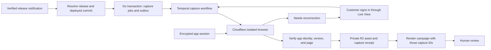

# Authenticated screenshots after a release: design and security review

Status: Proposed; locally security-reviewed, with open implementation blockers.
Date: 2026-10-24.
Source baseline: local `main`, `6447f4edc95a2ac6b41e412a2176e305e13db301`.

This is a companion to [RFC 007: Authenticated Product Capture](007-authenticated-product-capture.md),
which governs priority, pilot limits, secret retention, and human evidence
promotion. It evaluates Cloudflare as a managed-browser candidate subject to
that RFC's isolation, egress, and secret-lifecycle gates. Proposed record names
below must be reconciled with its contracts before implementation; do not build
two capture systems. The source findings retain the reviewed commit above.

The original draft used RFC number 045 before the catalog was renumbered.
This companion has no separate RFC number or implementation priority.

Use Cloudflare Browser Run to execute authenticated browser sessions. Keep
authorization, release state, durable execution, and assets in the existing Go
backend, Temporal, Postgres, and private R2. Add a reusable app connection and
versioned capture recipes. A release workflow must obtain screenshots for its
deployment before it renders campaign visuals.

The normal customer experience is: connect the app, sign in once, choose the
screens, test a capture, and enable capture after deployment. Later releases
reuse the authorized session. Expired sessions ask the customer to reconnect.
An app-provided session bootstrap can support unattended authentication where
the customer controls the target application's authentication system.

The focused security review in section 8 reproduced an existing backend SSRF
path and a readiness error. Fix the network boundary before extending capture
to authenticated sessions. The tests do not establish production exposure or
prove that the proposed authentication system is secure.

## 1. What the product already has

These are source-code findings, not claims about the running deployment.

| Existing capability                                     | Evidence                                                                                                                                                                                                                                     | Consequence                                                                                                                                                                                 |
| ------------------------------------------------------- | -------------------------------------------------------------------------------------------------------------------------------------------------------------------------------------------------------------------------------------------- | ------------------------------------------------------------------------------------------------------------------------------------------------------------------------------------------- |
| Signed GitHub intake and versioned release workflows    | [Webhook route](../../app/api/webhooks/github/route.ts), [intake](../../services/internal/product/release_automation_intake.go), [workflow guide](../release-automation.md)                                                                  | Reuse trusted source-to-workspace resolution and event deduplication.                                                                                                                       |
| Successful deployment events and background screenshots | [Deployment ingestion](../../services/internal/product/source_webhooks.go), [`captureDeployment`](../../services/internal/product/github_events.go)                                                                                          | Production pages on the deployed host are already captured, up to ten surfaces.                                                                                                             |
| Public URL screenshot client                            | [Go capture client](../../services/internal/capture/capture.go)                                                                                                                                                                              | Current deployment capture calls a Microlink-compatible API. It has no customer browser-session input.                                                                                      |
| Manual and agent surface capture                        | [Surface service](../../lib/tenant/product-surfaces.ts), [agent tool](../../lib/ai/tools/marketing.ts), [campaign tool](../../lib/ai/tools/campaign-studio.ts)                                                                               | These also use the public screenshot service; they need the same authenticated capture boundary.                                                                                            |
| Product pages and capture history                       | [ProductSurface and SurfaceCapture](../../services/ent/schema/productsurface.go), [capture recording](../../services/internal/product/surfaces.go)                                                                                           | Reuse page identity, feature tags, private assets, freshness, and supersession.                                                                                                             |
| Cloudflare CDP integration                              | [Design renderer](../../lib/design/renderer.ts), [deployment configuration](../digitalocean-deployment.md)                                                                                                                                   | The renderer already connects through `PLATFORM_RENDER_CDP_URL` and a bearer token. Customer app capture needs separate sessions and permissions.                                           |
| Durable jobs and outbox                                 | [Maintenance workflow](../../services/internal/temporalmaintenance/maintenance.go), [outbox dispatcher](../../services/internal/maintenance/outbox.go), [release interpreter](../../services/internal/temporalreleaseautomation/workflow.go) | Keep Temporal. Dispatch capture jobs quickly instead of holding the shared outbox loop during login and browsing.                                                                           |
| Early capture schema                                    | [Initial migration](../../services/platformmigrations/sql/20260814073500_initial_tenant_model.sql)                                                                                                                                           | `capture_recipe`, `capture_job`, and `capture` tables exist in migration history. Active Ent models and an authenticated executor were not found. Table existence is not a working feature. |

There are two material gaps beyond authentication:

1. `ready()` only checks an HTTP response. A login page or an older deployment
   can return 200. It does not prove the intended version is visible.
2. [`currentCapture()`](../../services/internal/product/release_automation_render.go)
   selects the latest available surface capture, independently of the release
   being rendered. The capture and campaign flows can race or use old imagery.

Earlier RFCs with previous IDs 001 and 004–008 mention Steel, Trigger.dev, and Prisma. Current
source and the deployment guide use Go, Ent/SQL migrations, and Temporal. Do
not restart the historical runtime design. Some repository skill text also
predates this migration.

The local branch trails the existing `origin/main` reference. Section 8 records
the security review's source comparison. Neither a remote fetch nor a live
infrastructure inspection was performed. The code graph was stale and
incomplete, so direct source inspection supplied the evidence.

## 2. Cloudflare's role

Cloudflare calls the service **Browser Run**, formerly Browser Rendering. Its
CDP endpoint accepts remote browser clients outside Workers. Sessions support
navigation, interaction, and screenshots; the account token stays server-side.
This lets the existing backend use the browser provider without moving the
product onto Workers, D1, Queues, or Cloudflare Workflows.
[Cloudflare CDP documentation](https://developers.cloudflare.com/browser-run/cdp/).

Use browser sessions for this feature. A one-request screenshot API can be
useful for simple captures, but it does not supply the app-connection lifecycle,
multi-step login, capture recipes, and recovery described here.
[Integration choices](https://developers.cloudflare.com/browser-run/get-started/).

Live View lets a customer interact with the remote browser. Cloudflare's human
handoff commands can request intervention and report completion. Both features
are currently marked beta. Treat a Live View URL as a bearer credential: issue
it only to the authorized connecting user, with a short connection deadline,
and close the session after use. Expiration is a deadline to connect; it must
not be treated as revocation of an already open viewer.
[Live View](https://developers.cloudflare.com/browser-run/features/live-view/),
[human handoff](https://developers.cloudflare.com/browser-run/features/human-in-the-loop/).

Cloudflare runs the browser. Shots must still decide who can connect, store
and revoke authentication state, select pages, verify deployment identity,
handle retries, and keep captured content private.

## 3. End-to-end execution



**Connection setup.** An owner or administrator associates an app connection
with a source, environment, allowed app origins, and expected app workspace or
account. Prefer a dedicated demo account with representative data and minimal
permissions. The Go backend creates a new isolated browser and returns a
short-lived Live View link through the authenticated web facade. The customer
signs in directly, including SSO or MFA. Pause agent observation while secrets
are entered; disable session recording, request-body logging, and screenshots
of the login process.

After the customer finishes, check both a signed-in marker and the expected
app account/workspace. Capture the required authentication state, encrypt it,
close the browser, and prove that a fresh session can restore it and reach a
protected page. Only then mark the connection ready. The customer's “Done”
action alone is insufficient proof.

**Authentication on subsequent runs.** Restore that state into a fresh browser
context, visit the configured protected page, and validate identity again.
Normal application token refresh can update the encrypted snapshot. Serialize
runs using the same connection and use a state revision check when saving
rotated tokens. Do not keep a browser alive between releases as a session store.

Persist only authentication state needed for approved origins. Cookies and
local storage cover many apps, but IndexedDB, session storage, device binding,
and passkeys require explicit compatibility tests. Playwright documents these
storage distinctions; its `storageState` format is a useful reference, not an
API available automatically to a Go CDP client. Do not export users' passkey
private keys. If a fresh browser cannot restore a session, use reconnection or
an app integration rather than claiming unattended support.
[Playwright authentication](https://playwright.dev/docs/auth).

For an app the customer controls, support a narrowly scoped server integration
that exchanges an authorized service credential for a short-lived browser
session. Bind the issued session to the correct tenant, demo account, and
environment. An ordinary OAuth API token does not automatically authenticate
the web UI. Generic password storage and MFA bypass are not prerequisites.

**Release notification.** Reuse signed GitHub intake. Prefer a successful
deployment notification with source, environment, deployment ID, and commit
SHA. A published release can arrive before deployment: resolve its tag to an
immutable commit and wait for the matching deployment or a customer-supplied,
authenticated deployment-ready signal. Do not treat `target_commitish` as an
immutable SHA or assume that a delay proves deployment.

Before capture, check an app version endpoint or an agreed DOM/build marker
against the expected SHA or a trusted build-ID mapping. A deployment callback
plus a reachable URL is weaker evidence. Missing or mismatched version proof
must produce `deployment_unverified` or `waiting_for_deployment`, not a
release-verified screenshot. A customer without version proof can explicitly
request a current-state capture, labeled as such, outside this release guarantee.

Generic CI providers can use the existing signed source-webhook boundary with
an extended, typed deployment event. An arbitrary target URL from a webhook
must never override the registered app origins or surface URLs.

**Capture.** Select explicit surfaces, or use the existing feature-tag lookup
to propose them. Its fallback page is not proof that it shows a new feature.
Execute the saved recipe: navigate, select a permitted tab or filter, wait for
the expected content, apply redaction masks, and capture at a fixed viewport.
Require the expected app account, page marker, and deployment version; reject
login pages, error screens, and empty/loading views. Wait for fonts and images
as well as app readiness. Use bounded conditions, not a single fixed sleep or
network-idle test for apps with persistent connections.

An agent can choose an existing recipe or propose new steps during setup. Once
tested and enabled, the worker executes a pinned recipe version. Page content
and release notes are untrusted data, never instructions granting permission
to change origins, reveal sessions, or perform additional actions.

**Finish.** Validate image type, decoded dimensions, and size. Store bytes in
the private tenant asset path. In a transaction, finalize the capture receipt,
record `SurfaceCapture`, and emit the completion/audit events. The campaign
receives explicit capture IDs from this job. Render and review remain the
existing product flow; a successful capture does not approve publishing.

## 4. Smallest complete implementation

### Data and contracts

Add `PlatformAppConnection` as a tenant-owned Ent model. Store source/app
identity, environment, approved origins and dependencies, expected account,
connection status, encrypted state or a private ciphertext reference, key
version, authorization generation, state revision, validation time, and
expiry information when the app supplies it. Suggested states are
`CONNECTING`, `READY`, `NEEDS_AUTH`, and `REVOKED`.

Use authenticated encryption with organization, connection, environment, and
authorization generation bound as associated data. Keep encryption keys in the
backend's managed secrets, separate from data. Existing encryption code offers
patterns, but its field-specific formats must not be reused without checking
their scope. Unlike the legacy social credential reader, the new session reader
must reject unencrypted input and unknown envelope versions. Session material
never enters agent prompts, workflow history,
outbox payloads, normal API responses, analytics, or logs. Revocation invalidates
queued work and active browser leases and removes the stored state.

Map and extend the existing `capture_recipe`, `capture_job`, and `capture`
tables instead of creating a second job system. Verify their deployed schema
and existing rows before migration. Add the missing Ent mappings and SQL
migrations under `services/platformmigrations/sql`; preserve legacy data and
the existing organization/idempotency uniqueness.

| Record                 | Required additions or use                                                                                                                                                                              |
| ---------------------- | ------------------------------------------------------------------------------------------------------------------------------------------------------------------------------------------------------ |
| Capture recipe         | Immutable version containing surface ID, app connection ID, viewport, typed bounded steps, readiness and identity checks, masks, and limits. No arbitrary customer JavaScript or embedded credentials. |
| Capture job            | Release/deployment identity, expected commit, pinned recipe, connection authorization generation, phase, lease/fencing token, safe failure code, deadline, and stable idempotency key.                 |
| Capture attempt        | Attempt number, browser-session reference, observed version, start/end times, and safe result metadata. Provider URLs containing credentials must not be stored as ordinary metadata.                  |
| SurfaceCapture / Asset | Existing image lineage; associate final output with the job, deployment, recipe version, and observed commit.                                                                                          |

Use a job-specific phase for `WAITING_DEPLOYMENT`, `QUEUED`, `RUNNING`,
`NEEDS_AUTH`, `SUCCEEDED`, `FAILED`, and `CANCELLED`. The historical
`ExecutionStatus` enum is shared; do not change its meaning for unrelated jobs.
The old job schema requires a release and recipe. Deployment-only captures
need an explicit compatible migration for an optional release association.

### Go execution and Cloudflare adapter

Add focused browser-session code under `services/internal/capture/`, keeping
the public Microlink path compatible. Go activities own job claims, eligibility
checks, browser lifecycle, state protection, image storage, and receipts.
Register a `platform-capture` Temporal queue in the existing Go orchestrator.
No new Trigger.dev task or TypeScript web handler runs the background job.

Use Cloudflare's REST API to allocate a guarded session and obtain session
identity, then a maintained Go CDP client to control it. `chromedp` is a
candidate; it would be a new Go dependency and needs a compatibility spike for
Cloudflare authorization headers, custom commands, and context isolation.
Do not build a new WebSocket/CDP implementation just to avoid that dependency.
[chromedp project](https://github.com/chromedp/chromedp).

The existing Playwright renderer demonstrates the provider connection, but it
renders Shots documents and restricts requests to Shots and fonts. Do not
relax its allowlist or reuse its authenticated contexts for customer browsing.
Keep its code and behavior separate. The Go adapter also needs an explicit,
tested state export/restore implementation; choosing a CDP client alone does
not supply portable authentication persistence.

Use backend-scoped configuration such as `PLATFORM_CAPTURE_CDP_URL`,
`PLATFORM_CAPTURE_CDP_TOKEN`, and `PLATFORM_CAPTURE_STATE_KEY`. Their names are
proposed. Never copy a Cloudflare account token into a tenant connection row.
Close sessions on success, failure, cancellation, and handoff timeout. A cleanup
job must reclaim sessions after a worker crash.

### Reliable sequencing and retries

Add a `capture_product` workflow action and pass its output to
`render_creatives`. Update the Go graph validator/interpreter, worker capability
lease, SDK/Zod contracts, action catalog, editor, templates, preview, and shared
fixtures together. Introduce a compatible graph version/capability; existing
activated workflow versions keep their meaning. New release-capture templates
must require capture output before rendering.

The legacy deployment trigger and this action call one shared job-admission
service. A canonical deployment identity plus organization, source,
environment, surface/recipe version, viewport, and connection authorization
generation defines the job key. A release event later associated with that
deployment must find the same job. Workflow retries and token refreshes must
not create a different business capture.

Transactionally create the job, audit record, and outbox event. Dispatch only
IDs and pinned versions to Temporal, with workflow ID derived from the job ID.
Re-read tenant, source, connection, release cancellation, and recipe eligibility
before external work and before committing its result.

A per-connection lease serializes token refresh. A fencing token prevents an
expired worker attempt from overwriting a newer result. Each surface result
has a unique receipt; resume missing surfaces after a crash. R2 upload before
database commit can leave an orphan, so use stable result identity, reconcile
existing objects/receipts, and clean abandoned attempts. Browser execution may
repeat; the guarantee is one canonical committed output, not exactly-once
external execution.

The release workflow waits for its exact capture result. It must not fall back
silently to `currentCapture()`. Preserve old assets for existing campaigns, and
prevent an older, slower deployment job from replacing a newer deployment's
current surface image. Required-page failures make the capture set incomplete.

Use bounded backoff for provider 429/5xx and deployment readiness. Invalid
origin/account, revoked connection, or invalid recipe is permanent. Expired
auth becomes `NEEDS_AUTH`: close the browser, show the reconnection action,
and resume through a durable event after fresh validation. Human waiting must
not occupy the outbox dispatcher or an indefinitely open browser. A missing
selector asks for recipe repair; it does not grant the agent permission to
explore and mutate the app without limits.

### Reach every existing entry point

| Area                                                                                             | Change                                                                                                                                         |
| ------------------------------------------------------------------------------------------------ | ---------------------------------------------------------------------------------------------------------------------------------------------- |
| `services/internal/product/github_events.go`                                                     | Admit durable capture jobs instead of doing long captures inline; preserve legacy/public behavior.                                             |
| `services/internal/product/release_automation_render.go`                                         | Resolve pinned capture outputs for the new action contract.                                                                                    |
| `services/internal/temporalreleaseautomation/` and `services/internal/releaseautomation/`        | Add durable capture action, completion handling, cancellation, validation, and capability checks.                                              |
| `services/internal/maintenance/` and Go orchestrator                                             | Dispatch new outbox events; register capture worker and abandoned-session cleanup.                                                             |
| `services/internal/product/`, `services/internal/httpapi/`, `lib/backend/sdk.ts`                 | Connection, recipe, job, reconnection, and revoke contracts; Go remains database authority.                                                    |
| `lib/api/contracts/`, tenant/tRPC facades, and applicable REST/MCP surfaces                      | Zod contracts and role checks; expose IDs and status, not browser state. Preserve synchronous public APIs until consumers support queued jobs. |
| `lib/tenant/product-surfaces.ts`, `lib/ai/tools/marketing.ts`, `lib/ai/tools/campaign-studio.ts` | Route authenticated capture through the common job service. Agent calls select owned surface/recipe IDs.                                       |
| Workflow UI, product surfaces, app connections                                                   | Connect, test, select screens, show progress, repair recipe, reconnect, revoke. Reuse existing UI and notifications.                           |
| Deployment config, fixtures, tests, docs                                                         | Backend-only provider/key configuration, queue registration, synthetic test app, and feature capability rollout.                               |

## 5. Isolation and image privacy

Use a fresh isolated browser/context for each connection run. Enforce tenant
ownership on every connection, source, surface, recipe, job, asset, and Live
View access. Store screenshots in private R2 and use authorized short-lived
downloads. Never send authenticated screenshots through the URL-only cache in
[`lib/screenshot-cache.ts`](../../lib/screenshot-cache.ts). Its identity does
not distinguish customer accounts.

Set Cloudflare session guardrails at allocation for the app and its explicitly
approved login/API/CDN hosts. They apply to HTTP/HTTPS and remain fixed for the
session. They are currently beta; they are not a complete permission system.
Validate schemes, origins, redirects, resolved addresses, subresources, and
WebSocket behavior in the capture implementation. Deny local, private, metadata,
and unapproved destinations. The existing `PublicPageURL()` hostname/literal-IP
check alone is insufficient for DNS rebinding or redirect enforcement.
[Cloudflare guardrails](https://developers.cloudflare.com/browser-run/features/guardrails/).

Approved origins do not make every app action safe. Use a low-privilege demo
account and typed, bounded navigation steps; exclude destructive or financial
actions. Do not block every POST indiscriminately, because read-only GraphQL
queries may use POST. Verify behavior against the target app. Mask private
fields before capture and retain human review before external publication.

## 6. Capacity and cost

Cloudflare currently documents paid-plan defaults of 200 concurrent browsers
and three new browser instances per second. Default inactivity timeout is 60
seconds and can be extended to 20 minutes. Active sessions have no fixed maximum
lifetime, but provider releases can close them. Design for session loss.
[Current limits](https://developers.cloudflare.com/browser-run/limits/).

Paid Browser Run includes ten browser hours/month, then $0.09 per additional
hour, and ten monthly-average concurrent browsers, then $2 per additional
browser. The concurrency charge uses the average of daily peaks. Browser hours
are shared with other Browser Run usage, including the existing renderer.
[Current pricing](https://developers.cloudflare.com/browser-run/pricing/).

For illustration, 1,000 runs at three browser minutes each consume 50 hours:
$3.60 in browser-time overage if the ten included hours are otherwise unused.
This excludes the Workers plan, concurrency, R2, Temporal, backend, model usage,
retries, and customer login time. Cap per-tenant and total browser concurrency,
run duration, pages, image bytes, and retries. Reserve account capacity for
existing design renders. Measure queue delay, time to capture, auth failures,
version mismatches, cost per successful run, and orphaned sessions.

## 7. Delivery and proof

1. **Provider/authentication spike:** On a synthetic protected app, create a
   Cloudflare session, complete customer login, export encrypted state, close
   the session, restore into a new session, verify account identity, and capture
   a protected page. Exercise cookies, local storage, and any additional storage
   mechanism the supported apps need. Verify CDP headers, guardrails, browser
   cleanup, and Live View beta behavior. This is the gate for the Go adapter.
2. **Complete capture slice:** Add connection/recipe/job storage, Go contracts,
   private asset output, manual test capture, revoke/reconnect, Temporal worker,
   and crash-safe receipts. Include tenant isolation and secret-redaction tests.
3. **Release automation:** Join release to deployment, verify running version,
   add the workflow capture action, and pass exact outputs into rendering.
   Update every caller and fixture listed above. Start with an opt-in source;
   existing activated workflow versions remain compatible.
4. **Release proof:** Run the acceptance cases below against a synthetic app
   through the real provider, then one authorized customer demo workspace.
   Record actual latency, cost, supported auth modes, and recovery behavior
   before enabling this broadly.

| Acceptance case                                                 | Required evidence                                                                                    |
| --------------------------------------------------------------- | ---------------------------------------------------------------------------------------------------- |
| Release before deployment                                       | Job waits; old UI is never recorded as the released version.                                         |
| Fresh-session auth restore                                      | Browser A closes; browser B reaches the protected screen with the expected app tenant.               |
| Duplicate release/deployment delivery                           | One canonical job/result; no duplicate asset attachment or campaign side effect.                     |
| Expired session, MFA, or CAPTCHA                                | `NEEDS_AUTH`; no login screenshot accepted; customer reconnect resumes the authorized job.           |
| Cross-tenant IDs and viewer access                              | Connection state, jobs, assets, and Live View links are denied to the other tenant.                  |
| Revoked access or cancelled release                             | Queued work stops; in-flight results cannot be finalized after eligibility is lost.                  |
| Redirect, DNS rebinding, subresource, WebSocket probes          | No unapproved destination is reached; auth state is not forwarded to another origin.                 |
| Worker crash after browser allocation/upload/commit             | Browser is reclaimed; output is reconciled; one canonical receipt remains.                           |
| Concurrent deployments complete out of order                    | Each campaign uses its own deployment capture; the older run cannot replace the newer current image. |
| Missing selector, loading page, wrong account, partial page set | Safe failure or repair state; no successful release capture claim.                                   |
| Authenticated image privacy                                     | No shared URL-cache hit; private download authorization, masks, retention, and deletion verified.    |
| Campaign rendering                                              | Render receipt references this release's verified capture IDs; human review still gates publication. |

No authenticated browser adapter, migration, UI, or deployment is implemented
by this document. A remote browser cannot guarantee unattended access when an
identity provider requires new human verification. The following review adds
concrete defects and implementation gates to the recommendation.

## 8. Security and failure review

Reviewed on 2026-10-24 against local commit
`6447f4edc95a2ac6b41e412a2176e305e13db301`. This is a focused review of capture,
its release integration, and the proposed authentication design, not a full
repository penetration test. The existing remote reference was
`e59aef07d8a9cac8dd629dcb44b376db2bc94a4d`, 19 commits ahead. The relevant
capture, URL validation, credential cipher, and rendering files matched that
reference; the surface-recording file differed only in an RFC-path comment.
Production code, infrastructure egress, and provider sessions were not inspected.

### Executed checks and evidence limits

Eight tests completed successfully: the two existing Go capture tests, five
adversarial capture probes, and the existing credential-envelope test. A
successful adversarial probe means it reproduced the unsafe behavior below;
it does not mean the product passed a security gate.

The capture client and its tests were copied unchanged. The readiness,
surface-URL, and deployment-URL functions were extracted with their original
bodies into a minimal fixture. Tests therefore establish those functions'
behavior, not a complete authenticated API/database/webhook execution. Source
inspection traced the callers separately.

Execution used the already installed Go image
`sha256:d530cf60723abf1ffae0cd16bb546b379ec0550d2f3815e5b16ed69dbc00fba4`,
with no image pulls or dependency downloads. The container had no external
network, an isolated loopback namespace, read-only source and root filesystem,
UID/GID 65534, no capabilities, no privilege escalation, one CPU, 1 GiB memory
without additional swap, 96 processes, 128 file descriptors, 64 MiB maximum
file size, a 90-second per-process CPU limit, and a 180-second outer deadline.
Only a 512 MiB scratch tmpfs was writable. Test binaries executed there; the
first attempt was blocked by a non-executable scratch mount and ran no tests.

The target process started with an empty environment plus only these safe
values: `PATH=/usr/local/go/bin:/usr/bin:/bin`, `HOME=/scratch/home`,
`TMPDIR=/scratch/tmp`, `GOCACHE=/scratch/gocache`,
`GOMODCACHE=/scratch/gomodcache`, `GOPATH=/scratch/gopath`, `GOPROXY=off`,
`GOSUMDB=off`, `GOTOOLCHAIN=local`, `GOENV=off`, and `GOMAXPROCS=2`.
The existing encryption test set its own dummy keys inside the container.
No host credentials, sockets, real app sessions, or other tenant data were
mounted. The scratch copies were disposable and are not product tests.

Commands inside that sandbox were:

```text
go test -mod=readonly -p=1 -count=1 -timeout=30s -v .
go test -mod=readonly -p=1 -count=1 -timeout=30s -v ./credentialcipher
```

The existing tests were `TestCaptureDownloadsFromTheAPIHostOnly`,
`TestCaptureOptionsAndPublicPageURL`, and `TestCredentialEnvelope`.
The five additional probes and their exact input classes were:

1. `TestReviewSurfaceAndDeploymentAcceptPrivateDestination`: an isolated
   `httptest` HTTP loopback URL ending in `/dummy-internal`, plus the same URL
   with its scheme changed to HTTPS as the deployment URL. Both validators
   accepted it, hostname comparison matched, and `ready()` reached the fixture
   once. `PublicPageURL()` rejected the same private surface URL as a control.
2. `TestReviewReadinessFollowsRedirectToPrivateDestination`:
   `http://registered-app.example.test/start`, mapped only inside the fixture
   to a local server, returned a 302 to a second isolated loopback server.
   `ready()` followed it and reached the second server once.
3. `TestReviewScreenshotDownloadFollowsHostChangingRedirect`: the configured
   fake screenshot API's `/image` redirected to a different loopback port.
   Direct download from that second origin was rejected; following the first
   origin's redirect returned the sentinel `dummy-private-response`.
4. `TestReviewReadinessAcceptsLoginPage`: a fixture returned HTTP 200 with
   `<form>Sign in</form>`. `ready()` returned success.
5. `TestReviewSourceURLValidationCases`: the strings
   `https://127.0.0.1/dummy`, `https://[::1]/dummy`,
   `https://10.1.2.3/dummy`, and `https://169.254.169.254/dummy` were accepted by
   both URL validators and rejected by `PublicPageURL()`. These were parsing
   checks only; no requests were made to those private/link-local literals.

### S1: Backend readiness can request private destinations

**Confirmed source path and local reproduction; medium severity.** A workspace
administrator can register a surface URL and control an integrated repository's
deployment URL. The web schema and backend surface validator accept arbitrary
HTTP/HTTPS hosts. Deployment validation requires HTTPS but does not reject
private hosts. Surface selection compares hostname only, so an HTTPS deployment
URL can select an HTTP surface, including a different port. `ready()` then sends
a GET from the backend with no private-address check and follows redirects.

Evidence: [`webUrlSchema`](../../lib/tenant/schemas.ts),
[`validSurfaceURL`, line 474](../../services/internal/httpapi/configuration.go),
[`validDeploymentURL`, line 446](../../services/internal/product/source_webhooks.go),
and [`captureDeployment` / `ready`, lines 517–633](../../services/internal/product/github_events.go).
The separate `PublicPageURL()` helper is used by the social MCP capture tool;
the deployment path does not call it. The first, second, and fifth probes above
demonstrated the missing boundary.

The web paths also differ: `/api/screenshot` calls `assertPublicCaptureUrl()`,
but `captureProductSurface()` calls `captureScreenshot()` directly, and neither
of those functions applies that input guard. Private-destination behavior at
the external screenshot provider was not tested. Put the shared policy below
all callers instead of relying on selected routes to remember it.

The affected principal is the shared backend, not just the tenant's own app.
The demonstrated effect is an unauthorized network request to the isolated
private fixture. It is not proof of production metadata theft, internal API
authorization bypass, or returned private data. Exploitation requires accepted
deployment intake, configured capture/storage, and reachable backend egress.
Those production conditions need separate validation.

**Required fix:** enforce one public-origin policy at the network boundary used
by readiness and downloads, not only in an API route. Reject credentials in
URLs, local/private/link-local/reserved addresses, and scheme/port mismatches.
Resolve and validate all destination addresses and dial the validated address
while preserving the intended HTTP Host and TLS identity. Disable redirects or
revalidate each hop; do not validate DNS once and let the client resolve again.
Use network egress controls as a second boundary. Cloudflare browser guardrails
cannot protect this separate Go HTTP request.
[OWASP SSRF prevention](https://cheatsheetseries.owasp.org/cheatsheets/Server_Side_Request_Forgery_Prevention_Cheat_Sheet.html).

### S2: Screenshot download escapes its initial host check

**Local host-policy bypass reproduced; attacker reachability needs validation.**
[`download()`, line 97](../../services/internal/capture/capture.go) validates the
initial screenshot URL against the configured API host or a Microlink subdomain.
Its HTTP client follows redirects without checking the new destination. The
third probe returned bytes from an origin that the initial check would reject.

Whether a tenant can cause the real provider/CDN to serve such a redirect is
unverified, so this is not assigned an exploit severity. The local result does
disprove the helper's claim that a hostile answer cannot point it internally.
Apply the S1 transport policy to every hop and validate decoded image limits.
Do not infer that returned arbitrary bytes become a readable asset: later
image validation/storage was not exercised by this probe.

### R1: A successful HTTP response is not release readiness

**Reproduced reliability defect.** The fourth probe established that login HTML
is accepted. There is also no running-version check in `ready()`.
[`currentCapture()`](../../services/internal/product/release_automation_render.go)
selects by organization, optional surface, and capture time, without requiring
the current release/deployment ID. The renderer can therefore select an older
capture; this selection behavior is source-verified, not database-tested here.

Require the protected-page account, page readiness, and expected deployed
version to match. Pass explicit job capture IDs into rendering. A wrong/missing
version, login page, loading view, or unverified app tenant must block the
release capture result.

### R2: Partial results and retries need stronger receipts

**Source-verified control flow; crash/concurrency effects need integration tests.**
The deployment loop commits each capture separately, then marks the deployment
`CAPTURED` whenever at least one asset exists. It does not require every selected
page to succeed. A crash after a per-page commit but before final status update
leaves the deployment eligible for another full attempt.
[`recordCapture()`](../../services/internal/product/surfaces.go) supersedes the
current image using completion time. The schema guarantees one current image
per surface, but has no unique receipt for deployment plus surface. That
constraint alone does not prevent a later-finishing old deployment from becoming
current. Rendering's own idempotency does not fix capture idempotency.

Require a per-page receipt, expected-page count, explicit partial state, stable
job identity, and deployment ordering. Inject failures after upload, after
capture commit, and before final status update; then retry. Run two deployments
in reverse completion order. Verify one canonical result per page and the
correct current image. These database-backed scenarios were not run here.

### Required changes to the authentication design

These are implementation requirements, not claims of vulnerabilities in a
session system that does not exist yet.

- **Strict session encryption.** The existing
  [`credentialcipher.Open()`](../../services/internal/social/credentialcipher/cipher.go)
  deliberately returns unprefixed input unchanged for legacy migration. Its
  existing test confirms that behavior along with nonce, tamper, purpose, key,
  and rotation checks. Do not reuse that reader unchanged for new browser
  sessions. Require an authenticated, versioned envelope; bind organization,
  connection, environment, and authorization generation. Tests must reject
  plaintext, altered ciphertext, wrong tenant, wrong environment, stale grant,
  unknown version, and missing key. Re-encrypt old-key state on validated use.
- **Login handoff ownership and revocation.** Bind start/finish/reconnect to the
  authenticated user, tenant, one-time connection intent, expected origin, and
  CSRF protection. Return Live View links with no-store and no-referrer handling;
  exclude them from analytics and logs. Close the login browser before running
  later captures in a fresh one. Cloudflare says an established viewer remains
  active while the browser lives; link expiry is not session revocation.
  Test copied links, replayed completion, concurrent reconnect, and logout.
  [Live View access semantics](https://developers.cloudflare.com/browser-run/features/live-view/).
- **No stale authorization at dispatch.** The existing deployment executor
  does not re-read source connection status before capture, and the outbox's
  product-event branch bypasses its generic release eligibility check. New
  jobs must validate tenant/source/app access and cancellation before session
  restore, each bounded step, state refresh, and result commit. Revoke the
  provider session when access is removed; fencing must reject late results.
- **Separate browser and backend network controls.** Configure immutable
  Cloudflare host guardrails and restricted Go egress. The provider documentation
  describes HTTP/HTTPS enforcement; it does not establish the complete handling
  of WebSockets, WebRTC, service workers, DNS rebinding, or every redirect case.
  Test those against a synthetic app before enabling authenticated capture.
  Do not claim that a client-side request hook alone covers all browser traffic.
  [Cloudflare guardrails](https://developers.cloudflare.com/browser-run/features/guardrails/).
- **Minimize the saved identity.** Prefer a demo account. Keep only origins and
  state needed for the app; avoid retaining a broad SSO-provider session when
  the app session works without it. Validate the account through an app-owned
  identity signal, not just a generic “dashboard” label. Test IndexedDB, rotating
  refresh tokens, cross-site cookies, SSO redirects, and device-bound sessions.
- **Do not export private content by accident.** Mask before screenshots or
  thumbnails are produced; keep raw HTML, traces, login recordings, and
  unmasked debug images out of general artifacts. Strictly scope asset reads,
  retention, deletion, and any cache to the tenant and authorization context.
  A failed mask selector must block capture. Test another tenant's asset ID and
  both signed-link expiry and workspace deletion. Those access tests remain
  unexecuted for the new feature.
- **Keep secrets out of errors.** Current deployment failure logging includes
  `err.Error()`. Adding credentialed URLs or browser-state errors to this path
  could leak material. The authenticated adapter must emit safe error codes
  and approved metadata only. Test dummy secret sentinels across logs, events,
  Temporal history, API responses, and audit records. No current secret leak
  was observed or claimed in this review.
- **Keep the agent's authority bounded.** A registered domain is not permission
  for every action on it. Permit tested navigation steps and required read
  requests, not arbitrary model-generated code. Test prompt injection in page
  text and release notes, destructive buttons, unexpected popups, and downloads.
  Changes to origins, account, or recipe authority require a new approved version.
- **Protect shared capacity.** The outbox currently runs product handlers
  sequentially; slow pages delay other work. Dedicated capture jobs need fair
  per-tenant limits, provider-wide limits shared with design rendering, retry
  budgets, bounded login waits, and crash cleanup. Test a stalled page without
  letting it block unrelated tenants. Do not hold a connection lease indefinitely
  while waiting for a person.

### Release gate and remaining validation

Before connecting real app sessions, fix S1 and the S2 redirect behavior, add
regressions that assert refusal, and rerun them against the actual shared
transport. Complete the authentication spike and the tenant/privacy/failure
tests above before enabling release-triggered authenticated capture.

No application code was changed by this review. Full application checks,
database-backed tenant/concurrency tests, production egress, actual Cloudflare
handoff/guardrails, and real IdP session compatibility remain unverified.

## 9. Second security and failure review

Reviewed on 2026-10-24 at the same local commit as section 8. This pass covered
webhook authentication, replay and repository binding, installation status,
asset download grants, and credential-bearing image requests. The relevant
webhook, installation, asset-grant, and release-normalization files also match
the existing `origin/main` reference recorded above. No remote fetch or live
provider test was performed.

**Result:** one additional reproduced repository-filter defect and one
source-grounded lifecycle replay concern. Neither is evidence of cross-tenant
access or a working attack against production. The first pass's S1/S2 and
capture-ordering defects remain unresolved.

### R3: Manual release intake ignores its repository filter

**Reproduced parser behavior; reliability defect.** A manual GitHub source
configured with `externalId: "123"` accepted a published release whose signed
body named repository `999`. The returned intent carried repository `999` and
event key `release:999:77`. The same source correctly rejected a successful
deployment from repository `999`.

[`getPublishedRelease()`, line 362](../../lib/tenant/webhook-security.ts) checks
the prerelease rule but never compares the payload's repository ID with the
source's configured ID. The pull-request and deployment parsers do compare
them. [`ingestSourceRelease()`](../../services/internal/product/source_webhooks.go)
locks the source and checks its tenant, active state, and automation mode, but
does not add the missing repository comparison.

This matters when a manual webhook is routed incorrectly or an
operator-managed signing secret is shared across repositories: an otherwise
valid delivery can create a release for the wrong configured source. A
signature authenticates the sender's body; it does not enforce this source's
repository selection. No forged signature, database mutation, or transfer
between tenants was demonstrated. The GitHub App path has a separate
`GitHubSources()` installation/repository lookup; this finding does not show
that lookup can be bypassed.

**Smallest fix:** apply the existing repository-ID comparison to published
releases and enforce it again at backend ingestion against the locked source.
Keep an omitted repository filter's existing semantics explicit. Add a
regression for matching, mismatching, and omitted IDs, including a correctly
signed wrong-repository envelope. For authenticated capture, bind the job to
the configured source, repository, app connection, environment, and immutable
deployment revision; a hostname match alone is insufficient.

### S3: Old installation events can overwrite newer local status

**Handler reproduction and source trace; security impact needs validation.**
The GitHub App route verifies the body signature, then
[`handleGitHubAppDelivery()`, line 227](../../lib/tenant/github.ts) processes
installation lifecycle events directly. Unlike repository-event admission,
this branch does not use a receipt, compare event order, or fetch current
installation status before writing.

Two dummy-event sequences reproduced the handler behavior:

1. `created` with no suspension, then `suspend`, then the original `created`
   body and signature again, with the original delivery ID. The handler issued
   another unsuspended `recordGitHubInstallation()` call.
2. `suspend`, then `unsuspend`, then the original signed `suspend` again. The
   handler issued another `SUSPENDED` update.

These checks used the unchanged handler with a recording backend stub.
They demonstrate accepted calls, not a database-backed authorization bypass.
The real [`upsertGitHubInstallation()`, line 198](../../services/internal/product/github_installations.go)
unconditionally writes `ACTIVE` or `SUSPENDED` from the supplied snapshot.
`SetGitHubInstallationStatus()` cancels automation runs on suspension.
[`automationSourceAccess()`, line 83](../../services/internal/product/release_automation.go)
and `GitHubSources()` use the stored installation status for local eligibility.
Suspension leaves sources in place, so restoring stale local `ACTIVE` status
is a meaningful boundary to test before adding stored browser credentials.

An attacker would need a previously valid signed lifecycle envelope and an
unchanged webhook secret. Delayed legitimate delivery can also cause stale
state. This does not prove GitHub would issue a new installation token after
suspension, that cancelled runs resume, or that archived sources reactivate.
No exploit severity is assigned without the downstream integration test.

**Required fix:** accept only intended lifecycle actions and reconcile against
current GitHub installation state before restoring eligibility. The existing
`GitHubApp.Installation()` interface can supply that check. Persist a receipt
for repeated deliveries, but do not rely on delivery-ID deduplication alone:
it does not resolve an unseen old event arriving late, and the signature does
not bind the delivery header. Fail closed when current status cannot be
established. Test both orderings against the real repository layer with a
fake GitHub client, including queued work, cancellation, and final result
commit. A webhook must never restore a revoked browser-session generation.

### Protections exercised and useful existing controls

- GitHub HMAC verification rejected changed body bytes, a malformed signature,
  and a different secret. Generic and GitLab verification rejected changed
  event IDs and timestamps ten minutes old. The generic check also rejected
  changed body bytes. A GitHub release retained the same semantic key when
  only its delivery ID changed. Database deduplication was source-inspected,
  not exercised by that parser check.
- Asset-grant probes preserved the original dummy organization, user, and
  session; rejected altered ciphertext, an overlong token, another asset ID,
  expired or excessive lifetime, and a rotated key; and propagated a resource
  reader's denial without returning bytes. Those tests used a stub resource
  reader, so they do not prove database membership enforcement.
- Source inspection confirms [`ReadAsset()`](../../services/internal/product/assets_media.go)
  authorizes before and after storage reads and rechecks the asset's tenant,
  status, and object key. Existing
  [database tests](../../services/internal/product/asset_downloads_integration_test.go)
  cover membership removal, session expiry, logout, API-key revocation, and
  removal during storage reads; those database tests were not run here.
- Asset download grants remain bearer links with a two-minute lifetime.
  Original-principal revalidation does not bind a copied link to the receiving
  browser. Preserve the content route's no-store/no-referrer behavior, redact
  tokens from logs, and decide explicitly whether sensitive captures require
  a signed-in recipient instead of a bearer grant.
- The separate GitHub release-image downloader refused all redirects for a
  request carrying `Bearer dummy`, including a redirect to the same allowed
  host. Without credentials it refused a redirect to an unapproved host.
  Wrong-repository and literal/encoded dot-segment paths were rejected.
  This is useful existing behavior to reuse; it does not repair the different
  screenshot-provider downloader described in S2.

### Executed checks and exact limits

**36 top-level tests passed:** 22 existing Go tests in
`internal/releaseautomation` and `internal/releasenotes`, eight new Node
probes, and six new Go probes. Subtests are not counted again. Three of the
Node probes asserted the unsafe behaviors above; passing them means the
issues were reproduced, not fixed.

The existing Go packages and their fixtures were copied unchanged. Node
execution used the actual webhook functions, their used schema declarations,
and installed Zod; only imports were redirected to the disposable copies.
The lifecycle handler used a recording backend stub. The six Go probes used
unchanged extracted functions for image requests and asset-grant processing,
with a minimal configuration and stub resource reader. None of these fixtures
is a replacement for API/database/Temporal integration tests.

Inputs were entirely synthetic:

| Probe group            | Inputs and expected observation                                                                                                                                                                  |
| ---------------------- | ------------------------------------------------------------------------------------------------------------------------------------------------------------------------------------------------ |
| Manual release routing | Source `123`; published release `77` from repository `999`; release accepted. A production deployment `9001` from `999` was rejected as a control.                                               |
| Release replay key     | Repository `123`, release `77`, delivery IDs `delivery-a` and `delivery-b`; identical `release:123:77` key.                                                                                      |
| Signature checks       | Dummy HMAC key, changed body whitespace, changed ID, wrong key, and timestamp ten minutes in the past; invalid variants refused. GitLab used 32 bytes of value `7` as its dummy key.             |
| Installation replay    | Installation `7`, account `dummy-org`, old `created` or `suspend` envelope replayed after the opposite transition; stale backend update issued.                                                  |
| Asset grants           | `org-a` / `user-a` / `session-a` / `asset-a`; `asset-b`, altered ciphertext, 4,097-character input, expiry minus one minute or plus ten minutes, key rotation, and a dummy denial.               |
| Image requests         | Allowed GitHub URL redirected to the same raw host with dummy authorization, or to `unapproved.example.test` without it; no second transport call. Wrong repo, `..`, and `%2e%2e` path controls. |

The containers used the section 8 sandbox limits, empty allowlisted
environments, no external network, no writable source, no dependency
downloads, and a 180-second deadline per run. Go used the same pinned image
and environment as section 8. Node used the already installed image
`sha256:984c53bfb07b2b321c825dd8e186aa6b12fa163f6d59f44a9a885f68dddf8529`
with Node `v22.23.3`, and only
`PATH=/usr/local/bin:/usr/bin:/bin`, `HOME=/scratch/home`, and
`TMPDIR=/scratch/tmp`. The image entrypoint was bypassed. Image-request tests
used an in-memory HTTP transport and made no real network requests.

Commands inside the isolated fixtures were:

```text
node --experimental-strip-types --test review.test.ts
go test -mod=readonly -p=1 -count=1 -timeout=30s -v ./internal/releaseautomation ./internal/releasenotes
go test -mod=readonly -p=1 -count=1 -timeout=30s -v ./internal/review
```

The temporary fixtures and containers were removed after verification. No
application code was changed. Before enabling authenticated capture, add R3
to the remediation list and close S3's lifecycle integration test, alongside
the section 8 gates. Actual browser handoff theft, concurrent reconnect,
session-generation fencing, provider guardrails, database races, full-app
type/lint/Gauntlet checks, and production behavior remain untested in this
pass. There is no implemented authenticated capture system to certify yet.
