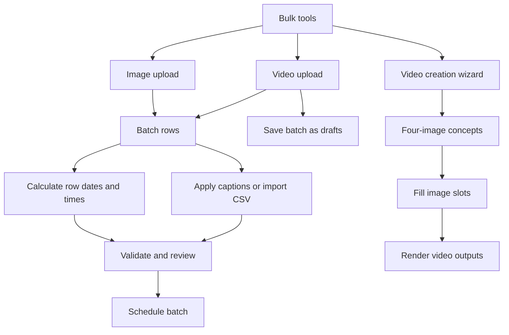
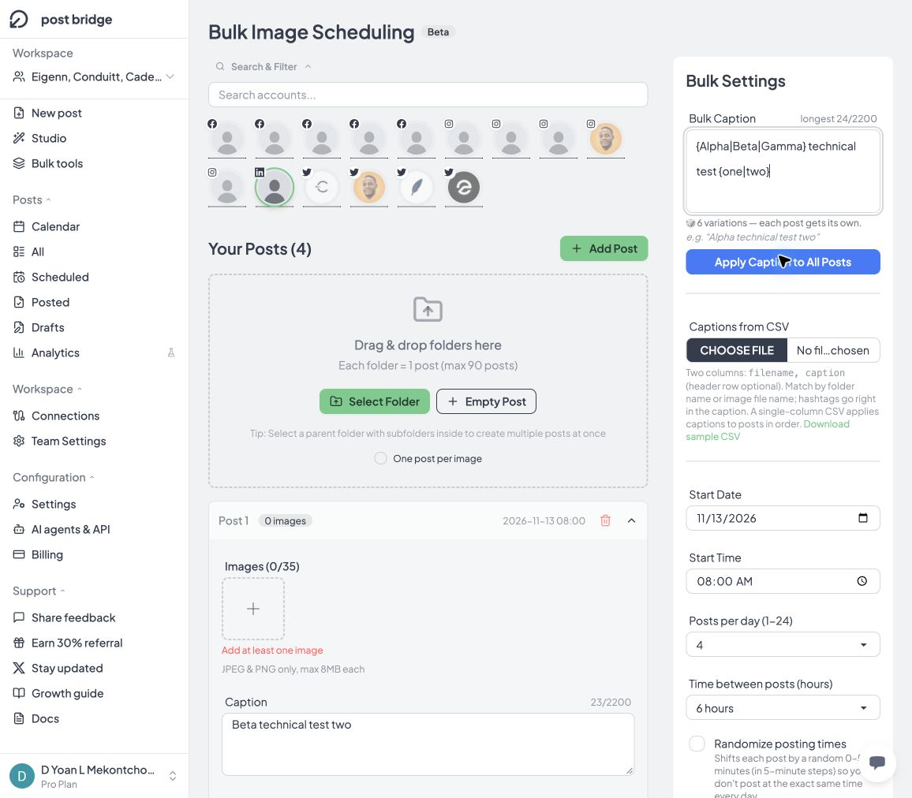
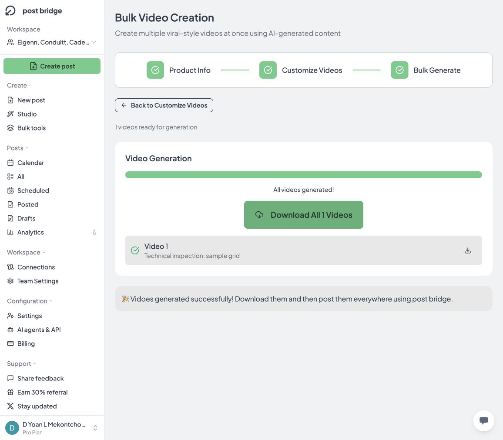

# Post Bridge Bulk Tools: technical reverse engineering

Inspected 13 October 2026 in an authenticated Pro-plan workspace. This extends the [New Post analysis](../composer/post-bridge-new-post-technical-analysis.md) and [Content Studio analysis](../content-studio/post-bridge-content-studio-technical-analysis.md).

## 1. What the feature is

Bulk Tools is a catalog for three different workflows. Two turn existing media into batches of scheduled posts. The third produces 2×2 grid videos and has its own preparation and rendering stages.

| Workflow | Workspace-relative route | Primary unit |
|---|---|---|
| Bulk Video Upload | `/create/bulk/video-upload` | One video item |
| Bulk Image Upload | `/create/bulk/image-upload` | One post containing images |
| Bulk Video Creation | `/create/bulk/video-creation` | One four-image video concept |

The catalog route is `/team/{workspaceId}/bulk-tools`. All three route suffixes above follow `/team/{workspaceId}`. They are separate routes, unlike the Studio catalog's in-place template editors.

The two upload pages display Beta. The catalog cards display NEW. These are UI labels; this inspection does not establish release dates.

### Evidence boundary

- **Observed:** live UI, DOM-backed attributes, sample download contents, and browser logs.
- **Executed:** form edits, empty image-post rows, caption expansion, schedule calculation, account selection, concept creation, AI image generation, a representative successful render, and download.
- **Measured:** downloaded MP4 metadata and complete video-frame decoding using AVFoundation.
- **Proposed:** data types, component boundaries, scheduling pseudocode, and API/job designs below. These are reconstruction specifications, not recovered source code.
- **Unverified:** actual file ingestion, folder parsing, CSV import, post submission, per-platform delivery, private request payloads, server internals, and failure recovery beyond the exercised cases.

No posts were scheduled, published, or saved as drafts. No personal files were uploaded. Account selection and Apply Bulk Schedule changed the temporary editor only. Four generated images were requested for the representative creation test. Billing or quota accounting was not inspected.

## 2. Shared scheduling shell

Both upload pages show account selection first, followed by media rows and bulk settings. A final section summarizes the batch and contains the submission action.



Schedule application and actual scheduling are separate operations. `Apply Bulk Schedule` computes values in each editor row. `Schedule All` is the persistence/submission boundary. No submission was performed.

### Accounts

Accounts are selectable avatar buttons with platform badges. `Search & Filter` expands/collapses an account-search field. The inspected video page listed the workspace's Facebook, Instagram, LinkedIn, X, and YouTube connections. The image page omitted those YouTube connections. This is a comparison of the connected-account lists, not a complete global support matrix.

Selecting the LinkedIn connection in the image editor added that account to the final summary. The disabled-action explanation changed from missing account to missing images. No per-row account override was visible in the inspected empty image rows; the selection was batch-wide.

Selecting a YouTube account on the empty video page did not expose additional controls at that stage. Per-video title, privacy, audience, and thumbnail behavior after upload remain unverified.

## 3. Bulk Video Upload

### Acquisition and advertised limits

| Property | Observed UI contract |
|---|---|
| Intake | Click to upload or drag and drop |
| Batch size | Up to 100 videos |
| Formats | MP4 or MOV |
| File picker | `video/mp4,.mp4,video/quicktime,.mov`, multiple enabled |
| Size | 500 MB per video after Pro entitlement loaded |
| Duration | Minimum 3 seconds, maximum 5 minutes |
| Resolution | Maximum 4K, described as 3840×2160 |
| Aspect ratio | UI says all ratios accepted, with possible platform cropping |

The initial loading state in a new tab briefly displayed a 250 MB limit and upgrade copy. Once account data loaded, it displayed 500 MB. Treat the limit as plan-dependent; do not encode the initial fallback as the inspected Pro entitlement.

The guidelines modal exposes these limits explicitly. Actual rejection boundaries, codec support inside the containers, resolution orientation, bytes-to-MB convention, and per-platform stricter constraints were not exercised.

### Bulk editing and completion

The page contains a bulk caption, CSV caption importer, start date/time, videos-per-day selector, random-time option, Apply Bulk Schedule, Schedule All, and Save All as Drafts.

Without media, caption application, schedule application, posts-per-day, randomization, and both final actions were disabled. Start date/time and caption input remained editable. The explanatory text asked for at least one video.

The video row schema after file intake was not inspected. Do not assume that every control from the single-post composer appears here.

## 4. Bulk Image Upload

### Grouping model

This workflow operates on posts rather than a flat list of images:

1. Selecting or dropping a folder is described as creating one post per folder.
2. A parent folder containing subfolders can create multiple posts.
3. `One post per image` changes the intended grouping mode.
4. `Empty Post`, `Add Post`, and `Add Another Post` expose manual row creation. Empty Post and Add Another Post were exercised.

The directory input has `webkitdirectory` and `multiple` enabled. The main ordinary image input accepts JPEG/PNG. Folder traversal depth, ordering, hidden files, empty folders, duplicate names, and unsupported files remain unverified.

### Row contract

| Field/control | Observed behavior |
|---|---|
| Post header | Number, image count, date, time; collapse/delete icons |
| Images | Counter `0/35` and an image-add target |
| Image guidance | JPEG and PNG only, maximum 8 MB each |
| Caption | Textarea with `maxlength=2200` |
| Date | Native date input with min/max |
| Time | Native time input |
| Empty state | Red `Add at least one image` message |

The catalog guidance advertises a maximum of 90 posts. The editor displays 35 images per post; actual acceptance and destination-specific caps were not tested.

Four temporary empty posts were created. With the default one-post-per-day setting, subsequent rows initially received the next calendar day at the same time. Rows can then be overwritten with bulk scheduling and bulk caption actions.

The final image page exposed `Schedule All`, but no `Save All as Drafts` action was visible in this inspected state. The video page did expose a draft action. Do not infer that image drafts are impossible elsewhere.



## 5. Caption generation and CSV mapping

### Spintax

The bulk caption syntax uses brace groups separated by vertical bars:

```text
{Alpha|Beta|Gamma} technical test {one|two}
```

The UI reported six variations, showed a sample expansion, and reported the longest expanded length as 24/2200. Applying it to four image-post rows produced:

```text
Beta technical test two
Beta technical test two
Alpha technical test one
Beta technical test two
```

The toast reported two unique captions across four posts. Therefore, duplicate expansions are allowed. The feature is random assignment, not a guarantee of unique captions. The exact random-number generator, distribution, nested-group grammar, escape syntax, and maximum combination count were not recovered.

Both upload pages' bulk caption fields had `maxlength=8800`, while the expanded-caption budget displayed 2200. Image-row captions had `maxlength=2200`. The larger source allowance can accommodate alternatives that shrink on expansion.

A 2,201-character literal bulk caption was accepted into the source field. Apply remained clickable, but clicking it displayed `Caption must be 2200 characters or less.` Existing row captions stayed unchanged. This verifies action-time overflow rejection for that literal case. Overlong alternatives, emoji counting, and CSV-supplied overflow require separate tests.

### CSV contract exposed by the UI

| Import shape | Advertised mapping |
|---|---|
| Two columns | `filename, caption`; header optional |
| One column | Assign captions to rows in order |
| Video mapping | Match video filename |
| Image mapping | Match folder name or image filename |
| Hashtags | Included directly in caption |
| Commas in caption | Quote the CSV field |

The exact video sample is saved as [bulk-video-caption-sample.csv](bulk-video-caption-sample.csv). A reconstruction should use a real CSV parser; splitting lines and commas manually will corrupt quoted fields.

CSV import was not executed. Case sensitivity, filename-extension normalization, multiple matches, duplicate headers, BOM, quoted newlines, unmatched rows, and import transactionality remain unknown. A faithful replacement should make these rules explicit and preview the match count before applying.

## 6. Schedule calculation

### Controls

- Start date and start time.
- Integer posts/videos per day from 1 through 24.
- An interval selector appears when more than one item per day is selected.
- Randomize posting times, described as a 0–55 minute shift in five-minute steps.
- Apply Bulk Schedule, separate from the final submit action.

On the inspection date, date inputs had `min=2026-10-13` and `max=2027-02-10`, a 120-day span. Server-side enforcement, clock source, time zone, DST handling, and whether all platforms share that horizon were not established.

### Executed examples

For four empty image rows, three posts per day, start 08:00, and six-hour spacing:

| Row | Date | Time |
|---|---|---|
| 1 | 2026-10-13 | 08:00 |
| 2 | 2026-10-13 | 14:00 |
| 3 | 2026-10-13 | 20:00 |
| 4 | 2026-10-14 | 08:00 |

Enabling randomization and applying again produced 08:20, 14:00, 20:15, and next-day 08:00. These samples agree with the displayed five-minute offset rule; they do not prove uniform randomness.

At three posts per day, available interval hours were `[1,2,3,4,6,8]`. At four per day, they were `[1,2,3,4,6]`. The options are constrained by frequency. The exact general filtering formula remains inferred rather than recovered.

With a native-keyboard date change to 13 November, four posts per day, and six-hour spacing, Apply produced 08:00, 14:00, 20:00 on 13 November and 02:00 on 14 November. Thus time arithmetic carries across midnight. The summary still said approximately one day because it appears to summarize batch groups rather than distinct calendar dates.

### Reconstruction algorithm consistent with these cases

```ts
// Proposed model, not recovered source. Use a time-zone-aware library.
for (let i = 0; i < rows.length; i++) {
  const dayGroup = Math.floor(i / postsPerDay);
  const slot = i % postsPerDay;
  const base = start.addCalendarDays(dayGroup)
                    .addHours(slot * intervalHours);
  const offset = randomize ? choose([0,5,10,15,20,25,30,35,40,45,50,55]) : 0;
  rows[i].scheduledLocal = base.addMinutes(offset);
}
```

This matches the tested cases. It is not enough to establish the exact implementation under DST changes, late-night starts, a changed per-day count, or different time zones. Preserve an explicit IANA time zone and a resolved UTC timestamp in a production implementation; do not silently treat native date/time strings as UTC.

Automation note: programmatic fill of the native date/time fields displayed new values but those values did not survive application. Native keyboard editing did commit the date and apply correctly. That automation discrepancy is not classified as a user-facing defect.

## 7. Bulk Video Creation: first stage

The wizard names its stages `Product Info`, `Customize Videos`, and `Bulk Generate`. Despite the first label, the inspected form contains caption and content-item lists, not a structured product record.

Quick-start presets are None, Food, Fitness, Productivity, Beauty, Tech, Travel, Finance, and Study. Selecting Productivity populated four captions and twelve content items. Selecting None reset the lists to one empty field each and counters to zero.

| Input | Contract |
|---|---|
| Video captions | Editable list; each initial input has `maxlength=60` |
| Content items | Editable list; no HTML maxlength observed |
| Video count | Slider from 1 to 30, default 5 |
| Add Caption / Add Item | Append a field |
| Remove icons | Exposed for list entries when multiple exist |
| Generate similar (AI) | Appears for nonempty caption/item lists; request not exercised |
| Generate N video concepts | Validates lists, then creates the editable concept set |

Validation was tested in sequence. An empty form asked for at least one caption. A caption without any content item asked for an item. A caption and one item then asked for at least four content items for the 2×2 grid.

With one neutral caption, four content items, and a count of two, the wizard created two concepts. Both used the supplied caption. Each contained all four supplied topics in a different order. Each also had a preselected library music track. These observations support combinatorial assembly from the lists; they do not prove an LLM is called for concept assembly itself.

A fresh tab at the same route showed a blank first-stage form rather than restoring the prior concepts. Cross-tab recovery is therefore absent in that tested path; same-tab reload persistence was not separately tested.

## 8. Customize Videos: images, captions, and audio

### Per-concept structure

Each video card includes a headline, four image slots with editable topic labels, a background track, readiness percentage, Regenerate caption, and Regenerate entire video.

Missing images display placeholders. The page summarizes ready videos and the total missing-image count. With two empty concepts, `Generate All (8)` referred to eight missing image assets, not eight video files. Proceed to video generation remained disabled.

### Image acquisition

There are three exposed acquisition paths:

1. Upload one image for an individual slot.
2. Bulk Upload images to distribute across videos.
3. Generate images from the topics through the built-in AI action.

The bulk upload dialog recommended eight images for two concepts, described as `2 videos × 4 images each`, and exposed Use N Images. Distribution order, shortages, excess uploads, reuse, and image format enforcement were not executed.

One representative concept's `Generate All (4)` was executed. The UI showed a generation state, then four images and `1/1 videos ready`. All four DOM image elements loaded successfully as WebP data URLs, each 1152×896. This verifies usable preview assets, not the identity of the model or provider. No private generation endpoint was captured.

The UI advertises a maximum of 50 AI photo generations per hour. Its scope, reset policy, and enforcement were not tested. A maximum-size batch of 30 all-new concepts needs 120 image slots; therefore the advertised video count does not imply that all images can be newly generated within one hourly allowance. Uploads, previously prepared assets, or staged runs may be needed. This is a capacity inference, not a tested rate-limit response.

### Master last-slide setting

Bulk Settings exposes a master caption, capped at 100 characters, and a master image. Blank caption is described as retaining individual captions.

Applying `Technical test CTA` without an image changed the **fourth topic field in each of the two grids**. It did not create a fifth image or a separate visible end-card timeline. The wording “last slide” and “final slide” is therefore ambiguous: the observed data target is slot index 3 in each 2×2 grid. Actual rendering of that master setting was not performed.

### Background music

Each concept receives a library track. The chooser showed the same eight names observed in Content Studio: Minecraft 1, Minecraft 2, Walking Dreams, Aria Math, Flawed Mangoes 1, Flawed Mangoes 2, Dorian Concept, and MUTT (baby take ur time). The chooser exposes preview controls, Select/Selected, and Cancel.

That supports reuse of a music catalog across Studio and Bulk Creation. It does not prove shared component source, common trim state, or identical render code. No trim control was visible in the inspected Bulk Creation chooser.

## 9. Final rendering stage

Proceed to video generation changes the wizard stage. It displays the number of ready videos, a Back to Customize Videos action, and Start Bulk Generation.

Start Bulk Generation was executed for one neutral concept with four generated images and the automatically selected Minecraft 2 track. The UI disabled Back, showed `Generating video 1: Processing...`, and warned that leaving or closing the page stops generation and loses progress.

The render completed successfully. The final screen displayed `All videos generated!`, a Download All button, and an individual download icon. It did not expose a direct Schedule or Create Post action. The UI instructed the user to download the files and then post them with Post Bridge. Thus the observed completion path differs from Content Studio's direct composer-handoff button.

For this single-output batch, Download All saved `video-1.mp4` directly, not a ZIP. Multiple-output download behavior and browser multiple-download permissions remain unverified.

| Measured property | Value |
|---|---|
| Saved test artifact | [bulk-grid-test.mp4](bulk-grid-test.mp4) |
| File size | 403,430 bytes |
| Duration | 6.0 seconds |
| Dimensions | 1080×1920, 9:16 |
| Video | H.264/AVC, 30 fps |
| Decode result | All 180 video frames decoded; reader completed |
| Audio | AAC track present; content not audited |

An exact-time extracted frame confirmed the headline above four topic-labeled images on a light panel with black bands above and below. The selected topic order was preserved in the output. The measured envelope matches the supplied Studio Grid example, supporting a common output convention; it does not establish identical renderer code.

See [media validation](bulk-media-validation.json) for the machine-readable result. This was **one actual video render**, following an earlier two-concept form-state test. Multi-video render concurrency, partial failure, cancellation, and retry semantics were not exercised.



Do not infer a durable server-side render job from the wizard's progress UI alone. Client-side processing, browser orchestration of server work, and a mixed pipeline remain possible until implementation evidence establishes the boundary.

## 10. Proposed reconstruction

### Component boundaries

```text
BulkToolsCatalog
├── BulkUploadScheduler(mode: video | image)
│   ├── AccountSelector
│   ├── IntakeNormalizer
│   │   ├── VideoFileList
│   │   └── DirectoryToImagePosts
│   ├── EditablePostRows
│   ├── BulkCaption / SpintaxExpander
│   ├── CsvCaptionMapper
│   ├── ScheduleAllocator
│   └── BatchReview / SubmissionController
└── BulkGridCreator
    ├── PresetAndInputLists
    ├── ConceptAssembler
    ├── GridAssetEditor
    ├── ImageGenerationController
    ├── MasterFourthSlotSettings
    ├── MusicPicker
    └── BatchRenderController / OutputManager
```

### Suggested domain types

```ts
type BatchMode = "video_upload" | "image_upload" | "grid_creation";
type MediaRef = { id: string; mimeType: string; sourceName: string };

type PostRow = {
  clientId: string;
  sourceKey: string;          // filename or folder name for CSV mapping
  media: MediaRef[];          // one video or a set of images
  caption: string;            // expanded, frozen publishing text
  scheduledLocal: string;
  timeZone: string;
  scheduledUtc?: string;
  validationErrors: string[];
  state: "editing" | "uploading" | "ready" | "submitting" | "saved" | "failed";
};

type GridSlot = {
  topic: string;
  image?: MediaRef;
  state: "empty" | "generating" | "ready" | "failed";
};

type GridConcept = {
  clientId: string;
  headline: string;           // text rendered inside the video
  slots: [GridSlot, GridSlot, GridSlot, GridSlot];
  musicAssetId?: string;
  outputMediaId?: string;
  renderState: "unready" | "ready" | "rendering" | "complete" | "failed";
};

type Batch = {
  workspaceId: string;
  mode: BatchMode;
  accountIds: string[];
  rows: PostRow[];
  submissionKey: string;
};
```

These names are proposed. The inspected application did not expose these internal type or database names.

### Services and transaction behavior to implement

- Normalize inputs into stable row IDs before captions and schedules are applied. Keep media order explicit.
- Validate file signatures, codec/duration/dimensions, account capabilities, caption limits, dates, and batch limits on both client and server.
- Parse CSV into a preview of matched, unmatched, duplicated, and invalid records. Apply accepted mappings as one editor operation.
- Freeze expanded captions and randomized times when the user applies them. Re-rendering the page or retrying submission should not silently re-roll them.
- Upload each media asset once and reference it by a durable ID. Bound upload/render concurrency and expose per-item progress.
- Make batch submission resumable with idempotency per batch/row/destination. A retry must not duplicate already-created posts.
- Report partial success explicitly; preserve failed rows for retry and successful post IDs for audit.
- Separate image-generation progress, video-render progress, post creation, and platform delivery. They have different completion criteria.

### Suggested endpoints, not vendor endpoints

```text
POST /batches/validate        -> row errors and capability results
POST /batches                -> durable batch specification
POST /batches/{id}/submit     -> asynchronous execution ID
GET  /batches/{id}            -> per-row and per-destination outcomes
POST /render-batches         -> frozen grid specifications
GET  /render-batches/{id}     -> output media references and failures
```

The public Post Bridge OpenAPI snapshot already retrieved in this session includes media, posts, accounts, results, and analytics, but no bulk-batch, Studio, image-generation, or render route. This describes public documentation coverage only; private endpoints may exist. [Public API reference](https://api.post-bridge.com/reference).

A reconstruction could use the documented media upload and single-post APIs as building blocks. Do not claim that the existing Bulk Tools UI uses one `/v1/posts` request per row without a captured request trace.

## 11. Engineering findings and remaining checks

| Finding | Status | Engineering implication |
|---|---|---|
| Caption variation duplicates | Executed, expected random behavior | Do not promise uniqueness; expose it as a separate option if required |
| 2,201-character bulk caption | Correctly rejected on Apply | Test expanded alternatives and CSV imports through the same validator |
| Midnight carry with one-day summary | Executed | Summarize actual first/last timestamps as well as nominal day groups |
| Master “last slide” means fourth grid slot | Executed form state | Rename for clarity or distinguish an appended CTA clip |
| 30 videos versus 50 images/hour | Advertised limits; capacity inference | Show required images and available generation allowance before starting |
| Fresh tab loses concept context | Executed | Add durable project/render recovery if cross-tab continuation is promised |
| Render requires tab to stay open | UI warning observed | Provide recovery or explain transient processing precisely |
| Account and action icon semantics | Inspected controls often lack useful accessible names | Test keyboard navigation and label row actions |
| Bulk upload drafts differ by mode | Video action observed; image action not visible | Decide whether draft parity is part of the product contract |

The [verification matrix](bulk-tools-verification-matrix.csv) and [observed contract JSON](bulk-tools-observed-contract.json) separate executed cases from remaining work.

Remaining high-value tests include actual file validation at boundaries; folder ordering and grouping; CSV quoted-newline and duplicate-name cases; platform-specific carousel limits; time zones and DST; rates and quotas; interrupted rendering; output retention; large batches; partial upload/post failures; retry idempotency; and actual draft/schedule persistence.

The prior Studio quota failure must not be generalized to Bulk Creation without testing its handoff. They share concepts and music choices, but the output transfer path may differ.
