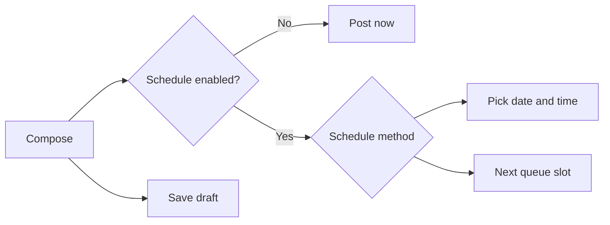
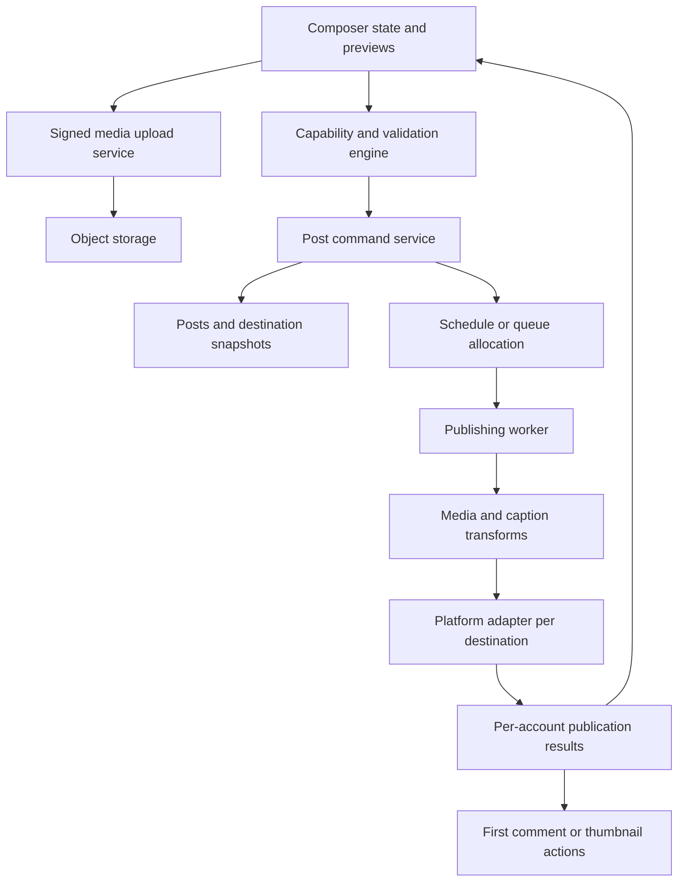

# Post Bridge: technical analysis of New Post

Inspection date: 13 October 2026. Scope: the authenticated workspace composer, all four creation routes, and the current public API specification.

## 1. Main finding and evidence boundaries

The observable behavior is consistent with **one shared composer, configured by post type and selected platform capabilities**. The four entry points are text, image, video, and story. Account selection, scheduling, draft controls, and much of the configuration UI are shared. Story mode removes caption and feed/reel options and restricts destinations to Instagram and Facebook.

The public API models these as **one post resource**. `CreatePostDto` has no `post_type` field. Text/image/video behavior is represented by media and platform configuration; stories use `placement: "story"` under the selected Meta platforms. This is the most useful basis for reconstructing the feature. [Current API reference](https://api.post-bridge.com/reference), [story documentation](https://support.post-bridge.com/social-media-scheduling/how-to-post-instagram-and-facebook-stories).

Evidence labels used below:

| Label | Meaning |
|---|---|
| **Observed** | Inspected in the live composer through rendered UI or DOM attributes, including temporary form interactions. |
| **Documented** | Described by the current public OpenAPI document or official help center. Not an executed API test. |
| **Proposed** | An implementation design inferred from the behavior. Not recovered private source code. |
| **Unverified** | Requires uploads, persistence, provider delivery, or access not exercised in this inspection. |

No posts were published, scheduled, or saved. No files were uploaded, accounts connected, or remembered preferences changed. Temporary captions and selections were discarded through navigation. The browser was returned to the New Post chooser.

This is a black-box functional and contract analysis. No authenticated network trace, internal server handler, database schema, upload processing implementation, or production worker code was obtained. The public API must not be mistaken for proof that the web UI uses the same HTTP endpoints internally.

## 2. Routes and page structure

**Observed routes**, under `/team/{workspaceId}`:

| Route | Purpose |
|---|---|
| `/create` | Four post-type choices and a connection-management link |
| `/create/text` | Caption-only composer |
| `/create/image` | Multiple-image composer |
| `/create/video` | Single-video composer |
| `/create/story` | Single image or video, story placement |

The desktop page has persistent workspace navigation, a main editing column, and a right-hand publishing card. The account picker appears first. Media upload, where applicable, precedes the main caption. Configuration panels sit below the caption. A panel selection replaces the previously displayed configuration panel.

**Proposed component decomposition**—these are descriptive names, not recovered symbols:

```text
WorkspaceShell
└── PostComposer(mode)
    ├── EligibleAccountPicker
    │   ├── AccountSearch
    │   └── RememberSelection
    ├── MediaInput(mode, plan, selectedPlatforms)
    │   ├── FileDropzone / ClipboardInput
    │   ├── ImportSelector
    │   └── MediaEditor [post-upload behavior not inspected]
    ├── MainCaption [absent for stories]
    ├── ConfigurationPanels [absent for stories]
    │   ├── PlatformCaptions
    │   ├── PastCaptions
    │   └── PlatformOptions
    └── PublishCard
        ├── Now / FixedTime / Queue
        └── Publish / Schedule / SaveDraft
```

DOM classes use Tailwind-style utilities and component classes such as `textarea`, `tooltip`, and `bg-base-100`. That suggests a utility CSS/component-theme approach, but does not establish exact dependencies or versions. The public Scalar reference declares a NestJS integration; this describes its documentation integration, not the entire product stack.

## 3. Account selection and shared editor behavior

### Account picker

**Observed:** available accounts change by composer mode. The inspected workspace exposed 10 account choices for text, 15 for images, 20 for videos, and 10 for stories. These are workspace-specific counts, not product limits. The observed types were Facebook, Instagram, LinkedIn, X, and YouTube. No TikTok, Pinterest, Threads, or Bluesky account was available for live configuration inspection.

`Search & Filter` expands a text search field. Searching `eigenn` reduced the text picker to matching Facebook and X accounts. An already selected, nonmatching account remained selected while hidden by search. Filtering should therefore be separate from selection state.

Selecting a second X account replaced the first. The second account had a green selected border; the first became gray. Mixed-platform selection retained both accounts. Official help also describes one account per platform per post. [Account-selection restriction](https://support.post-bridge.com/social-media-scheduling/social-media-platform-posting-limitations-multiple-accounts-and-duplicate-content).

The picker has a `Remember` checkbox, initially off. Its storage location, scope, and persistence were not tested.

**Proposed selection rule:**

```ts
// UI model, not recovered application source.
type SelectedAccounts = Partial<Record<Platform, AccountId>>;

function toggleAccount(selected: SelectedAccounts, account: Account) {
  const next = { ...selected };
  if (next[account.platform] === account.id) delete next[account.platform];
  else next[account.platform] = account.id;
  return next;
}
```

### Caption inheritance and limits

**Observed:**

| State | Main caption counter | Additional behavior |
|---|---:|---|
| No account selected | 2,200 | Publishing and draft actions disabled |
| Standard X selected | 280 | X configuration appears |
| X and LinkedIn selected | 3,000 | Separate X and LinkedIn caption sections |
| 281 ASCII characters with X + LinkedIn | 281 / 3,000 | Warning for smaller destination limit; inherited X field displayed 280 / 280 |

The main counter followed the larger selected limit in the tested combination, not the most restrictive limit. The X inherited preview was visibly truncated. Whether the submitted payload is truncated identically remains unverified.

`Platform Captions` requires at least two selected accounts to expose separate platform editors. Each starts in an inherited state. `Edit` copies the main caption into an editable override; the label changes to indicate custom content and the action becomes `Clear`. A reset-confirmation component explains that clearing returns to the main caption. Reset submission was not exercised.

`Past Captions` opens a searchable list of prior captions. Retrieval was observed; applying an existing caption was not tested. Existing post text is intentionally omitted from this report.

**Proposed caption resolution:** account override → platform override → main caption. The API exposes both override levels, but simultaneous precedence was not verified. Use an explicit inherited/custom state; do not infer inheritance from an empty string. Validate effective content for every destination, including Unicode and link transformations.

## 4. The four creation modes

| Property | Text | Image | Video | Story |
|---|---|---|---|---|
| Media input | None | Multiple images | One video | One image or one video |
| Main caption | Yes | Yes | Yes | No |
| Platform caption panels | Yes | Yes | Yes | No |
| Platform options | Conditional | Conditional | Conditional | Hidden in inspected flow |
| Now / schedule / draft controls | Yes | Yes | Yes | Yes |
| DOM `multiple` attribute | N/A | Present | Absent | Absent |
| Story placement | N/A | N/A | N/A | Instagram / Facebook |

### Text

The inspected text composer offered Facebook, LinkedIn, and X accounts. It provides one main text area, platform overrides, past captions, and platform-specific first comments.

**Observed risk:** selecting an X account enabled `Post now` even when the caption was empty. The button was not pressed. This establishes incomplete button-level gating, not a server validation defect. Drafts may intentionally allow incomplete content.

**Documented transformation:** Post Bridge strips URLs and bare domains from the main X caption. Links are allowed in the X first reply. A faithful reconstruction must account for this visible content transformation and preview the actual X output. This is Post Bridge behavior, not a claim that X universally forbids links. [API reference](https://api.post-bridge.com/reference).

### Image

**Observed:** upload supports a file picker, drag/drop, and a clipboard-paste affordance. Help text states JPG/PNG, 8 MB per image, up to 35 images, and a 500 MB total for the inspected Pro plan.

The actual DOM `accept` list is broader:

```text
image/jpeg,image/png,image/heic,image/heif,image/avif,image/webp,.heic,.heif
```

This proves picker acceptance hints, not successful decoding, conversion, or server acceptance. The public upload DTO accepts JPEG and PNG but does not list HEIC/HEIF/AVIF/WebP, suggesting a possible browser conversion step. That conversion is unverified.

The import panel exposes Google Drive images, up to 20 per import. Senja is disabled with an explanation that it supplies video testimonials. The 20-image import batch limit and 35-image composer limit are distinct.

With an Instagram account selected and no media, both publish and draft actions remained disabled. Post-upload ordering, crop editing, replacement, removal, upload retry, and thumbnail previews were not exercised.

**Documented:** a carousel preserves multiple-image ordering. Official help says Instagram receives only the first 10 images and that a warning is displayed for larger sets. Treat this as documented product behavior requiring a live upload test, not a freshly verified Meta platform limit. [Carousel limits](https://support.post-bridge.com/media-limits-and-processing/instagram-carousel-post-photo-limit-10-photos-maximum).

Cropping documentation says later carousel images follow the first image's aspect ratio. However, that article says manual crop controls are unavailable while the live uploader help mentions a cropping option. Actual crop controls and processing timing remain unresolved. [Cropping help](https://support.post-bridge.com/media-limits-and-processing/how-post-bridge-handles-instagram-image-aspect-ratios-and-cropping).

### Video

**Observed:** a single-file input accepts `video/mp4,video/quicktime`. The Pro-plan help states 3–300 seconds, 500 MB maximum, and aspect ratios 9:16, 16:9, 1:1, or 4:3. These are displayed rules, not tested boundary enforcement. The import panel offers Google Drive videos and Senja testimonials and describes a duration below five minutes.

The import wording is strictly “under five minutes,” while uploader help permits a 300-second maximum. Test the exact boundary.

Instagram options add a custom cover upload, profile-grid visibility, and trial-reel configuration. YouTube options add title, tags, altered-content disclosure, and a custom thumbnail upload. Details appear in the next section.

**Documented:** `processing_enabled` defaults to true and controls video processing. The API does not expose a top-level Shorts/Reels mode. Help describes automatic YouTube Shorts handling for eligible vertical videos. This was not tested through delivery. [API reference](https://api.post-bridge.com/reference), [YouTube Shorts help](https://support.post-bridge.com/social-media-scheduling/how-to-post-a-video-to-youtube-as-a-youtube-short).

### Story

**Observed:** only Facebook and Instagram accounts are presented; exactly one image or video is requested. The caption field, caption tools, covers, and trial-reel controls disappear. Selecting Facebook plus Instagram adds no configuration panel. Actions stay disabled without media.

The file input combines the image and video MIME hints but has `multiple=false`.

**Documented API representation:** set `instagram.placement` and/or `facebook.placement` to `"story"`, with one media item. A story is a platform placement on the shared post resource. [Story API guidance](https://support.post-bridge.com/social-media-scheduling/how-to-post-instagram-and-facebook-stories).

Two observed inconsistencies need correction in a reconstruction:

1. Story upload help still says up to 35 images although the form requires exactly one.
2. Story `Import` opens a video-only panel, including Google Drive “Videos,” despite the story input supporting images.

Story-specific provider duration limits, cropping, segmentation, and final appearance were not validated. Do not assume the generic 300-second uploader message guarantees story delivery.

## 5. Destination configuration

| Platform | Live controls inspected | Current API fields / semantics |
|---|---|---|
| Instagram | Up to 20 user tags; up to 3 collaborators; first comment with 2,200-character counter. Videos add cover upload, profile-grid toggle default on, trial toggle default off, Manual/Performance graduation | `user_tags`, `collaborators`, `first_comment`, `cover_image`, `video_cover_timestamp_ms`, `share_to_feed`, `is_trial_reel`, `trial_graduation`, `placement` |
| X | First reply and Remember checkbox; 280-character counter | `first_comment`; main-caption links stripped. API also reports account premium status |
| LinkedIn | First comment; 1,250-character counter; Remember checkbox | `first_comment`; API additionally supports PDF document title, outside these four inspected media inputs |
| YouTube | Title with 100-character counter; comma-separated tags with 500-character counter; altered-content toggle; thumbnail upload | `title`, `tags`, `contains_synthetic_media`, `thumbnail`; API additionally has `has_paid_product_placement` |
| Facebook | Story destination verified; normal-feed configuration not expanded | API exposes `first_comment` and `placement` |
| TikTok | No connected account available to inspect | API exposes title, cover timestamp, native draft, private/public visibility, AI label, photo auto-music, comments, duet, stitch, own-brand and paid-brand disclosures |
| Pinterest | No connected account available to inspect | API exposes board IDs, title, link, cover timestamp |
| Threads / Bluesky | No connected account available to inspect | Caption/media overrides; Threads also exposes location and first reply |

API-only entries above come from the [current API reference](https://api.post-bridge.com/reference). They establish contract availability, not UI availability.

**Observed Instagram permission state:** the selected account showed a refresh-required warning for first comments, while stating the main post could still publish. This is a capability-specific permission problem, not evidence that the entire connection is unusable.

**Observed trial-reel dependencies:** enabling the toggle reveals requirements—Professional/Creator account, public profile, 1,000+ followers, maximum five trials per day—and a graduation selector. Default is Manual. These are product-displayed eligibility rules; external enforcement was not tested.

**Observed YouTube title fallback:** entering a main caption populated the generated title automatically. Help says it takes the first 100 caption characters. Custom thumbnail help specifies regular videos, verified channel, JPEG/PNG, 1280×720, and under 2 MB; Shorts ignore it.

**Documented partial success:** first-comment failures and YouTube thumbnail failures do not fail the main post. Treat ancillary results separately from primary publication. TikTok's `draft` option means handoff to TikTok for completion; top-level `is_draft` means a Post Bridge draft. These are different lifecycle states. [API reference](https://api.post-bridge.com/reference).

## 6. Scheduling and readiness

**Observed publishing modes:**



Switching scheduling on reveals fixed-time and queue tabs. Fixed time defaults to 12:00 PM and offers quick choices of 11:00 AM, 3:00 PM, and 7:00 PM. Calendar dates before the current day are disabled. With no date, `Schedule` is disabled. Selecting the next day enables it and shows that the time is local.

No timezone selector was visible in the tested card. Conversion to UTC, source timezone, DST handling, and invalid same-day time handling require additional tests.

The workspace has no queue schedule. The queue panel exposes a settings link, yet `Add to Queue` appeared enabled. It was not pressed. Model queue availability as an independent validation result.

**Documented API rules:** `scheduled_at` and `use_queue` are mutually exclusive. `use_queue` accepts true or a timezone object according to its description. Omitting/nulling the schedule on a new nondraft post means immediate processing. A particularly important PATCH warning says to resend `scheduled_at` when updating scheduled content, or it may process immediately. [API reference](https://api.post-bridge.com/reference).

**Proposed readiness rules:**

```text
canPublish = hasEligibleDestinations
          && validEffectiveContentForEveryDestination
          && requiredMediaReady
          && noUploadsPending
          && scheduleValid
          && noSubmissionInFlight

canSaveDraft = draftSchemaValid && noSubmissionInFlight
```

Draft completeness should be intentionally defined rather than reusing publishing validity. The API permits incomplete drafts according to its descriptions, while the inspected image/video/story forms disabled draft saving without media.

## 7. Verified public contract

These endpoints were read from the live public OpenAPI document, not captured from authenticated composer traffic. REST clients use bearer API keys. No credentials were accessed.

| Method and path | Composer responsibility |
|---|---|
| `GET /v1/social-accounts` | Paginated account discovery; platform/username filters |
| `POST /v1/media/create-upload-url` | Create media record and signed upload URL |
| `PUT {upload_url}` | Transfer binary media to the signed storage destination |
| `GET /v1/media/{id}` | Read media metadata |
| `POST /v1/posts` | Create immediate, scheduled, queued, or draft content |
| `GET /v1/posts/{id}` | Read aggregate state and dashboard link |
| `PATCH /v1/posts/{id}` | Update caption, media, accounts, options, or schedule |
| `DELETE /v1/posts/{id}` | Delete a draft or scheduled post; published posts excluded |
| `GET /v1/post-results?post_id={id}` | Read destination-specific success, errors, provider IDs, URLs |

Source: [API reference](https://api.post-bridge.com/reference). A relevant, machine-readable OpenAPI snapshot accompanies this report.

### Media contract

```json
{
  "mime_type": "image/jpeg",
  "size_bytes": 123456,
  "name": "example.jpg"
}
```

The response contains `media_id`, `upload_url`, and `name`. Upload bytes with PUT and the matching Content-Type. The published upload MIME enum contains PNG, JPEG, MP4, QuickTime, and PDF. PDF is broader than the four creation modes examined here.

The signed URL has limited validity. The exact lifetime, post-upload acknowledgement mechanism, virus checks, transforms, resumability, orphan cleanup, and checksum enforcement are not established by this contract.

`media_urls` also accepts public media URLs when creating a post; it is ignored when `media` is supplied. This API ability does not prove a generic URL-import field exists in the UI.

### Post contract

```ts
// Normalized reading of the documented interface, not generated server code.
interface CreatePost {
  caption?: string;                 // descriptions allow omission for drafts
  social_accounts: number[];
  media?: string[];
  media_urls?: string[];
  scheduled_at?: string | null;     // ISO date-time
  is_draft?: boolean;
  use_queue?: true | { timezone: string };
  processing_enabled?: boolean;    // documented default: true
  platform_configurations?: Record<string, object>;
  account_configurations?: {
    account_configurations: Array<{
      account_id: number;
      caption?: string;
      media?: string[];
    }>;
  };
}
```

The nested `account_configurations.account_configurations` shape is present in the public schema; do not flatten it accidentally.

### Four illustrative payloads

All examples use fake IDs and `is_draft: true`. They describe serialization and were not submitted.

```json
{
  "caption": "Example text post",
  "social_accounts": [101],
  "is_draft": true,
  "platform_configurations": {
    "twitter": { "first_comment": "Details: https://example.com" }
  }
}
```

```json
{
  "caption": "Example image carousel",
  "social_accounts": [202],
  "media": ["image-id-1", "image-id-2"],
  "is_draft": true,
  "platform_configurations": {
    "instagram": { "caption": "Instagram-specific caption" }
  }
}
```

```json
{
  "caption": "Example video description",
  "social_accounts": [202, 303],
  "media": ["video-id"],
  "is_draft": true,
  "processing_enabled": true,
  "platform_configurations": {
    "instagram": { "cover_image": "cover-id", "share_to_feed": true },
    "youtube": { "title": "Example title", "tags": ["example"] }
  }
}
```

```json
{
  "caption": "",
  "social_accounts": [202, 404],
  "media": ["story-media-id"],
  "is_draft": true,
  "platform_configurations": {
    "instagram": { "placement": "story" },
    "facebook": { "placement": "story" }
  }
}
```

An empty caption is illustrative for a story draft. Live nondraft story serialization, including whether caption is omitted or empty, was not observed. The OpenAPI required-field metadata and story semantics need an integration test before relying on generated clients.

For fixed scheduling, use an ISO timestamp and disable draft state when intentionally scheduling. For queue scheduling, use `use_queue` and omit `scheduled_at`.

### Result model and schema inconsistencies

The public post status enum is `scheduled | processing | posted | failed`. Draft is represented by `is_draft`, not a member of that enum. A per-account result carries `success`, `error`, and `platform_data` with provider identifiers and a URL. TikTok additionally distinguishes a processing/publish ID from its eventual public video ID. [API reference](https://api.post-bridge.com/reference).

OpenAPI inconsistencies worth handling explicitly:

- `caption` is marked required, while its description allows omission for drafts.
- `use_queue` is typed as an object, while its description and example allow boolean true.
- Several response/PATCH properties use `object` where the description indicates a timestamp or media array.
- The upload tutorial is attached to `/v1/media/upload-link` while instructing clients to call `/v1/media/create-upload-url`.

These are specification weaknesses. They do not establish the precise runtime behavior.

## 8. Proposed architecture and data model

The following design is sufficient to reproduce the observed feature; it is not a claim about Post Bridge's private infrastructure.



Use one composer state with separate content, targeting, media, schedule, and submission sub-states. Avoid a single boolean `isReady`: a file can be chosen but not uploaded, uploaded but not processed, or valid for one destination but invalid for another.

```ts
type ComposerMode = "text" | "image" | "video" | "story";
type ScheduleIntent =
  | { mode: "now" }
  | { mode: "fixed"; localDate: string; localTime: string; timezone: string }
  | { mode: "queue"; timezone: string };
type MediaPhase = "selected" | "validating" | "uploading"
  | "processing" | "ready" | "failed";
type CaptionValue =
  | { source: "main" }
  | { source: "custom"; text: string };
```

| Proposed entity | Responsibility |
|---|---|
| Workspace | Access boundary, plan limits, scheduling defaults |
| SocialAccount | Platform, provider identity, connection state, capability flags |
| Post | Shared caption, draft flag, scheduling intent, aggregate state, revision |
| PostDestination | Account target and resolved content/options snapshot |
| MediaAsset | Ownership, MIME, dimensions, duration, byte size, storage object, processing phase |
| PostMedia | Ordered association between content and assets |
| QueueSchedule / QueueReservation | Workspace time slots and atomic reservations |
| PublishAttempt | Destination, attempt number, provider request identity, outcome |
| AncillaryAction | First comment, thumbnail, or other post-publication result |

Public DTOs support the concepts of posts, accounts, media, and per-account results. Workspace ownership, joins, attempts, reservations, and snapshots above are design recommendations.

For a reliable reconstruction, freeze destination-specific content at submission; prevent repeated clicks from creating duplicate sends; reserve queue slots transactionally; retry transient errors per destination; and reconcile ambiguous provider timeouts before retrying. No idempotency header, retry policy, cancellation guarantee, or delivery atomicity was established by the inspected documentation.

Keep original assets separate from generated crops/transcodes/covers. Explicitly manage reference lifetimes: the composer DOM contains a duplicate-post explanation that says media is re-uploaded to avoid conflicts after original media cleanup. This is explanatory component text, not a tested duplicate operation.

## 9. Findings to carry into implementation

| Finding | Evidence | Practical consequence |
|---|---|---|
| Shared post resource, mode-specific UI | Live routes + public DTO | Use a shared core and capability-driven sections |
| One account per platform | X replacement tested; help confirms rule | Picker is platform-keyed selection, not unrestricted checkboxes |
| Mixed-platform caption limits | 281-character X + LinkedIn test | Validate and preview each effective destination caption |
| Empty text enables publish | Live X-only state | Add a clear content error; verify server handling separately |
| Missing queue still exposes enabled action | Live workspace state | Disable submission or surface a precise validation error |
| Story helper says 35 images | Opened and visually checked modal | Make upload guidance depend on mode |
| Story import exposes video options only | Live import panel | Add image import or explain the limitation |
| Image picker accepts more formats than help/API | DOM accept vs help and DTO | Confirm conversion path; align messages and validation |
| Older thumbnail help conflicts with current product | Live custom-cover controls + API | Prefer current UI/API; keep historical help clearly marked |
| First comments have separate permissions/results | Live Instagram warning + API | Do not collapse all failures into “post failed” |
| Scheduled PATCH may publish immediately if schedule omitted | Explicit API warning | Preserve schedule on edits; use a dedicated regression test |
| API schemas contain weak/mismatched types | Current OpenAPI | Add a normalized adapter rather than trusting generation blindly |

The older thumbnail article says external custom images are unavailable. The inspected Instagram and YouTube controls, plus the current API fields, directly contradict that statement for supported use cases. [Older thumbnail help](https://support.post-bridge.com/social-media-scheduling/setting-custom-thumbnails-for-videos), [current API](https://api.post-bridge.com/reference).

## 10. Verification coverage and remaining tests

**Completed:** all four initial forms; mode-dependent account lists; search; same-platform replacement; mixed-platform selection; caption inheritance and override activation; one caption boundary; scheduling mode changes and future-date readiness; queue empty state; import menus; native file-input MIME/multiplicity; Instagram image/reel controls; X/LinkedIn first comments; YouTube generated title, tags, disclosure, and thumbnail controls; story restrictions; public contract extraction.

**Not executed:** upload/processing; image ordering/cropping; cover selection and persistence; OAuth imports; saved drafts; posting; actual schedule execution; queue reservation; error retries; duplicate/delete; mobile layout; timezone/DST behavior; delivery on any social platform. TikTok/Pinterest/Threads/Bluesky configuration remains documentation-only.

A companion CSV lists observed checks and the remaining implementation acceptance tests. Tests marked `not_run` are a verification plan, not passed results.

The critical completion criterion for a future implementation is destination-level proof: a successful create response is not proof of publication. A queued or processing post must be reconciled with per-account results, native post IDs/URLs, and any separate ancillary-action failures.
