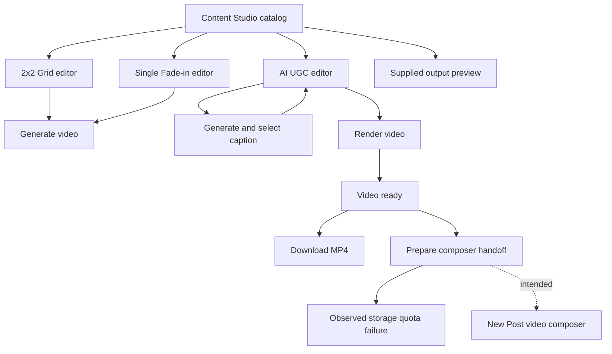
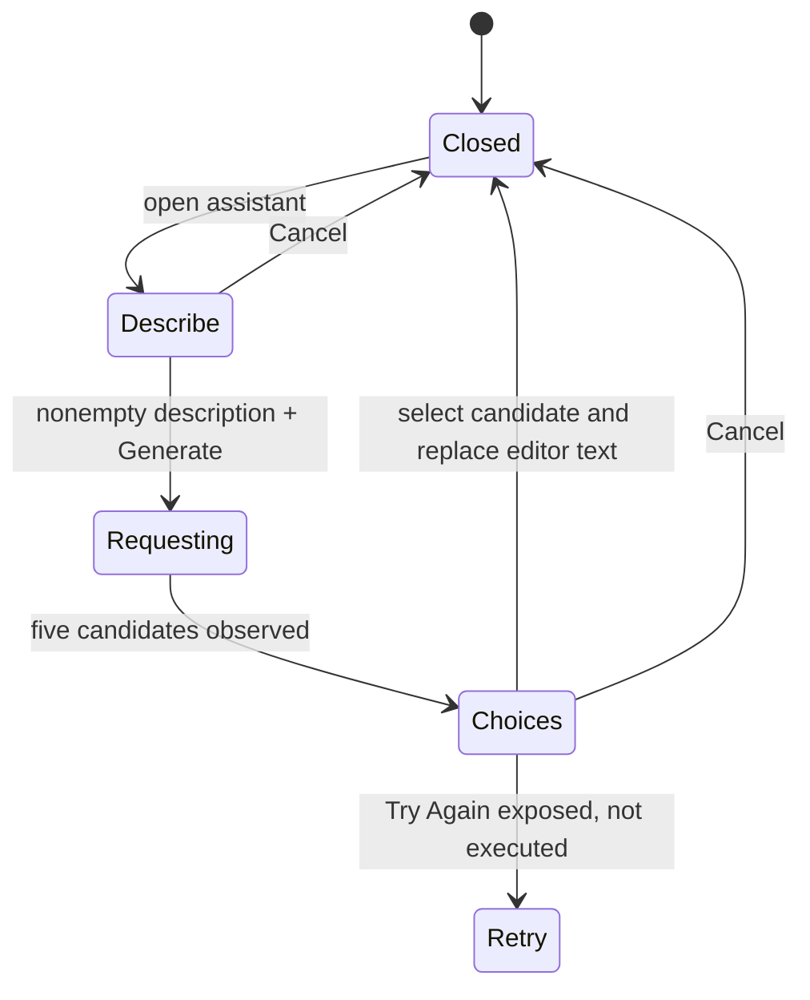
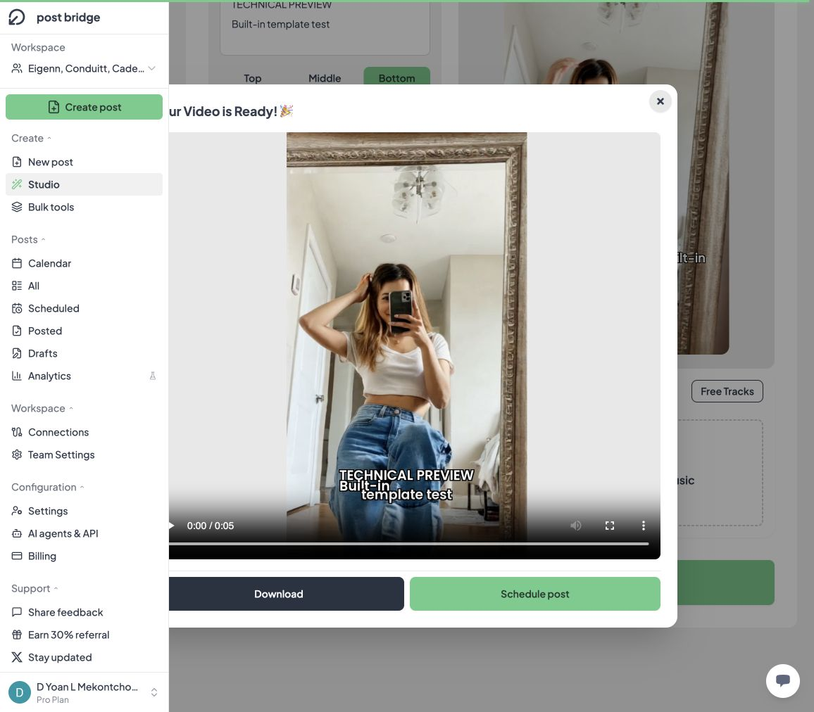

# Post Bridge Content Studio: technical reverse engineering

Inspected 13 October 2026 in the authenticated Pro-plan workspace. This extends the [New Post analysis](../composer/post-bridge-new-post-technical-analysis.md).

## 1. Findings that matter

**Studio and Content Studio are the same feature.** The sidebar label is Studio; its route is `/team/{workspaceId}/content-studio`. The inspected page contains three video-production workflows: a four-image grid, a single-image fade-in, and an AI UGC template editor. It is not a separate scheduling system.

**The UGC workflow was tested through generation and download.** A built-in template plus test text produced a valid 5.1-second MP4. It did not require a music file or a CTA clip. The AI caption tool returned five candidate captions from a product description.

**The composer handoff failed with a concrete client-side cause.** Clicking `Schedule post` after generation raised a Web Storage quota error for the key `studioGeneratedVideo`. The generated file was 4,263,280 bytes. The result stayed available in Studio, but the post composer did not open.

**The image templates share editing state.** Switching from Grid to Single Fade-in retained the headline and selected music. Entering UGC started with empty text and no selected music, which suggests a separate state boundary.

**Trim Cancel does not restore the prior value in the tested grid flow.** A changed start time remained selected after Cancel and reopening the dialog.

## 2. Evidence and limits

| Label | Meaning |
|---|---|
| Observed | Live UI, DOM-backed attributes, media element metadata, or browser console evidence |
| Executed | A behavior was exercised and its resulting state inspected |
| Measured | Downloaded media inspected locally using AVFoundation |
| Proposed | A reconstruction design, not recovered application source |
| Unverified | A flow or implementation detail not established in this inspection |

Executed actions included temporary text entry, template selection, audio selection/trimming, caption generation, one UGC render, downloads, and one Studio-to-composer handoff attempt. No posts were published, scheduled, or saved as drafts. No personal files were uploaded. No connection or remembered preference was changed.

The generated UGC result remains open in the browser and is also saved as [studio-ugc-test.mp4](studio-ugc-test.mp4). Temporary Grid/Single state may remain in the current page session; it was not saved as a project.

The internal render HTTP endpoint, render location, model provider, database, queue implementation, and billing accounting were not inspected. A browser Blob output does not prove that rendering happens locally. No private application source was recovered.

## 3. Navigation and feature boundaries

All three editors replaced the catalog inside the same Content Studio URL. Browser routing did not expose a separate path or query parameter for the selected template.



The catalog includes a large UGC promotion and a UGC card in the three-template grid. These are duplicate entry points to one named feature, not evidence of two UGC products. The large promotion was the entry exercised.

Each card has `Use Template` and an icon-only output-preview action. The image-template previews open small vertical-video modals. Both preview videos autoplay, loop, and start muted. The native video controls are hidden; a separate mute control is exposed.

The page also contains marketing labels and historical view/download claims. They are promotional copy, not measured product performance. They are excluded from the reconstruction's success criteria.

## 4. 2x2 Grid Video

### Form and input contract

| Control | Observed behavior |
|---|---|
| Main Caption | Single-line text input; used as a headline at the top of the video |
| Upload Images | File input accepts `image/*` and has `multiple` enabled |
| Four image slots | Each has a separate single-file `image/*` input |
| Four image captions | One single-line text input per numbered slot |
| Portrait Image Mode | Off initially; can be enabled for tall images such as posters |
| Music | File upload/drop affordance or built-in track selection |
| Viral Examples | Social-embed example collection |
| Generate Video | Disabled with no images, including after headline and music were supplied |

No `maxlength` attribute was present on the inspected headline or slot-caption inputs. No image byte-size, resolution, or MIME-validation policy was proven. `image/*` describes the browser picker hint, not the renderer's supported decoders.

The visual editor is a two-by-two grid with a headline above it and a music/help column to its right. Slot captions appear below the upload boxes in the form. The supplied output places each slot caption above its corresponding image.

The four-slot data structure and bulk file input are observed. Assignment rules for excess bulk uploads, image replacement, reordering, crops, transparent images, EXIF rotation, and unsupported file types remain unverified because no local image fixture was uploaded.

### Supplied output sample

The preview asset is `/videos/2x2-grid-example.mp4`. It was downloaded through the visible preview, decoded, and visually inspected at exact frame times.

- 1080×1920, vertical 9:16.
- Six seconds, 30 fps, 180 decoded video frames.
- H.264/AVC video (`avc1`) and an AAC audio track.
- A headline above four labeled images on a light central panel, with black bands above and below the panel in this sample.

These are measured properties of the supplied example, not a guarantee that every new grid export uses identical layout, codec settings, or timing.

## 5. Single Fade-in Video

The Single editor has the same headline and music concepts, one image input, and a `No Caption (Image Only)` switch. Its upload guidance recommends an image around 500×400; this is guidance, not a demonstrated validation threshold.

Enabling image-only mode disables the headline input and changes its placeholder to `Caption disabled`. The existing text remains in the field. Disabling the mode restores editing and preserves that text. The intended render behavior is omission of the overlay, rather than deletion of stored text; an image-only render was not executed.

Switching Grid → catalog → Single retained the test headline and the selected built-in music. This occurred without saving a project or changing the route. An implementation should make this shared state explicit and decide whether cross-template carryover is desirable.

The supplied `/videos/single-image-example.mp4` has the same measured encoding envelope as the grid sample: 1080×1920, six seconds, approximately 30 fps, 180 video frames, H.264/AVC plus AAC. Exact-time frame extraction confirms a fade from a dark starting frame into a headline-and-image composition. The exact transition duration and easing were not recovered.

No timeline editor, keyframe controls, transition-duration field, font picker, color picker, or export-resolution selector was visible in the inspected initial Grid/Single forms.

## 6. Shared music and trimming subsystem

### Acquisition and preview

The upload guidance names MP3 and WAV; the actual file-input hint is broader, `audio/*`. Successful acceptance of other audio types was not tested.

The Free Tracks dialog contains eight named entries. Selecting an entry loads the track into the editor, closes the chooser, displays its name, exposes native audio playback, and adds trim/remove controls. Selecting the first entry produced a successful-load toast.

The selected track's media metadata reported 30.14525 seconds. Two audio elements were present: the main editor player and the trim-dialog player. Their sources were browser Blob URLs. Those Blob URLs are session resources, not durable asset identifiers.

### Trim model

| Parameter | Observed value |
|---|---:|
| Target excerpt | 6 seconds |
| Minimum start | 0 |
| Slider step | 0.1 seconds |
| Maximum start for test track | 24.14525 |
| Last reachable step tested | 24.1 seconds |
| Displayed interval at that step | 24.1–30.1 seconds |

The observed maximum equals `audioDuration - 6`. This supports a fixed-length excerpt model with an adjustable start offset. Behavior for tracks shorter than six seconds remains unverified.

The dialog provides Cancel and Save Selection. Save Selection produced an audio-trim success message. The main audio player still represented the original-length source, so the UI should be modeled as a selected interval, not assumed to contain a physically shortened audio file.

### Reproduced cancellation defect

1. Load the built-in track at its initial zero-second offset.
2. Open Trim Audio.
3. Move the start slider to the end: 24.1 seconds.
4. Press Cancel.
5. Reopen Trim Audio.

The new value persisted at 24.1 seconds, and the editor showed the corresponding selected interval. Cancel behaved as dismissal rather than rollback. Render submission was not needed to establish this form-state defect.

**Proposed correction:** keep `committedStartSeconds` and `draftStartSeconds` separate. Opening copies committed into draft; Cancel discards draft; Save commits it. Avoid binding the dialog slider directly to the render specification.

## 7. AI UGC editor

### What the feature actually exposes

The observed workflow selects an existing video template and renders text over it, with optional music and an optional CTA video appended afterward. The separate text assistant generates caption ideas from a product description.

There was no visible prompt-to-actor-video field, voice selector, script-to-speech control, lip-sync control, avatar creation, or user face-cloning input. This inspection establishes template-based composition plus text generation; it does not establish how the underlying template clips were originally made.

The initial layout has editing controls on the left and a tall video preview on the right. It provides:

- A multiline video-text area.
- A small `generate` button for text assistance.
- Top, Middle, and Bottom overlay positions; Middle selected initially.
- 25 thumbnails labeled UGC Style 1 through UGC Style 25.
- A single CTA file input with `video/*`, described as a 3–15 second clip shown after the UGC.
- The shared music/trim component.
- A video-render action whose label and enabled state change with readiness.

UGC started with empty text and no music after the image-template flow. This was different from Grid → Single carryover.

### Readiness behavior

| State | Render action |
|---|---|
| No template selected | Disabled, asking for a template |
| Template selected, no text | Disabled Generate Video |
| Template and nonempty text | Enabled Generate Video |
| Template and text, no music, no CTA | Successfully rendered |
| Rendering | Disabled generating action |
| Completed | Generate action available again; result modal displayed |

The successful test confirms that music and CTA are optional for this UGC path. Whitespace-only text, text-size limits, invalid-template handling, expired asset URLs, and CTA boundary enforcement remain unverified.

### Asset delivery and preview

Selecting Style 1 loaded a 720×1280 video with a 5.1-second duration into a looping, muted preview. The DOM source was a signed S3 object URL under a template-media path. Its query indicated a one-hour signature lifetime in this instance. Full signed URLs and credential-like query values are intentionally excluded from the deliverables.

This is evidence of object-storage-backed template delivery. It does not identify the rendering worker or prove that all styles share a resolution or duration.

### Overlay implementation evidence

The preview uses an absolutely positioned text wrapper. Observed classes were:

```text
Middle: top-1/2 -translate-y-1/2
Top:    top-24
Bottom: bottom-24
Common: absolute left-0 right-0 px-4 text-center
Text:   text-white text-lg font-semibold plus four black text-shadow offsets
```

These describe browser preview styling. Exact export coordinates and typography must be tested separately. The generated test output visibly contains white, black-outlined text near the bottom. Input newline handling and output wrapping need explicit tests; the test's two-line input wrapped to three visible output lines.

## 8. Caption-generation state machine

The small `generate` action opens a product-description dialog. Empty description keeps Generate disabled. Filling it enables the request.

A neutral screen-break-timer description returned **five candidate captions**. The result state has one selection button per candidate, Try Again, and Cancel. Selecting a candidate closes the dialog and replaces the main video-text value; the preview updates accordingly.



The model provider, prompt template, temperature, endpoint, rate limit, and retry/error behavior were not observed. The five-result count is from one executed request, not a proven invariant.

This tool generates **on-video overlay text** in the UGC editor. It must not be conflated with the publishing caption or with text generation in the New Post composer.

## 9. Executed render, output, and download

The test used Style 1, Bottom placement, and this deliberately neutral overlay:

```text
TECHNICAL PREVIEW
Built-in template test
```

No CTA or soundtrack was added. Progress was observed at 20% and then at 100% with completion text. The result modal exposed playback, Download, and Schedule post. Completion elapsed between observations; no precise render-performance claim is made.

The Download link had a Blob URL and the suggested filename `post_bridge_made_video.mp4`. Download through the normal UI succeeded. The browser automation download-event watcher did not report completion, so the local file was checked independently before claiming success.

### Measured media results

| Asset | Dimensions | Duration | Rate | Video frames decoded | Video codec | Audio |
|---|---:|---:|---:|---:|---|---|
| Supplied Grid preview | 1080×1920 | 6.0 s | 30 fps | 180 | H.264/AVC | AAC track present |
| Supplied Single preview | 1080×1920 | 6.0 s | ~30 fps | 180 | H.264/AVC | AAC track present |
| Generated UGC test | 720×1280 | 5.1 s | 30 fps | 153 | H.264/AVC | No audio track |

All three video tracks decoded to completion with AVFoundation. Representative exact-time frames were inspected. Audio codec/presence was inspected; the soundtrack content was not audited. The generated output's duration and geometry match the selected Style 1 source in this test.

Files: [test video](studio-ugc-test.mp4), [media validation](studio-media-validation.json).



The result modal also contains a close warning explaining that the generated video will be lost on closure. Its warning text was observed in the DOM; accepting that warning was not tested. Do not infer persistent cloud storage from the result modal alone.

## 10. Reproduced handoff failure

Clicking Schedule post produced `Error preparing video for upload` and left the browser on Content Studio. The captured console error was:

```text
QuotaExceededError: Failed to execute 'setItem' on 'Storage':
Setting the value of 'studioGeneratedVideo' exceeded the quota.
```

The stack identifies a frontend click handler in a `/_next/static/chunks/…js` asset. The key name and error are direct evidence. The API `Storage` can back localStorage or sessionStorage; the inspected log does not distinguish which object was used.

### Supported diagnosis

The handoff attempts a browser-storage write under `studioGeneratedVideo`; that write exceeded available quota. Generation and download had already succeeded. The failure is therefore in preparation/handoff after rendering, not evidence of a rendering failure or a social-platform publishing error.

The exact stored representation, quota available before the test, and storage occupancy were not inspected. The stored value could be an encoded video or a wrapper containing it. As an explanatory calculation only, base64 encoding a 4,263,280-byte file requires 5,684,376 characters before any wrapper. This makes inline media storage a plausible contributor, but does not prove the actual representation.

### Proposed correction

Prefer a durable media reference:

```text
rendered Blob
  → upload/commit as MediaAsset
  → receive media_id
  → navigate to video composer with media_id
  → load asset metadata and show preview
```

For an all-browser temporary implementation, retain the Blob in shared application state or IndexedDB and hand over a small key. Web Storage should hold small metadata, not the entire encoded MP4. A reload-safe flow still needs expiry, cleanup, and ownership checks.

Handle storage failures before navigation, keep Download usable, and retain the output while reporting the handoff error. The tested UI did retain the downloadable result.

[Saved diagnostic](studio-handoff-diagnostic.json). No storage was cleared and no application code was changed during diagnosis.

## 11. Reconstruction architecture

The following components and contracts are **proposed**. They describe a faithful, maintainable replacement, not recovered source identifiers.

```text
ContentStudio
├── TemplateCatalog
│   ├── TemplateCard
│   └── ExamplePreviewModal
├── ImageTemplateEditor
│   ├── GridSlots[4] or SingleImage
│   ├── HeadlineInput
│   ├── PortraitMode or HideCaption
│   └── SharedAudioPicker
├── UgcTemplateEditor
│   ├── OverlayText + Position
│   ├── CaptionAssistant
│   ├── TemplateAssetPicker
│   ├── OptionalCtaClip
│   └── SharedAudioPicker
├── RenderController
│   ├── Validation
│   ├── ImmutableRenderSpec
│   ├── Progress / Failure
│   └── ResultModal
└── ComposerHandoff
```

### Suggested editor state

```ts
type TemplateKind = "grid_2x2" | "single_fade" | "ugc";
type OverlayPosition = "top" | "middle" | "bottom";

type AudioSelection = {
  assetId: string;
  source: "upload" | "library";
  durationSeconds: number;
  startSeconds: number;
  excerptSeconds: number;
};

type ImageEditorState = {
  template: "grid_2x2" | "single_fade";
  headline: string;
  hideHeadline: boolean;
  portraitMode: boolean;
  slots: Array<{ assetId?: string; caption: string }>;
  audio?: AudioSelection;
};

type UgcEditorState = {
  template: "ugc";
  selectedClipId?: string;
  overlayText: string;
  overlayPosition: OverlayPosition;
  ctaAssetId?: string;
  audio?: AudioSelection;
};

type RenderState =
  | { phase: "idle" }
  | { phase: "validating" }
  | { phase: "rendering"; jobId: string; progress?: number }
  | { phase: "ready"; outputMediaId: string }
  | { phase: "failed"; reason: string; recoverable: boolean };
```

Do not store Blob URLs as permanent IDs. A Blob URL can be used for a current-tab preview, but it needs a separate asset record or upload reference for reloads, cross-tab use, and publishing.

### Proposed render contract

```json
{
  "template_id": "ugc-style-1",
  "template_version": 1,
  "source_asset_id": "template-clip-id",
  "overlay": {
    "text": "TECHNICAL PREVIEW\nBuilt-in template test",
    "position": "bottom"
  },
  "audio": null,
  "cta_asset_id": null,
  "output": {
    "container": "mp4",
    "video_codec": "h264",
    "fps": 30
  }
}
```

This is an illustrative replacement contract. It was not captured from a Post Bridge request. The observed UGC result supports the no-audio/no-CTA case, but other styles and processing settings require further tests.

### Suggested backend responsibilities

| Service/entity | Responsibility |
|---|---|
| TemplateDefinition | Versioned layout, defaults, required assets, render behavior |
| TemplateAsset | Source clip, poster, dimensions, duration, access policy |
| StudioProject | Editable specification and workspace ownership, if persistence is provided |
| MediaAsset | User/library/generated asset metadata, storage reference, processing state |
| RenderJob | Frozen inputs, progress, attempts, failure cause, output reference |
| CaptionRequest | Product description, candidate results, request state |
| ComposerHandoff | Transfer output asset and optional publishing-caption seed |

An implementation can render client-side or in a worker service. Both need consistent preview/render layout rules, correct font metrics, predictable wrapping, media normalization, cancellation, retry behavior, and durable outputs where reload recovery is promised.

Do not invent a queue or renderer provider based solely on progress UI. No FFmpeg console evidence or renderer provider identity was found in this inspection.

## 12. Relationship to the public posting API

The public OpenAPI snapshot retrieved earlier in this same session exposes accounts, media, posts, results, and analytics. It contains no documented Studio, template, caption-generation, or render endpoint. That establishes the public contract's coverage, not the absence of private endpoints. [Public API reference](https://api.post-bridge.com/reference).

The existing media/post APIs can support a replacement handoff: create a media upload URL, upload the completed MP4, then compose a post referring to its media ID. However, the actual Studio-to-composer transfer mechanism in this build was only observed failing at the browser-storage step. No actual post payload from that handoff was captured.

Keep two text concepts distinct:

1. **Render text:** headline or UGC overlay burned into video frames.
2. **Publishing caption:** text sent alongside the video to social platforms.

The failed handoff means whether Post Bridge automatically carries overlay text into the publishing caption remains unverified.

## 13. Defects, risks, and priority

Priorities below are proposed engineering priorities, not vendor classifications.

| Priority | Finding | Evidence / scope | Suggested action |
|---|---|---|---|
| P1 | Render-to-composer handoff fails on a small generated clip | Executed; quota exception names `studioGeneratedVideo` | Use asset IDs or Blob-capable storage |
| P2 | Trim Cancel preserves changed start offset | Executed on built-in audio in Grid | Separate draft and committed trim state |
| P2 | Preview/export consistency needs explicit rules | Browser text styles and rendered wrapping inspected | Share layout calculation and test long/multiline text |
| P2 | Output is presented as easy to lose | Result close-warning component | Persist completed renders or state clearly when transient |
| P3 | Result modal is partly occluded by sidebar | Observed at current approximately 1156-pixel-wide viewport | Check overlay stacking, centering, and responsive width |
| P3 | Single-image social example is unavailable | Embedded Instagram error observed | Replace sample or provide a fallback preview |
| P3 | Icon-only catalog actions lack useful names in inspected accessibility tree | Live AX inspection | Add accessible labels and keyboard state |
| Verify | Grid/Single fields carry between modes | Executed | Decide intended reuse vs per-template drafts |
| Verify | “First six seconds” text remains after choosing another start | Executed trim flow | Describe selected interval rather than fixed beginning |
| Verify | Wildcard file hints exceed named formats | DOM `image/*`, `audio/*`, `video/*` | Validate actual codecs and report limits precisely |

Do not treat the static `Generating Video`, `Creating your video`, or `Your Video is Ready` headings in a broad DOM snapshot as proof that a render is active or complete. These modal components can exist while hidden. This report's render claim is based on the executed transition, completed modal, downloaded MP4, and decoded frames.

## 14. Acceptance tests for a reconstruction

The companion [verification matrix](studio-verification-matrix.csv) separates executed observations from tests still to run. The critical remaining checks are:

- Grid/Single rendering with real image fixtures, slot ordering, cropping, portrait mode, and caption-free output.
- Short/long audio, excerpt boundaries, removal, source replacement, and Cancel rollback.
- CTA clips at 3 and 15 seconds, mismatched resolution/frame rate, audio mixing, and concatenation order.
- Caption requests that fail, return no choices, are retried, or complete after modal cancellation.
- Whitespace-only text, emoji, CJK, RTL scripts, long tokens, multiple paragraphs, and overlay overflow.
- Expired template URLs, interrupted renders, repeat clicks, progress recovery, and abandoned outputs.
- Handoff with output sizes above and below browser quota, followed by actual composer preview and draft persistence.
- Browser reload, route changes, workspace switching, keyboard navigation, and narrow-screen modal layout.

Completion for the production flow should require separate proof at each stage: render valid → download valid → composer receives the asset → draft/schedule persisted → per-platform publication results. Only the first two stages succeeded in the executed UGC test.
