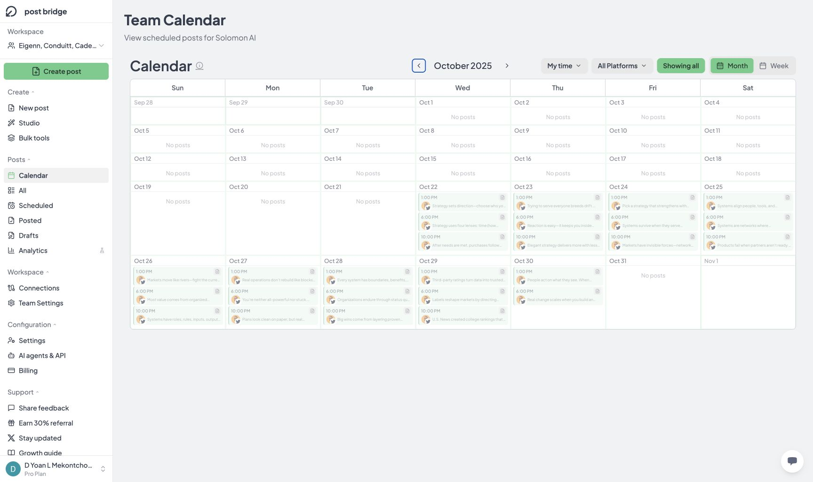
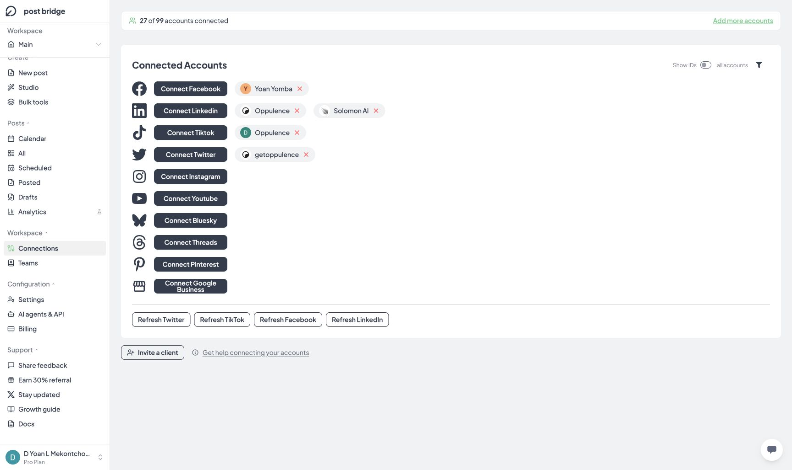
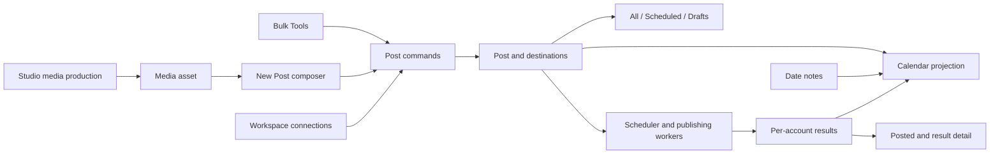
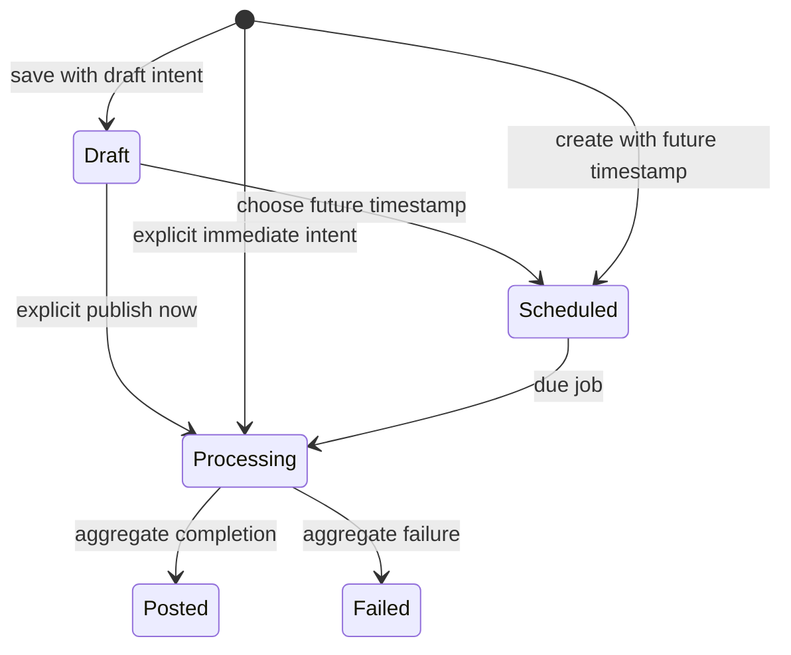
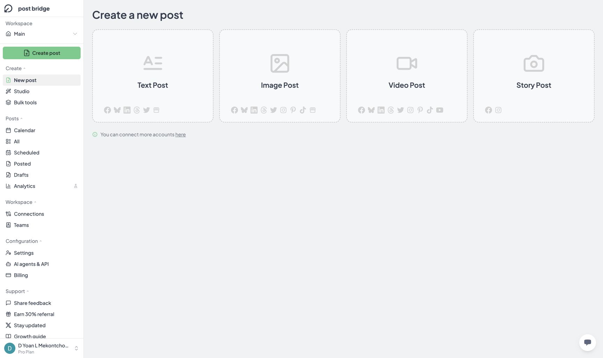
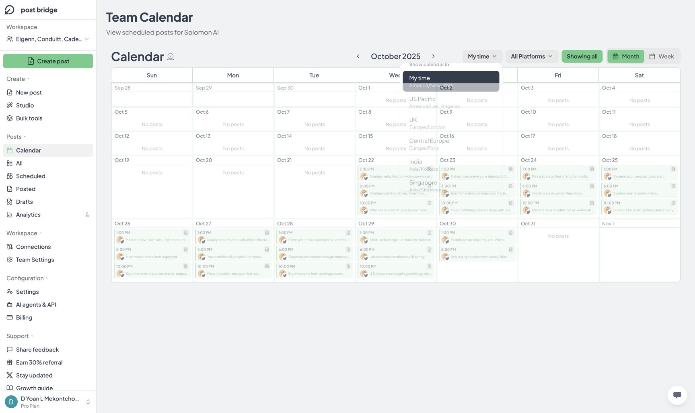

# Post Bridge: Calendar, post lists, and Connections

Technical reverse engineering · Inspected 13 October 2026 · Authenticated Main and team workspaces

## 1. Main result

The observed product is consistent with **one post model, several list/calendar projections, a separate result per publishing destination, and workspace-scoped connected accounts**. Studio supplies media, the composer supplies publishing intent, and Bulk Tools supplies batches. Calendar, All, Scheduled, Posted, and Drafts are management surfaces around that shared lifecycle.

Three findings matter when rebuilding it:

1. **Draft is a separate flag.** The public post status enum is `posted | scheduled | processing | failed`; draft behavior is represented by `is_draft`.
2. **Calendar includes published history.** The inspected team calendar displayed the same 26 historical posted records visible in All/Posted. Its subtitle mentions scheduled posts, but its contents are broader.
3. **Workspace context must survive every link.** A confirmed defect sends the team posted-result page’s “Create a new post” action to `/dashboard/create`, which opens Main.

The timezone dropdown also has a confirmed layering defect: calendar cells cover the menu, intercepting a click on UK. Timezone conversion therefore remains unverified.

The companion [verification matrix](post-management-verification-matrix.csv) records individual checks. The [observed contract](post-management-observed-contract.json) separates observations from documented API behavior. The [public OpenAPI subset](post-management-public.openapi.json) preserves vendor schemas without silently correcting their inconsistencies.

## 2. Evidence and limits

| Classification | Meaning |
|---|---|
| Observed | Rendered UI, DOM-backed text/attributes, visible records, or route |
| Executed | A reversible interaction was performed and the resulting state inspected |
| Documented | Official public API contract; no authenticated API request executed |
| Proposed | Design sufficient to reconstruct the behavior; not recovered application code |
| Untested | No suitable records, or requires saving, publishing, deleting, or provider authorization |

The Main workspace had no posts in the inspected views. The inspected team had 26 loaded historical text posts from 22–30 October 2025, all associated with one X account and shown as posted. Both workspaces’ Scheduled and Drafts views were empty. These are observations of the loaded account state, not global product limits or an exhaustive database export.

This investigation used live UI navigation, temporary filters, an unsaved note form, a date-prefilled composer, and the public API specification obtained during this session. No post, draft, calendar event, or account group was saved. No connection was added, disconnected, or refreshed. No invitation was generated or sent. No private source code, authenticated network payload, database schema, background job, or OAuth credential was inspected.

A public REST endpoint is evidence of an integration contract, **not proof that the web application uses that endpoint internally**. The internal endpoints for workspace posts, calendar notes, account groups, filtering, and calendar loading remain unknown.

## 3. Route map and workspace behavior

| Surface | Main | Team |
|---|---|---|
| Calendar | `/dashboard/posts/calendar` | `/team/{workspaceId}/calendar` |
| All | `/dashboard/posts` | `/team/{workspaceId}/posts` |
| Scheduled | `/dashboard/posts/scheduled` | `/team/{workspaceId}/scheduled` |
| Posted | `/dashboard/posts/posted` | `/team/{workspaceId}/posts/posted` |
| Drafts | `/dashboard/posts/draft` | `/team/{workspaceId}/posts/draft` |
| Connections | `/dashboard/connections` | `/team/{workspaceId}/connections` |
| New Post chooser | `/dashboard/create` | `/team/{workspaceId}/create` |
| Existing post | Main detail route not exercised | `/team/{workspaceId}/create/{postId}` |

The asymmetry is real: team Calendar and Scheduled omit the `/posts` segment. A reconstruction should use a central route builder rather than string replacement on `/dashboard`.

The workspace selector displayed Main and three teams plus workspace-management actions. Selecting the inspected team opened its New Post chooser. It did not preserve the equivalent page in the newly selected workspace. Only Main and that team were inspected.

The team sidebar replaces Main’s Teams entry with Team Settings. Team Connections explicitly says connected accounts are available to team members. The exact role matrix and server authorization checks were not tested.

**Proposed boundary:** every data query, cache key, route builder, and command includes an explicit workspace identity. Changing workspace clears selections that refer to the previous workspace. Do not infer authorization from the current URL alone.

## 4. Shared All / Posted listing

The populated All and Posted views share a card layout and filter bar. All says cards can be opened to view or edit; Posted says cards open details. The inspected posted card opened a result screen, not an editable composer.

| Control | Verified behavior |
|---|---|
| Refresh posts | Present; refresh request behavior not exercised |
| Sort | Newest First / Oldest First; switching to Oldest First moved 22 October to the top |
| Platform | All Platforms control present; calendar’s full platform menu inspected separately |
| Date | All Time, Today, This Week, This Month, Custom Range |
| Custom Range | Exposes two native date inputs; no separate Apply action visible |
| All Posts | A trial-reel filter: All Posts / Trial Reels / Non-Trial; **not a status selector** |
| All Accounts | Searchable account menu; only the represented X account was offered in the inspected dataset |

Today reduced the historical card list to zero while leaving the filter shell visible. No explicit no-results message appeared in that inspected state. Restoring All Time restored the historical dataset. Date-filter and sort changes did not add query parameters to the URL in these tests.

The account menu’s single option contrasts with the team’s 20 connections. This suggests options may derive from accounts represented in the loaded posts; the derivation was not proven. Do not reproduce that assumption as a contract without a multi-account dataset.

Cards display a date/time, post type, caption preview, account avatar/name, and status. Each is a link to a post-detail route. Twenty-six cards were present in the inspected DOM. The main area scrolled independently; no pagination controls were visible. The UI’s loading/page-size/infinite-scroll strategy remains unknown even though the public API is paginated.

**Date semantics are unresolved:** the displayed date may be scheduled, created, or published time depending on state. Do not assume a specific source field from the formatted label alone. Custom-range inclusivity, sorting ties, week-start semantics in list filters, and timezone conversion at range boundaries need targeted tests.

### Empty states

| View | Settled empty-state behavior |
|---|---|
| All | Generic no-posts message and Create Post link |
| Posted | Generic no-posts message and Create Post link |
| Scheduled | No scheduled posts; Create Post link |
| Drafts | No draft posts; explains that an unscheduled scheduling flow or duplication can produce drafts; Create Post link |

Team empty-state Create Post links retained the team route. Initial loading snapshots sometimes contained headings and controls that disappeared once the empty query resolved. The final rendered state is the basis of this table.

## 5. Scheduled and Drafts: what is established

The navigation and empty states were verified in both workspaces. Existing scheduled-post editing, draft reopening, duplication persistence, and moving a draft to a chosen calendar date were not exercised because there were no records in those states.

The prior [New Post report](../composer/post-bridge-new-post-technical-analysis.md) covers the visible schedule, queue, and Save Draft controls. Calendar adds an entry point into that composer and a draft picker. It does not prove an independent scheduling subsystem.

The official contract provides these lifecycle rules:

| Operation | Documented rule |
|---|---|
| Create with `is_draft: true` | Save without processing until updated |
| Create with fixed `scheduled_at` | Request future processing |
| Create without a timestamp | Normally requests immediate posting; draft intent must be explicit |
| Update scheduled post | **Send `scheduled_at` again. Omitting it causes immediate processing according to the endpoint description.** |
| Delete post | Allowed for drafts/scheduled posts; published posts excluded |
| Retrieve result | Use per-account post results for actual publication outcomes |

Source: [Post Bridge API reference](https://api.post-bridge.com/reference). These rules were read, not tested through destructive or publishing actions.

Do not model drafts as `status === 'draft'`, and do not infer draft state solely from `scheduled_at === null`. The valid combinations of status, draft flag, timestamp, and platform draft options need an integration test; the public schema does not enumerate every combination.

A safer reconstruction uses explicit commands such as SaveDraft, SchedulePost, ReschedulePost, and PublishNow internally, then adapts those commands to the vendor contract. A generic “save changed fields” PATCH can accidentally omit a schedule.

## 6. Posted result screen

Opening a historical card produced:

- A success summary for its destination.
- The platform/account identity and a Success label.
- A View post link to the published X post.
- More post info control.
- Read-only post caption.
- Create a new post link.

No edit, delete, or duplicate action was visible on this inspected posted-result screen. More post info and the external View post link were not opened. Multi-destination partial success, failure details, retry controls, and processing states were not available in this dataset.

The public result contract is a better unit for provider delivery than aggregate post status:

```ts
// Normalized description, not recovered private source.
type PostResult = {
  id: string;
  post_id: string;
  social_account_id: number;
  success: boolean;
  error: unknown;
  platform_data: {
    id?: string;
    url?: string;
    username?: string;
    platform_video_id?: string | null;
  };
};
```

TikTok’s final public video ID can arrive later than its publish/processing ID. A destination’s “accepted” response and public availability should not be treated as the same event. [API reference](https://api.post-bridge.com/reference).

## 7. Calendar

### Views and navigation

Month uses a Sunday-first seven-column grid, including adjacent-month overflow dates. The current date is highlighted. Week displays a seven-day range and replaces Previous/Next month with Previous/Next week.

Switching Week added `?view=week`; switching Month added `?view=month`. A previously selected week view reappeared after navigation/workspace switching, even without a query parameter. This supports persistence of a view preference; the storage mechanism and exact scope were not inspected. Navigating away and back reset the viewed period to the current month in the tested sequence.

The displayed historical month was not encoded in the URL. The expanded/collapsed global state also survived a page navigation during this investigation. These are observed state-retention behaviors, not proof of a particular local-storage implementation.

### Day actions

For current-month dates:

- Add note was available on past, current, and future dates.
- Create post for this date was available for today and future dates; it was absent on past dates.
- Adjacent-month overflow cells did not expose these actions in the inspected initial view.
- Empty days display No posts.

Creating for 15 October opened a Schedule Post chooser with Text Post, Image Post, Video Post, Story, and Pick from Drafts. The draft picker displayed an empty state and a Back action.

Selecting Text Post navigated to `/dashboard/create/text?date=2026-10-15`. The schedule toggle was on, the date matched the selected day, and the default time was 12:00 PM with local-time guidance. This only prefilled an editor; it did not create a scheduled record.

### Calendar notes

Add note opens a Calendar Event form containing the selected full date, a title input, six color choices, Cancel, and Add Event. Colors were Blue, Green, Red, Yellow, Purple, and Orange. No body, duration, start-time, or end-time field was visible.

Add Event was disabled with an empty title. Entering a temporary title enabled it; Purple was selectable. Cancel closed the form without creating an event. Whitespace validation, maximum length, persistence, edit/delete, recurrence, permissions, and timezone migration were not tested.

**Proposed:** model this as a date-bound note separate from a social post. The observed form does not justify treating it as a timed calendar event or a publishing job.

### Historical posts and expansion

The October 2025 calendar displayed the same 26 posts as the team lists. Days with three posts initially showed two and a `+1 more` control. There were 18 post links in the collapsed view.

Opening one `+1 more` raised the visible link count to 19 and exposed Show less for that day. Global Show all expanded every day, raised the count to 26, changed its label to Showing all, and removed the day expansion controls. Week did not expose the same global Show all control in the inspected view.

Post links use the same `/create/{postId}` detail route as the list cards. Published items were visually faded in this past-date calendar. No drag-and-drop reschedule behavior was tested or established.



### Platform and timezone menus

The calendar platform menu listed Twitter/X, Instagram, LinkedIn, Facebook, TikTok, YouTube, Bluesky, Threads, Pinterest, and Google Business, plus All Platforms. Selection effects on a populated multi-platform calendar remain untested.

The timezone menu listed:

| Label | IANA zone |
|---|---|
| My time | America/New_York in this browser |
| US Pacific | America/Los_Angeles |
| UK | Europe/London |
| Central Europe | Europe/Paris |
| India | Asia/Kolkata |
| Singapore | Asia/Singapore |
| Japan | Asia/Tokyo |
| Sydney | Australia/Sydney |
| Dubai | Asia/Dubai |
| Moscow | Europe/Moscow |
| São Paulo | America/Sao_Paulo |

Clicking UK did not change the button label or the 26 displayed post times. DOM hit testing at the UK label showed a calendar cell above the menu, matching the screenshot. This is an interaction failure, not evidence that the conversion algorithm is wrong. Conversion, date rebucketing, daylight-saving transitions, and timezone preference persistence are unverified.

**Proposed calendar algorithm:** convert each timestamp into the selected IANA zone, derive the local date key, group into the visible grid, then sort within each day. Compute query range boundaries in that zone, including overflow dates. Keep date-only notes as local dates unless the product explicitly defines a timezone conversion rule. The actual timestamp field used by this product’s calendar remains unknown.

## 8. Connections

### Main and team are distinct surfaces

| Property | Main | Inspected team |
|---|---|---|
| Loaded connections | 5 | 20 |
| Provider distribution | Facebook 1, LinkedIn 2, TikTok 1, X 1 | Facebook 5, Instagram 5, LinkedIn 1, X 4, YouTube 5 |
| Account allowance | 27 of 99 banner | Banner absent in inspected state |
| Add more accounts | Present | Not visible |
| Client invitation | Present | Not visible |
| Team ownership explanation | Absent | Accounts are shared with team members |
| Account groups / Show IDs | Present | Present |

The allowance is larger than the five visible Main connections. Its exact aggregation across workspaces was not proven; do not label it a Main-only count. Other workspaces were not enumerated.

Both surfaces expose Connect actions for ten providers: Facebook, Instagram, LinkedIn, X/Twitter, YouTube, TikTok, Bluesky, Threads, Pinterest, and Google Business. Existing connections appear as avatar/name chips with icon-only removal controls. Refresh actions appear for providers with connected accounts in the inspected workspace. No Connect, Refresh, or removal action was invoked.

Show IDs was present but left off. Account identifiers should be stable application IDs, not usernames; the public API explicitly says reconnecting after disconnection creates a new ID.



### Groups

The filter shows all accounts with a small funnel label. Clicking the text alone did not open it; the adjacent focusable label did. With no existing Main groups, its menu contained All accounts and Create New Group.

The opened creation form had a group-name input and account checkboxes grouped by platform. It warned that adding an account to a new group removes it from its existing group. This supports **at most one group per account** in the visible grouping model. Create Group was enabled with an empty form; submission-level validation was not tested. Cancel closed the form.

A Manage Groups component was present in the DOM, but no existing-group management path was exercised. Do not infer rename/delete/reorder behavior from that hidden component alone.

**Proposed entities:** AccountGroup belongs to a workspace; SocialAccount has a nullable group reference, or an equivalent membership constraint. Assignment and reassignment should be atomic. Group membership is an organizational filter; it must not silently change a previously saved post’s destinations.

### Client invitation

Invite a client opened a platform chooser describing account-owner authorization through the provider’s own page, without sharing a password. It offered nine providers: Instagram, Facebook, TikTok, YouTube, X, LinkedIn, Threads, Pinterest, and Bluesky. Google Business was absent.

No platform was selected, no invitation link was generated, and no message was sent. The UI’s next screens, copy-link behavior, expiry controls, revocation, and return flow remain untested.

The public API documents a related connect-link capability, which should not be assumed to be the exact private UI implementation:

```ts
// Public contract, normalized from documented descriptions.
type CreateConnectLink = {
  platform: 'instagram' | 'facebook' | 'tiktok' | 'youtube' |
    'twitter' | 'linkedin' | 'threads' | 'pinterest' | 'bluesky';
  return_url: string;
  external_ref?: string;
  expires_in?: number; // default 86400; min 60; max 604800 seconds
};
```

The owner follows a temporary link, authorizes the selected provider, and returns with connection results. The return URL receives `status=connected`, platform, comma-separated account IDs, and external reference, or an error status and reason. HTTPS is required except for localhost. One consent can create multiple account IDs for Facebook Pages or LinkedIn profile/company access. Google Business is dashboard-only for this documented mechanism. The account cap can reject link creation with HTTP 402. [API reference](https://api.post-bridge.com/reference).

### Connection lifecycle

The documented SocialAccount includes ID, platform, username, `needs_reconnect`, `external_ref`, `connected_via_link_at`, and X premium capability. `needs_reconnect` indicates repeated dead-token failures for Meta accounts; posting is skipped until reconnection. X premium capability is refreshed on reconnect/Refresh. [API reference](https://api.post-bridge.com/reference).

Documented disconnect behavior is consequential: it frees a capacity slot, removes the destination from scheduled posts, makes a post with no remaining destination fail, retains published results, and assigns a new account ID if reconnected later. None of these effects was executed in the browser.

**Proposed:** show affected scheduled posts before disconnect; retain historical destination snapshots after account removal; do not reconnect old schedules to a new account merely because usernames match. Authorization credentials belong on the server and should not be part of the browser-visible post model.

## 9. Public API map and contract gaps

| Method | Path | Relevant capability |
|---|---|---|
| GET | `/v1/posts` | Offset/limit pagination, platform/status filters |
| GET | `/v1/posts/{id}` | Post, draft flag, targets, media, schedule, dashboard URL |
| POST | `/v1/posts` | Create draft, immediate, scheduled, or queued post |
| PATCH | `/v1/posts/{id}` | Update content, targeting and scheduling |
| DELETE | `/v1/posts/{id}` | Delete eligible draft/scheduled post |
| GET | `/v1/post-results` | Paginated per-account results; post ID/platform filters |
| GET | `/v1/post-results/{id}` | One publication result |
| GET | `/v1/social-accounts` | Accounts; platform/username/external-reference filters |
| GET | `/v1/social-accounts/{id}` | Account identity and connection health |
| DELETE | `/v1/social-accounts/{id}` | Disconnect account |
| POST | `/v1/social-accounts/connect-link` | Temporary provider authorization link |

Source: [official API reference](https://api.post-bridge.com/reference). The accompanying subset contains these exact paths and their referenced schemas.

Public post pagination defaults to offset 0 and limit 10. Its response carries data plus `meta.total`, `offset`, `limit`, and nullable `next`. Multiple platform values use OR; multiple status values use OR. The documentation does not establish the UI’s combined-filter execution strategy.

The public post-list query does **not** describe the UI’s date range, account, trial-reel, sort, or draft-filter parameters. That does not prove these are client-side filters; they may use a different internal query. Calendar events, account groups, workspace membership, and calendar range endpoints are absent from the inspected public schema.

Schema inconsistencies to preserve in an integration audit:

- `caption` is marked required but its description allows omission for drafts.
- `PostDto.status`’s description omits failed even though its enum includes it.
- Several schedule/media fields are typed `object` despite timestamp/array descriptions.
- `use_queue` is typed object while its description allows boolean true.
- Nullable account metadata is also loosely typed as object.

Use an adapter with runtime validation; do not blindly generate a strongly typed client and assume these properties are accurate. Actual response examples and sandbox integration tests are needed to resolve the mismatches.

## 10. Proposed reconstruction

This is a design derived from the observed behavior, not a claim about Post Bridge’s infrastructure.



A conceptual lifecycle is:



This diagram expresses user intent. It does not replace the API’s orthogonal `is_draft` flag, establish mixed-destination aggregation rules, or assert support for every reverse transition. Per-destination outcomes must remain separate.

### Data model

| Proposed entity | Minimum responsibilities |
|---|---|
| Workspace | Ownership and authorization scope |
| SocialAccount | Workspace, provider, numeric ID, display name, health and capabilities |
| AccountGroup | Workspace, name; exclusive membership as described by UI |
| MediaAsset | Ownership, MIME, size, dimensions/duration, processing state |
| Post | Workspace, caption, draft flag, aggregate status, schedule, revision, timestamps |
| PostDestination | Post/account link plus resolved provider/account overrides |
| PostResult | Durable per-destination outcome, error and external post identity |
| CalendarNote | Workspace, local date, title, color |
| PublishAttempt | Proposed retry/idempotency record; not exposed in public DTOs |

### Component and state boundaries

```text
WorkspaceShell
├── PostList(view)
│   ├── FilterState(platform, dateRange, account, trial, sort)
│   ├── Loading / Empty / NoMatches / Error
│   └── PostCard -> workspace-safe post route
├── Calendar
│   ├── Period + Month/Week + Timezone + Platform
│   ├── DayCell + independent day expansion
│   ├── DateNoteDialog
│   └── DateCreateChooser -> Composer or DraftPicker
├── PostDetail
│   ├── Editable state [draft/scheduled behavior untested]
│   └── PublicationResults [posted screen observed]
└── Connections
    ├── ProviderSections + ConnectionHealth
    ├── GroupFilter + GroupEditor
    └── ClientConnectChooser [Main observed]
```

Persisted data, fetched-query state, local filter state, unsaved form edits, and display preferences should be separate. Suggested query keys include workspace, view, filters, calendar range/zone, and pagination. Cache invalidation should refresh list and calendar projections after saving a draft, scheduling, processing completion, or disconnecting an account.

### Implementation order

1. Build workspace routing and the account/post/result model.
2. Implement All/Posted with loading, empty, no-match and error states.
3. Add draft/schedule commands with explicit intent and timestamp preservation.
4. Add calendar range projection, date prefill and date-only notes.
5. Add connection groups, health and owner-authorization links.
6. Attach Studio assets and Bulk Tools batches to the same post commands.
7. Add destination-level retries and reconciliation after the core lifecycle is tested.

Recommended tests should focus on behavior: workspace preservation, scheduled PATCH safety, partial delivery, date/zone boundaries, DST, empty filters, large-page loading, group reassignment, token expiry, and disconnect effects. These are a test backlog, not checks claimed as passed.

## 11. Confirmed defects and follow-up risks

### PM-B01 — Team result action opens Main

**Reproduction:** open a posted card in the inspected team → click Create a new post → route becomes `/dashboard/create` → sidebar shows Main.

**Evidence:** the link’s DOM href was `/dashboard/create`, and navigation confirmed the workspace change. Team empty-state Create Post links did retain team context.

**Impact:** a user can start the next post in the wrong workspace. This inspection does not establish cross-tenant access or data leakage.

**Suggested fix:** construct the action route from the current workspace context. Test both Main and team results, including success, failed, and mixed outcomes. Proposed priority: P2 functional defect.



### PM-B02 — Calendar grid intercepts timezone menu clicks

**Reproduction:** open the populated month view → open My time → click UK/Europe-London → menu closes, label remains My time, displayed times remain unchanged.

**Evidence:** at the UK label’s visible point, `document.elementsFromPoint` returned calendar No posts/cell elements before the timezone span and anchor. The cell had a `z-50` class. The screenshot shows grid contents painted over the dropdown. This establishes paint/hit-test overlap; the exact ancestor stacking-context cause was not recovered.

**Suggested fix:** render the menu in an overlay layer/portal above the calendar, with an opaque surface and semantic keyboard-accessible options. Test selection by pointer and keyboard at the inspected widths and with expanded days. Proposed priority: P2 functional defect.



### Other limits and risks

- Icon-only connection removal buttons lacked accessible names in the inspected state; the group trigger also depends on a small label target.
- The narrow calendar header overlapped controls at an observed 1156-pixel viewport. No complete breakpoint sweep was performed.
- The draft/scheduled populated states, note persistence, invitation completion, error recovery, and failed/processing post views remain untested.
- Public API schedule-update semantics can cause immediate publication if clients omit `scheduled_at`.
- No delivery, reconnection, role-isolation, bulk transaction, or production concurrency guarantees were established.

## 12. Integration with the earlier investigations

[New Post](../composer/post-bridge-new-post-technical-analysis.md) covers text, image, video, story, account eligibility, caption inheritance, platform options, media handling, queue/fixed scheduling, and draft controls.

[Content Studio](../content-studio/post-bridge-content-studio-technical-analysis.md) establishes that Studio and Content Studio are one feature. Its Grid, Single Fade-in, and UGC flows produce video assets. A prior same-session UGC render/download succeeded, but Schedule post handoff failed with a storage quota error. That failure was not retested here.

[Bulk Tools](../bulk-tools/post-bridge-bulk-tools-technical-analysis.md) covers the two batch schedulers and the separate grid-video creation wizard. A prior representative render/download succeeded; actual batch posting was not executed.

Together these reports define the production-to-management chain. They do not establish end-to-end social delivery, because no real post was submitted in these inspections.
