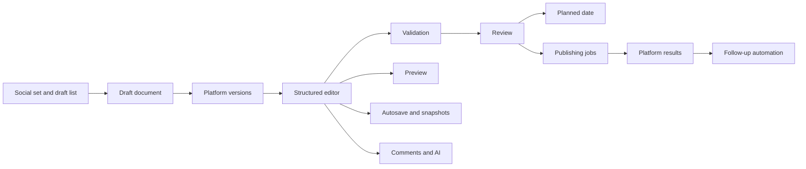
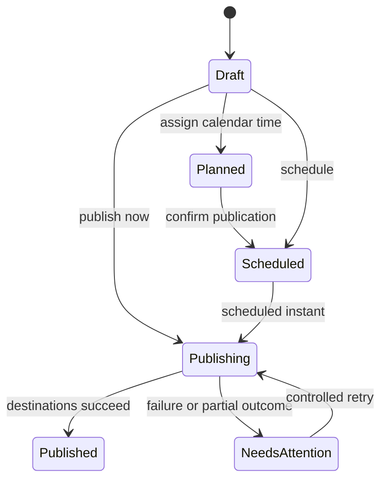

# Typefully Write: comprehensive functional reconstruction

Inspected: 13 October 2026. Scope: signed-in desktop web app, X and LinkedIn company workspaces, plus official Typefully documentation and changelog.

This document explains how the Write product is organized and how to implement comparable behavior. It does not claim access to Typefully's private source code, database, internal API, or production workers.

Evidence labels used throughout:

- **LIVE:** directly visible in the signed-in UI or rendered DOM.
- **BEHAVIOR:** a transition or outcome actually observed.
- **DOC:** described by an official source, linked beside the claim; not necessarily exercised.
- **PROPOSED:** a reconstruction or implementation recommendation, not an assertion about Typefully internals.

Companion: [settings specification](../settings/typefully-settings-spec.md). A separate [implementation and test checklist](typefully-write-build-checklist.md) turns this inventory into engineering work.

## 1. Core product model

Write is a social publishing workspace with several cooperating systems:

1. A social-set selector establishes the brand/person and connected accounts.
2. Drafts, Queue, and Posted provide lifecycle views.
3. A structured editor holds platform-specific content, including ordered thread posts.
4. Sidebars provide metadata, comments, realistic previews, and AI assistance.
5. Review dialogs control destinations, timing, audience, and follow-up automation.
6. Background services must preserve drafts, retain backups, publish content, and track outcomes.

The central distinction is **draft versus platform version versus post**. A draft can contain multiple platform versions. A version can contain multiple posts when its platform supports threads. A LinkedIn version has a different composition experience from an X thread.

The selected account had separate X and LinkedIn social sets with the same visible brand name. Identity cannot safely be based on the name alone.

## 2. Workspace layout and navigation

**LIVE:** at the inspected 1156-pixel-wide desktop viewport, the screen contained:

| Region | Controls and content |
|---|---|
| Global navigation | Typefully menu; Search & Commands; sidebar toggle; Write, Plan, Analyze |
| Left workspace | Social-set selector; Drafts / Queue / Posted tabs; draft filters; New draft with creation dropdown; draft list |
| Editor top left | Platform tabs/toggles and Manage platforms |
| Editor top right | Schedule; next-free-slot shortcut; Publish; realistic preview; comments; sharing; draft properties; Writing Assistant |
| Main canvas | Platform-styled author identity, text, media/poll content, ordered posts, per-post actions |
| Bottom toolbar, X | Emoji, reply/continue thread, Thread Finisher, auto-numbering, Spread the word, display mode, focus mode |
| Bottom toolbar, LinkedIn | Emoji, Spread the word, display mode, focus mode |
| Optional right area | Draft properties, realistic preview, or Writing Assistant; comments can appear beside the draft |

Write and Plan are distinct modes. The Write sidebar's Queue exposes upcoming slots without requiring a full calendar transition. Draft editing remains visible while navigating sidebar lifecycle tabs.

**LIVE:** onboarding tips advertise Command+Enter or two empty lines to continue a thread, media drag-and-drop, tagging, and feedback links. These tips can be dismissed. The onboarding's older AI shortcut wording differs from the current shortcuts page; do not treat every tip as the current command contract.

## 3. Draft list, sorting, and organization

**LIVE:** draft rows show a truncated content preview and enabled-platform icon. Hovering a row revealed an overflow button and sharing action. The overflow menu contains:

- Delete.
- Duplicate.
- Copy to social set, with a submenu.
- Pin draft, with Command+Shift+P shown.
- Tag this draft.
- Select multiple, with Shift+Click shown.
- View automatic backups.
- Copy internal link.
- Share & copy public link.

The public-link menu action should be treated as an access-changing action, not a harmless clipboard operation. It was not executed.

**LIVE:** Draft filters exposes Search drafts and four sort orders: Recently updated, Least recently updated, Newest created, Oldest created. The inspected set had no tags, so its tag-filter section was disabled with “No tags yet.” Pin ordering, bulk-action menus, and delete recovery semantics were not tested.

**DOC:** tags can filter drafts and calendar content. A draft created while a tag filter is active inherits those tags. The command bar also exposes tag filtering. [Tags & Metadata](https://support.typefully.com/en/articles/8717753-tags-metadata)

## 4. Draft creation modes

**LIVE:** the X-connected social set's New draft dropdown offered:

| Group | Action |
|---|---|
| New post | X (Twitter), X Article |
| Engagements | Quote a post, Reply to an X post |
| Reuse | Repurpose published content |
| Settings | Edit or add platforms, Change default platforms |

Creation choices depend on the selected social set. Do not hard-code the X-only menu globally. The LinkedIn workspace exposed an empty LinkedIn draft with different editor tools.

**PROPOSED:** use explicit draft kinds for ordinary social posts, quote/repost content, replies, and long-form articles. A reply should carry a target reference; a quote/repost should carry an embedded-source reference. They should not be modeled solely as URL text.

## 5. Rendered editor structure

**LIVE DOM:** the editable surface was a `DIV` with `contenteditable="true"` and class `tiptap ProseMirror`. Its direct children in the X sample were three `DIV` elements with `react-renderer node-atom` classes, matching the three rendered posts.

This strongly indicates a Tiptap/ProseMirror editor using rendered post nodes. It does not reveal dependency versions, editor schema, extension code, database serialization, CRDT use, or framework architecture outside those nodes.

**LIVE:** each X post renders author avatar, name, handle, paragraphs, and a local action bar. Controls become associated with the active post. The final sample post showed a #3 marker and a circular count/progress indicator. Exact character-count semantics were not verified.

**BEHAVIOR:** undo removed an inserted promotional post and restored the original three-post draft. A later automatic-backup view and re-selection of the original workspace showed the original content again. This demonstrates editor undo and a persisted content version in this session; it does not establish save debounce duration or offline guarantees.

**PROPOSED:** preserve semantic post boundaries separately from visual whitespace. Represent text, mentions, media references, polls, and comment anchors as structured content. Keep post order stable when editing adjacent text. Derive preview and publication payloads from the same normalized representation.

## 6. X thread editing

**LIVE:** per-post controls include Add post below, Audience & disclosures, Add media, Refine, and More options. The overflow for the third post exposed Add poll, Who can reply, Move up, and Delete post. Move up displayed Option+Up. Downward movement is documented as Option+Down; it was not available on the final post's observed menu.

**LIVE:** the bottom toolbar offers Reply or continue thread. The onboarding describes two ways to create another post: Command+Enter or two empty lines. Splitting, merging, keyboard-boundary behavior, drag-reordering posts, and rich paste were not stress-tested.

**DOC:** Typefully's current X limitations page describes up to 50 posts per thread. It distinguishes 280-character posts for non-Premium X accounts from up to 25,000 characters per post for eligible X Premium accounts. Over-limit content blocks publishing and scheduling. Eligibility is an X-account property, not simply a Typefully subscription property. [X posting limitations](https://support.typefully.com/en/articles/8717699-twitter-x-posting-limitations)

**PROPOSED:** validation must use platform-aware weighted character counting and entitlement checks. A simple JavaScript string-length test is insufficient for robust URLs, Unicode, and generated numbering. Treat current provider limits as configurable capabilities.

## 7. Thread numbering

**LIVE:** Auto-numbering opens a modal rather than immediately enabling numbering. It contains:

- Enable auto-numbering switch, initially off in the inspected draft.
- Position: Start or End.
- Formatting: `#1`, emoji number, `1.`, `1/`, `/1`, `1/9`, `1 of 9`.
- Skip first N tweets and last N tweets.
- Close.

The UI examples containing 9 are style examples, not a verified thread-length limit. Numbering was not enabled during inspection.

**PROPOSED:** store numbering as draft/platform configuration. Derive prefixes/suffixes at rendering and publishing time, rather than irreversibly injecting numbers into authored text. Recompute the denominator after exclusions and edits according to a clearly documented policy. Test whether generated numbers count toward platform limits and whether first-post skips change the numbering origin.

## 8. Thread Finisher and promotional insertion

**LIVE:** Thread Finisher opens a template modal. It describes encouraging engagement with the first post. A template includes editable text, an author preview, a “First post quote...” placeholder, and a character count. Actions are Delete, Add to current draft, Create new template, and Close. The inspected template asked readers to follow the account and engage with the quoted first post. No template was changed or inserted.

**BEHAVIOR:** Spread the word immediately added a fourth post containing a Typefully credit. It does not open the engagement-automation dialog. The insertion was undone, and the original three-post content was verified. A second toolbar interaction also caused this insertion; it too was undone. Consequently, the exact display-mode interaction was not established.

**PROPOSED:** distinguish reusable user templates, a finisher that quotes a thread root, and promotional product-credit insertion. Use an unresolved reference to the first post until its external URL exists during publishing. Do not create a quote that depends on a URL before the first post succeeds.

## 9. X audience, replies, and disclosures

Three separate concepts appear in the interface:

| Concept | Observed controls | Scope |
|---|---|---|
| Audience | Everyone or community lookup via search/pasted community URL | Where the X version is published / who can see it |
| Reply permissions | Everyone; accounts followed by this account; mentioned accounts; verified accounts; subscribers | Who can reply to an individual post, with apply-to-all capability |
| Content disclosures | Paid partnership; Made with AI | Per-post labels |

**LIVE:** the reply modal explicitly says reply permissions do not change who can see the posts. On the all-default thread, its apply control displayed “Applied to all posts” and was disabled.

**DOC:** community publishing also supports deciding whether to share the community post to the timeline. [Typefully changelog](https://typefully.com/changelog)

**PROPOSED:** model these fields independently. A single `visibility` enum cannot correctly represent destination, replies, and disclosures.

## 10. LinkedIn editor

**LIVE:** the inspected company-page version showed company name, follower count, and a “now” label. Its inline controls were:

- Add media.
- Add mention.
- Add poll.
- Add PDF Carousel.
- Post visibility.
- Refine.
- Add LinkedIn comment below the main post.

An empty draft did not expose ordinary active publishing buttons in the same way as the populated X draft. Do not equate presence of the surrounding toolbar with publication readiness.

**BEHAVIOR:** Add mention inserts `@` into the text and opens suggestions with Companies and People categories. The insertion was undone; the draft returned to empty. Lookup results, eligible people, selection, and mention serialization were not exercised.

**LIVE:** visibility menu offered Anyone and Connections only, even in the inspected company-page workspace. The menu alone does not prove that both choices are valid for publication on that account type.

**DOC:** LinkedIn cross-posting merges thread parts into one post; its version can be edited independently by disabling auto-sync. Personal profiles and company pages are supported. [LinkedIn cross-posting](https://support.typefully.com/en/articles/8718168-publish-cross-post-to-linkedin)

**Documentation conflict:** that help page still says personal mentions are unavailable, whereas the live editor has a People category and the newer mention changelog describes limited personal mentions for people available to the account. Treat unrestricted people tagging as unproven. [Improved LinkedIn mentions](https://typefully.com/changelog/improved-linkedin-mentions-for-companies-and-134)

**DOC:** LinkedIn reposts can be created from a pasted post URL with accompanying commentary. [Typefully changelog](https://typefully.com/changelog)

## 11. Polls

**BEHAVIOR, LinkedIn:** Add poll inserted an inline poll block and changed the draft-list preview to a poll icon. The block showed:

- A dedicated Poll question field, counter 0/140, and missing-question validation.
- Two initial option fields, each with 0/30 counter.
- Add option.
- Duration choices: 1 day, 3 days, 1 week, 2 weeks; 1 week selected initially.
- Remove poll.
- A disabled media action explaining that LinkedIn posts with polls cannot have media.

The blank poll was undone. A missing-question message briefly remained, then disappeared on the next observed state. The draft list returned to Empty draft. No poll content was submitted.

The PDF Carousel control remained present while the poll existed. This is not proof that PDFs can coexist with polls; final validation was not tested.

**DOC:** LinkedIn polls support 2–4 options. Threads polls use the post body as the question, 2–4 options of up to 25 characters, and 24-hour duration. Mastodon supports multiple-choice polls with server-specific limits. Poll options can propagate across supported platform versions, while duration/settings remain platform-specific. Polls are described as available on every plan. [Polls on LinkedIn, Threads, and Mastodon](https://typefully.com/changelog/polls-linkedin-threads-mastodon)

## 12. Media and PDF carousels

**LIVE:** Add media supports images, videos, and GIFs; the tooltip shows Command+Shift+I. Editor onboarding advertises drag-and-drop. No local files were uploaded, so crop tools, upload progress, compression, alt-text editing, thumbnails, and processing failures were not exercised.

**DOC:** media can be dragged to reorder it within a post or move it between thread posts. AI image descriptions are available through Generate descriptions and were announced for paid plans. [Typefully changelog](https://typefully.com/changelog)

**DOC:** LinkedIn PDFs can be uploaded through the PDF control or drag-and-drop. The published guide lists 100 MB and 300 pages as limits. Preview overlays help check slide content around LinkedIn's controls. [PDF carousel guide](https://support.typefully.com/en/articles/11970191-create-and-schedule-linkedin-pdf-carousels)

**DOC, entitlement caveat:** the original carousel announcement specifies Creator or higher. Current lower-tier entitlement was not tested. [Carousel announcement](https://typefully.com/changelog/pdf-carousels-for-linkedin-posts-120)

Selected documented media constraints, not upload-tested:

| Platform | Documented constraints |
|---|---|
| X | JPG/PNG/WebP images; GIF up to 15 MB; MP4/MOV up to 512 MB and 10 minutes |
| LinkedIn | Images/GIFs include HEIF/HEIC/JPEG/PNG/WebP; video up to 100 MB |
| Bluesky | Images compressed to meet the provider's 1 MB limit; video up to 100 MB |
| Threads | JPG/PNG/WebP/HEIC images |
| Mastodon | Video up to 40 MB; WebM/MP4/M4V/MOV listed |
| Substack Notes | Up to six images/GIFs; GIF up to 10 MB; video unsupported |

The guide generally distinguishes 5 MB image uploads for free users from 20 MB for paid users with resizing. [Supported media formats](https://support.typefully.com/en/articles/8717768-supported-media-formats)

**PROPOSED:** use media assets with upload/processing/ready/failed states. Store platform-specific derivatives. Validate media count, type, dimensions, duration, and incompatible attachments before scheduling. Preserve order and alt text independently from upload order.

## 13. Platform management and synchronization

**LIVE:** Manage platforms opens Draft Platforms. It offers publishing switches for X, LinkedIn, Threads, Mastodon, Bluesky, Substack beta, and Typefully. Connected X displays account identity, audience selector, and Preview. Typefully includes a profile link. A Change platforms defaults shortcut opens settings.

The same platform destination controls recur inside Schedule and Publish review. Availability of an off switch for an unconnected platform does not establish that it is ready to publish; connection/setup behavior was not triggered.

**Prior live settings evidence:** a social set has ordered default platforms; the primary platform syncs to the other enabled platforms. Defaults are described as applying to new drafts.

**PROPOSED:** separate `enabled`, `active editor tab`, `connected`, and `sync mode`. A selected editing tab is not equivalent to an enabled publishing destination. Use a source version and per-target sync/manual modes. Before overwriting a manually edited version, require an explicit merge/reset decision. Never silently discard target-only content or comment anchors.

## 14. Refine and Writing Assistant

**LIVE:** Refine opens a prompt input and these actions:

| Action | Intended operation indicated by its label |
|---|---|
| Fix grammar | Correct language |
| Improve writing | General edit |
| Make it punchier | Stronger, more concise phrasing |
| Condense | Shorten |
| Rephrase / Mix it up | Alternate wording |
| Expand & Elaborate | Add development |
| Improve structure & spacing | Improve organization |
| Rewrite in a positive tone | Tone change |
| Rewrite as thread start | Opening-post adaptation |
| Add emoji | Emoji enrichment |
| Rewrite as announcement | Announcement format |

These labels were inspected without requesting generation. Response streaming, token consumption, review/accept/reject UI, and automatic application were not verified.

**Prior live evidence:** Writing Assistant opens a social-set-specific sidebar. When unconfigured, it exposes Create Assistant; Style Guide and Writing Samples settings point to that setup flow.

**DOC:** the assistant supports chat, voice input, rewriting, hooks/endings, structural feedback, ideation, and platform adaptation. It learns from writing samples and drafts and retains preferences. Usage is limited by plan; daily resets use the user's timezone and monthly resets follow billing. Optional paid extra usage is a separate billing choice. [Writing Assistant](https://support.typefully.com/en/articles/14756434-writing-assistant)

**PROPOSED:** keep AI suggestions scoped to draft, platform, post, and selection. Preserve the original text and selection anchors until acceptance. AI output must pass the same platform validation as human edits.

## 15. Draft properties and tags

**LIVE:** the Info Sidebar contains an internal title field, Generate title with AI, tags field, Manage tags, scratchpad, copyable draft ID, word count, character count, estimated reading time, and Activity.

The sample displayed 109 words, 618 characters, and 30 seconds reading time. These are observed outputs, not enough evidence to infer the exact counting formula. They may differ from platform publication counts.

Manage Tags identifies the selected social set and says each set has its own tags. Create New Tag opens a name field, ten visible color buttons, a Preview area, Cancel, and Create Tag. Submission is disabled while the name is blank. No tag was created.

**PROPOSED:** separate internal title and scratchpad from published content. Store tags as set-scoped records rather than global name strings. Recheck tag ownership when duplicating across sets.

## 16. Activity versus automatic backups

**LIVE:** Activity appeared in Draft Properties with a Draft created event and relative timestamp.

**DOC:** Activity is a read-only, real-time history of modifications with actor/time/context. It does not expose line-level diffs, restore versions, or track mere views. It is described as available on all plans. [Draft Activity](https://support.typefully.com/en/articles/15291407-draft-activity)

**BEHAVIOR:** View automatic backups opened a separate `/backups` tab with a Browse Versions modal. Controls: Prev, Next, version timestamp, Create new draft from this version, support action, platform indicator, and rendered content. Next was disabled on the latest version. The recovery operation explicitly creates a new draft; it was not executed.

**PROPOSED:** use separate audit events and immutable snapshots. Snapshot recovery should preserve the original draft and create a new identity. Retention interval, snapshot frequency, and deleted-draft recovery were not established.

## 17. Comments and sharing

**LIVE:** Show comments exposes instructions to select text to comment or share a feedback link. Comments therefore attach to selected draft text rather than only to the whole document. No comment was sent.

Share & Collaborate contains:

- Public link switch, initially off.
- Explanation that anyone with the link may view and comment.
- Internal link with Copy link.
- Access summary: Only you can access, for this private set.

**DOC:** comments support teammate mentions and rich formatting including bold, italic, lists, and blockquotes. Mobile comments use a drawer. Typefully also describes an editing lock that prevents simultaneous teammate edits and helps across browser tabs. [Typefully changelog](https://typefully.com/changelog)

Neither a multi-user editing session nor a public viewer session was tested. A lock is different from real-time concurrent text merging; do not assume CRDT/OT collaboration.

## 18. Realistic preview

**BEHAVIOR:** Preview from Publish review closed that modal and opened a right sidebar. The sidebar supports desktop/mobile preview and Open in new tab.

**LIVE:** mobile device choices included iPhone SE, iPhone 16, iPhone 17 / Pro, iPhone Air, iPhone 17 Pro Max, Samsung Galaxy S25, and Google Pixel 10. The selected iPhone 16 displayed 393 × 852. The X preview rendered each thread post in a feed-like layout with illustrative engagement numbers.

Those engagement numbers are preview decoration, not analytics for the unpublished draft.

**DOC:** realistic preview simulates X long-post truncation and LinkedIn's “more” cutoff. [Typefully changelog](https://typefully.com/changelog)

**PROPOSED:** share the normalized content model with the publisher, while isolating platform-specific display rules. Preview correctness includes line wrapping, mentions, media order, text truncation, quoted posts, disclosures, and account identity.

## 19. Schedule review and planned drafts

**LIVE/BEHAVIOR:** Schedule opens a dialog with social-set timezone, a date/time input, Next slot, Browse queue, Best time, destination switches, Preview, and X automation controls.

Opening the date input revealed:

- Suggested slots: Today, Tomorrow, Later.
- A scheduling-settings shortcut.
- A month calendar with past days disabled.
- A time list in 15-minute increments; past times disabled for the current day.
- Current timezone and UTC offset.

Selecting Tomorrow's noon slot populated the input but did not itself schedule. It exposed a Confirm button containing the date/time/timezone, Save as planned, Clear scheduled time, and a Natural posting time switch displaying ±0m while off. The dialog was closed without confirmation.

Browse queue listed future day/time slots. Schedule here controls appeared disabled in the captured accessibility state; the cause was not diagnosed. Best time showed day navigation and an insufficient-history message asking the user to return in a few weeks for the Daily Engagement chart. No recommendation data was available.

**DOC:** Confirm creates a real schedule. Save as planned places the draft on the calendar without automatic publication. Planned and scheduled items appear in Queue/calendar, and planned items have a dashed outline. [Scheduling and Calendar](https://support.typefully.com/en/articles/9210135-scheduling-and-calendar)

**Prior live settings evidence:** weekly slots are templates; changing them does not move already scheduled drafts. Natural timing can apply a ±4-minute offset and be overridden per draft.

## 20. Immediate publishing review

**LIVE:** Publish opens a review dialog rather than immediately sending. The sample summary identified a three-post X thread. Publish now is a separate final action. The form repeats account identity, destination switches, audience, Preview, Auto-RT, Auto-Plug, and Auto-DM.

No Publish now, scheduling Confirm, Save as planned, or next-free-slot publication action was executed. Successful delivery, failed delivery, retries, post IDs, and external social-network state are not verified by this inspection.

**PROPOSED:** treat review and execution as separate states. Revalidate the exact draft revision and destination set on final submission. Record per-platform outcomes and avoid repeating already successful writes when another platform fails.

## 21. Auto-Retweet

**LIVE:** the Auto-RT action opens an explicit configuration form. The text says retweets are removed after 12 hours. It has Edit default settings, timezone context, multiple retweet rules, per-rule Remove, Add a retweet, Reset to defaults, Cancel, and Enable auto-retweet.

Three visible sample/default rules illustrated different time expressions:

1. Relative hours after publishing: 6 hours.
2. Days plus hours after original publication: 1 day and 1 hour.
3. Relative day with a local clock time: 7 days at 10:30.

Each rule rendered a concrete projected timestamp “if published now.” These observed values are not necessarily universal defaults for all accounts.

**PROPOSED:** normalize relative-duration and local-wall-clock rules separately. Generate follow-up jobs only after the root post exists. Pair each automatic retweet with its removal task. Make retries idempotent.

## 22. Auto-Plug

**LIVE:** Auto-Plug contains an engagement threshold, Likes/Retweets selection, reply composer and preview, counter, affiliate-program link, Enable auto-plug, and Save as default for new drafts.

The observed threshold was 100 likes and the reply counter was 0/280. The UI states that once the condition is met, the plug is published within ten minutes.

No automation was enabled. Threshold comparison details, repeated crossings, polling interval, and maximum campaign age were not tested.

**PROPOSED:** keep triggering state separate from configuration. Once a campaign succeeds, prevent duplicate plugs even if engagement falls and crosses the threshold again. Preserve the external reply ID for reconciliation.

## 23. Auto-DM

**LIVE:** Automatic DMs is an opt-in form with:

- Warning that the first post must mention the DM offer using words such as DM, message, or send.
- Follows-you condition: Optional or Required.
- Any versus all action matching.
- Retweets-first-post checkbox.
- Replies-to-first-post checkbox and optional reply-text condition.
- DM content editor.
- Insert variable menu: First name, Full name, Username, Action, Tweet URL.
- Explicit Enable Auto-DM action.

The form says campaigns operate for four days after publication and send at most 500 DMs per day due to X limits. These are displayed product limits, not independently verified provider limits. No campaign was enabled and no message sent.

**PROPOSED:** model event matching, recipient eligibility, deduplication, delivery state, expiry, and daily quotas separately. A retry must not send another DM to the same recipient/campaign. Stop jobs when the campaign is disabled or its source post is removed.

## 24. X Articles

**LIVE:** X Article is a creation option. Its dedicated editor was not created during this inspection.

**DOC:** articles require title and body, a connected eligible X account, and X Premium. They support headings, paragraphs, bold/italic/strikethrough, links, lists, quotes, Markdown conversion, cover media, inline images/videos, and GIFs. They can be previewed, shared for collaboration, scheduled, or published. An article cannot be combined with other publishing platforms in the same draft. [X Articles](https://support.typefully.com/en/articles/15887300-x-articles-support-in-typefully)

**PROPOSED:** use a separate article schema and renderer, not a very long standard-post string. Validate eligibility both before review and at execution because provider eligibility can change.

## 25. Public API evidence relevant to Write

**DOC:** Typefully documents a public REST API; this is not evidence that its web app uses the same endpoints. Draft operations are scoped under `/v2/social-sets/{social_set_id}/drafts`. Content is grouped by platform with ordered posts. Publication and planning are distinct: `publish_at` and `plan_at` are mutually exclusive. Immediate publication is asynchronous; `publish_state` may be in progress while draft status has not yet changed.

Comment threads use platform/post position and selected text, with occurrence disambiguation. Editing content must preserve comment-thread markers; missing markers can produce a conflict. Mentions are atomic for anchoring. Threads on auto-synced platform versions cannot be created, and comment edits are restricted to their author. This makes comment preservation part of content-edit correctness, not merely UI decoration. [Public API reference](https://typefully.com/docs/api)

No private API calls, credentials, or network interception were used.

## 26. Keyboard contract

**DOC:** current shortcut reference, translated to Mac modifier notation where applicable:

| Action | Shortcut |
|---|---|
| Command bar | Cmd+K |
| Left sidebar / properties | Cmd+/ ; Cmd+Backslash |
| Write / Plan / Analyze | Cmd+Shift+1 / 2 / 3 |
| New draft | Cmd+. |
| Pin | Cmd+Shift+P |
| Share | Cmd+Option+S |
| Publish flow | Cmd+Shift+Enter |
| Next free slot | Cmd+Option+Enter |
| Next / previous draft | Cmd+Option+Down / Up |
| Add post | Cmd+Enter |
| Move post | Option+Up / Down |
| Media | Cmd+Shift+I |
| Emoji | Cmd+Shift+. |
| Focus mode / display mode | Cmd+Shift+F / H |
| Leave comment | Cmd+Shift+M |
| Writing Assistant / Refine | Cmd+J / Cmd+I |

Refine can target the current post or selected text. AI-input focus changes the meaning of some new-item shortcuts. Browser/OS conflict behavior was not tested. [Keyboard shortcuts](https://typefully.com/shortcuts)

## 27. Proposed implementation architecture

This is a design for equivalent functionality, not Typefully's recovered internals.

Suggested boundaries:

| Component/service | Responsibility |
|---|---|
| Draft repository | Authorization, revision checks, normalized content persistence |
| Editor adapter | Transactions, selection, undo, node serialization, input normalization |
| Platform capabilities | Limits, attachment compatibility, supported audiences and draft kinds |
| Synchronization engine | Source-to-target transforms, manual overrides, divergence warnings |
| Media service | Upload, scanning/validation, processing, derivatives, metadata |
| Comment service | Anchors, messages, permissions, resolution, notifications |
| Revision service | Audit history and recoverable snapshots |
| Preview renderer | Native-looking platform output without implying actual engagement |
| Scheduling service | Timezone conversion, slot selection, planned versus scheduled status |
| Publisher | Platform adapters, external IDs, retries, partial outcomes |
| Automation service | Retweets, plugs, DMs, expiry and idempotency |
| AI service | Context-scoped generation, usage accounting, suggestion application |

Suggested entities: SocialSet, ConnectedAccount, Draft, PlatformVersion, PostNode, ArticleDocument, MediaAsset, Poll, Tag, CommentThread, Comment, DraftRevision, DraftActivity, ShareGrant, Publication, AutomationRule, AutomationRun.

Suggested UI state should be separate from domain state: active social set, selected draft, active platform, selected post, cursor/selection, open sidebar, open dialog, filters, sort, device preview, and focus mode. Switching a panel must not change publication configuration.

## 28. Proposed lifecycle and invariants

This is an implementation model, not a claim about exact Typefully status enum values.

Important invariants:

1. Planned content never publishes because a date merely exists.
2. Platform enablement, editing focus, and connection health are independent.
3. Source synchronization does not silently erase manual edits or comments.
4. Internal title/scratchpad never enter social post text.
5. Review references a specific draft revision and set of accounts.
6. An uncertain network response does not justify blindly publishing again.
7. Follow-up automation waits for successful source publication.
8. Backups and audit events have distinct retention and recovery semantics.
9. Preview metrics cannot be mistaken for performance data.
10. Permission checks apply to every mutation, not only hidden buttons.

## 29. Observed issues, conflicts, and limits

| Finding | Evidence and implication |
|---|---|
| Command palette unavailable | Search & Commands displayed “Couldn't load this view. Check your connection and retry.” A retry did not resolve it. Search behavior could not be tested. |
| Transient missing editor state | Switching social sets briefly showed “no empty state component,” then loaded normally. This was a transient UI artifact, not proof of data loss. |
| Transient stale validation | Undoing the blank LinkedIn poll briefly left its missing-question warning, then cleared. |
| Personal mention documentation conflict | Older help says unavailable; live People category and newer changelog show partial support. |
| Video documentation conflict | An older failure article contains both ten-minute and 2:20 statements; the newer formats guide lists ten minutes. Do not derive a validator from the stale sentence. |
| Preview from publishing changes location | Opens preview sidebar and dismisses review; do not expect a stacked modal. |
| Generic media lookup is not an upload test | No upload or processing path was exercised. |
| AI access is visible, output untested | No generation was requested and no assistant was created. |
| Paid account coverage | Inspected account was Creator Yearly; Free and team-role behavior are not proven by visible controls. |

The older failure guide says Typefully rolls back already-published X thread parts when a later part fails, but that recovery behavior was not tested. [Failure troubleshooting](https://support.typefully.com/en/articles/9577433-why-did-my-post-fail)

Not tested: real publication, schedule execution, multiple concurrent editors, offline saves, media processing, restoring a backup, public sharing access, comment submission, bulk operations, X Article editing, live Threads/Bluesky/Mastodon/Substack accounts, quota exhaustion, or payment gates.

Inspection caused reversible sample-content insertions through toolbar actions and a blank LinkedIn poll. These were undone and the original visible content was rechecked. Autosave timestamps, activity records, or backup history may reflect those temporary edits. No post, comment, DM campaign, public share, or publishing schedule was submitted.
