# Store screenshot studio

The studio at `/store-screenshots` builds App Store and Google Play
screenshot sets: compose slides, localize them, check them against store
rules, export every size, share them for review, and upload them to App
Store Connect or a Google Play edit.

Editing runs in the browser. The server holds review links, comments,
publishing credentials, and the AI and provider calls.

## Screenshots

Captured from the running studio against a local backend (`docs/store-screenshots/`).

| | |
| --- | --- |
| 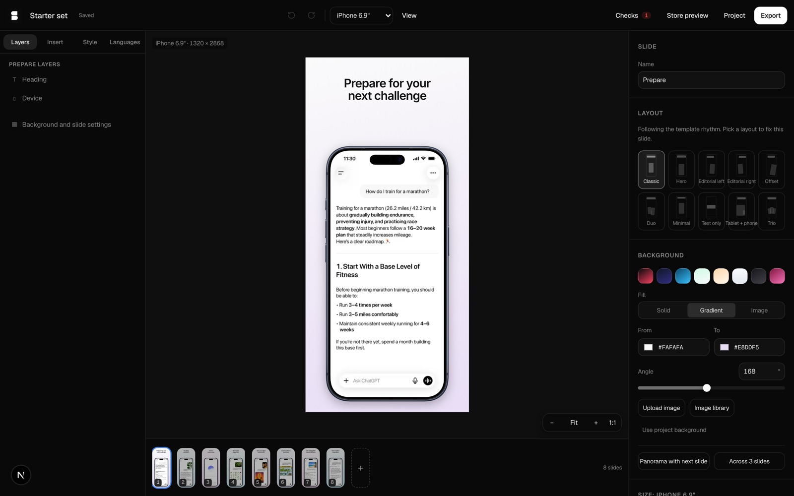 Editor: layers, canvas, contextual inspector, filmstrip | 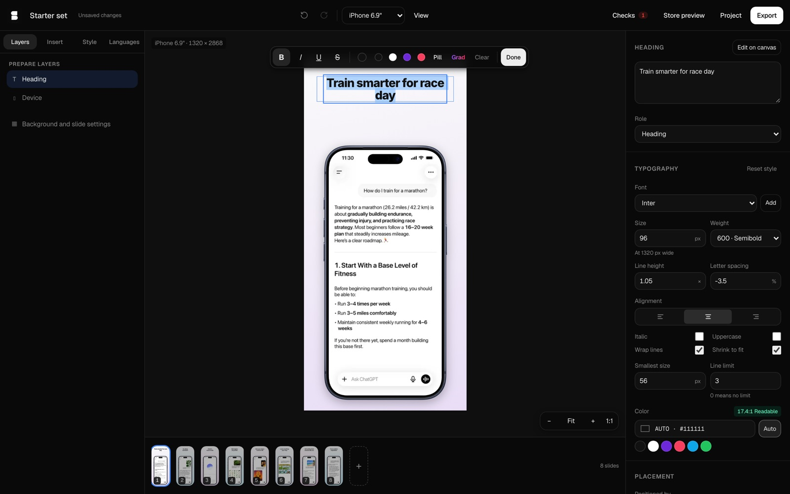 Double-click to edit text on the canvas |
| 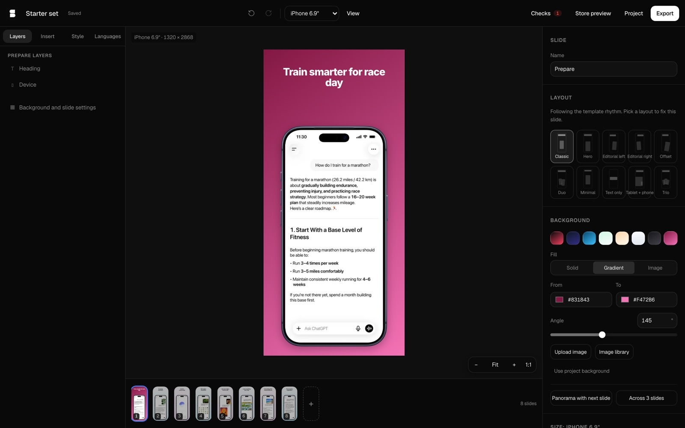 Text color adapts to a dark background | 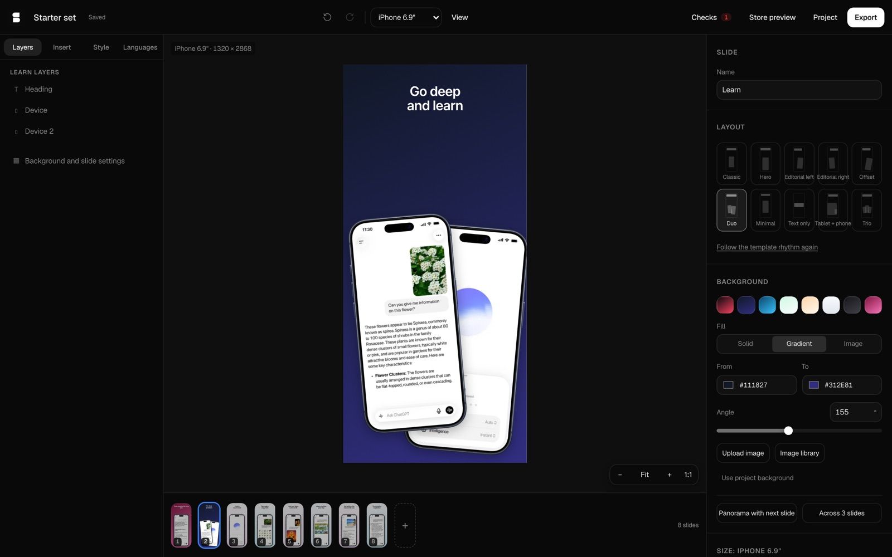 Two devices with different screenshots |
| 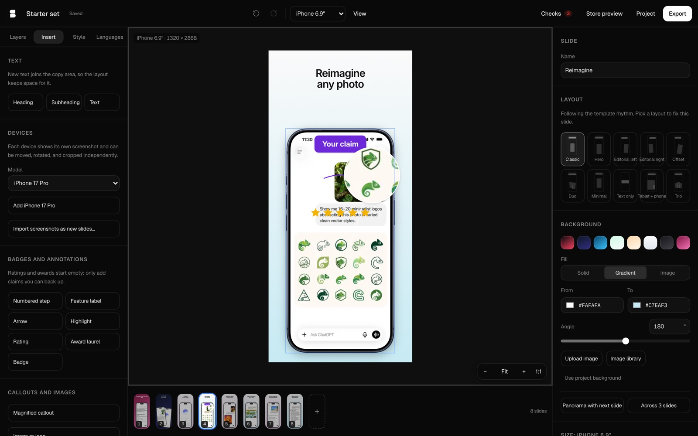 Badge, arrow, rating, and a magnified callout | 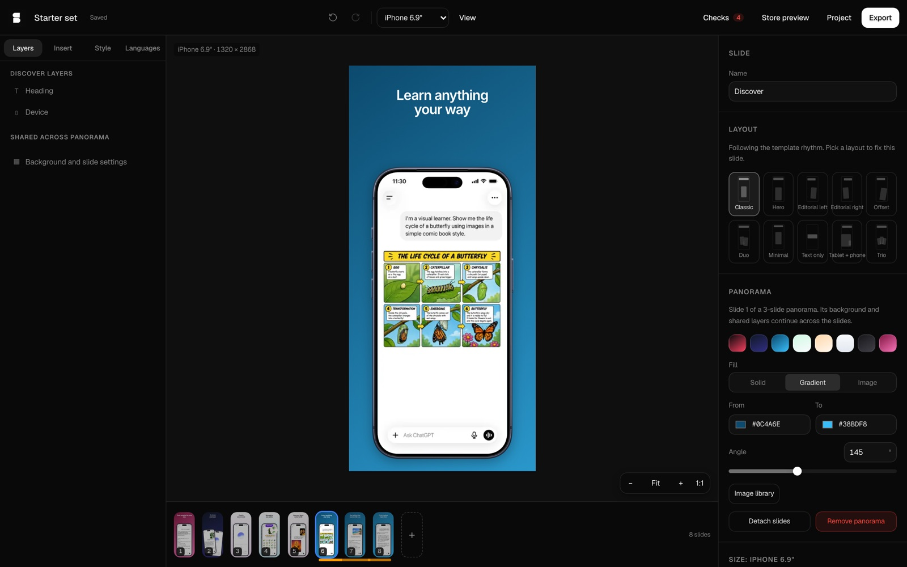 A background shared across three slides |
| 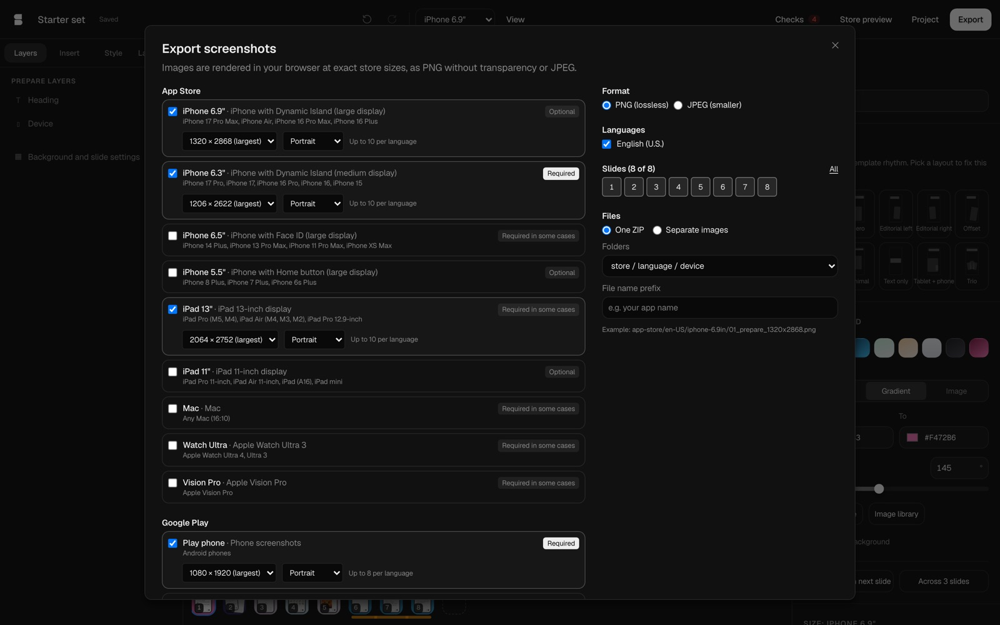 Export: stores, sizes, formats, languages, packaging | 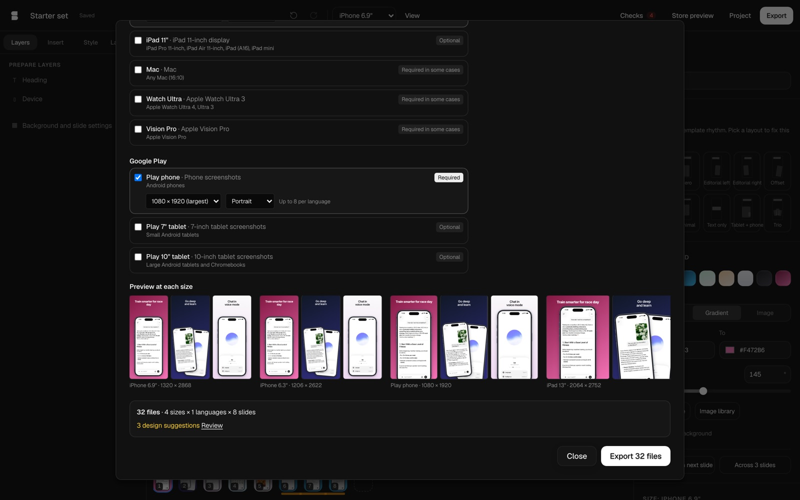 Preview at each size, file count, and checks |
| 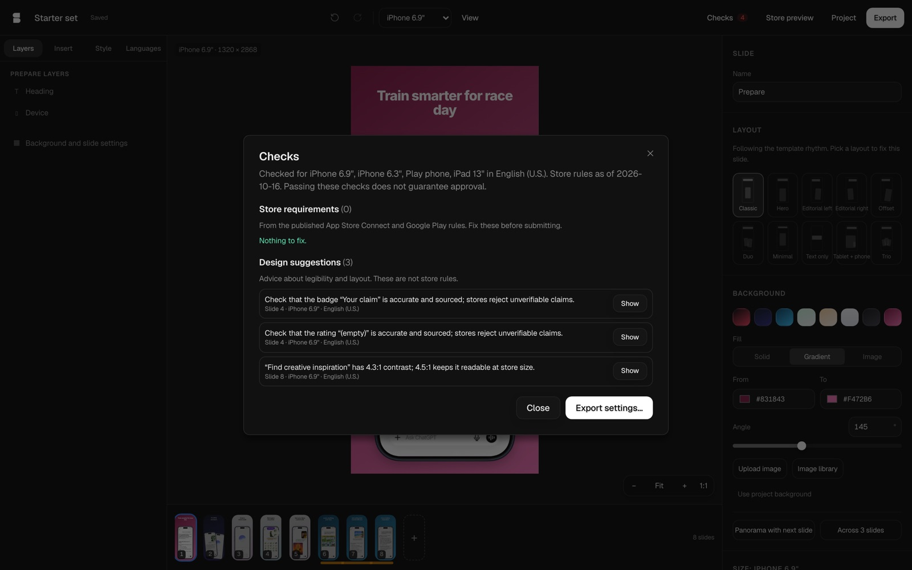 Store requirements vs design suggestions | 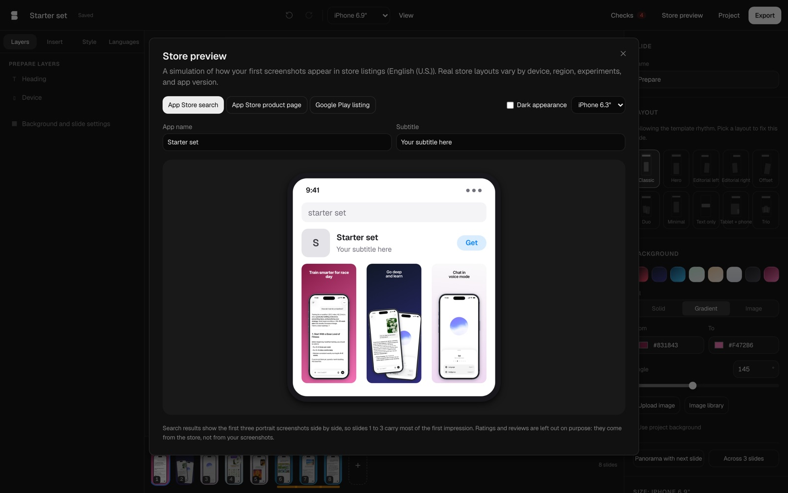 App Store search-result preview |
| 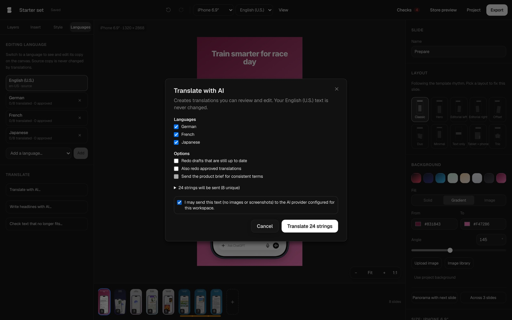 AI translation asks before sending text | 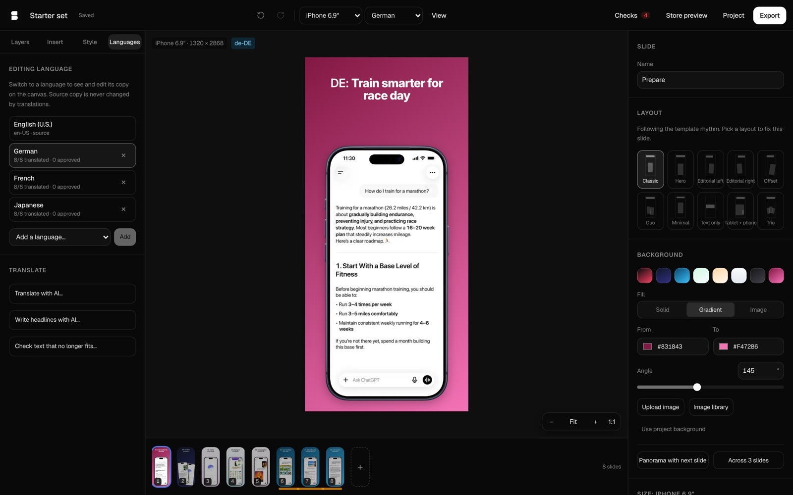 Editing the German copy on the canvas (text from the local test model) |
| 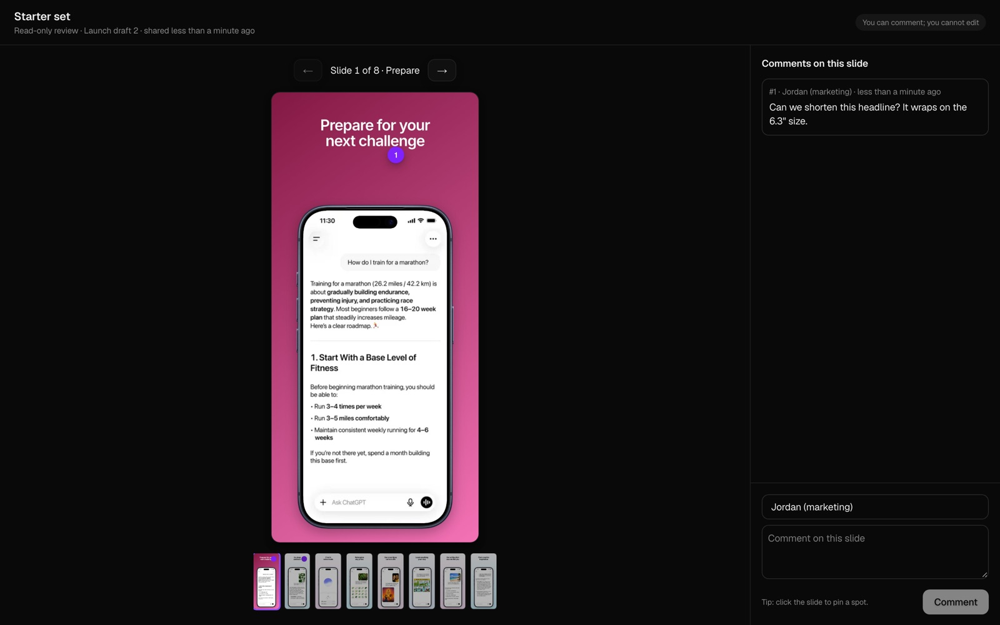 Read-only review link with a pinned comment | 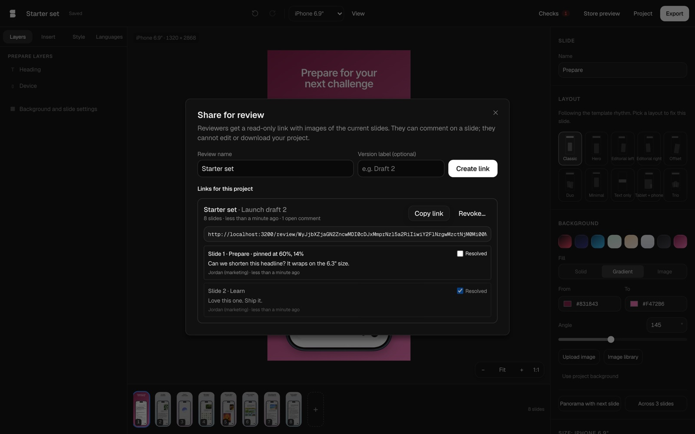 Comments, resolve, and revoke in the editor |
| 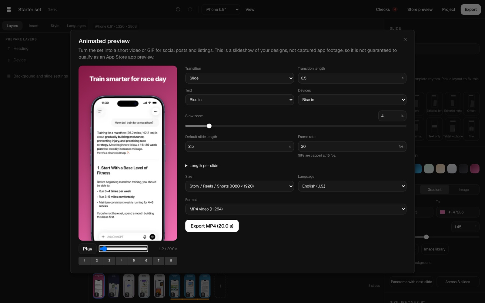 Animated preview, MP4 and GIF | 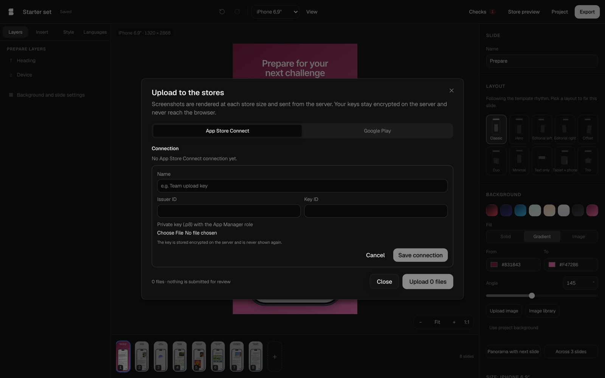 App Store Connect connection; keys stay on the server |

## Architecture

One document, one renderer, and one command path serve every feature.

| Layer | Location | Responsibility |
| --- | --- | --- |
| Document | `lib/store-screenshots/document/` | Versioned zod schema (`schema.ts`), factories, v1 migration (`migrate.ts`), annotation and callout factories |
| Commands | `lib/store-screenshots/commands/` | Every edit is a validated command (`schema.ts`) applied by a pure reducer (`apply.ts`); history coalesces gestures into one undo step (`history.ts`) |
| Engine | `lib/store-screenshots/engine/` | Layout presets, scene evaluation (`scene.ts`), contrast, text fitting, geometry, snapping, hit testing |
| Renderer | `components/store-screenshots/render/` | `SlideRender` draws a scene; the canvas, thumbnails, store previews, export, animation, and review snapshots all use it |
| Editor | `components/store-screenshots/studio/` | zustand store, canvas, inspector, sidebar, filmstrip, dialogs |
| Export | `lib/store-screenshots/export/` | Planner (paths, sizes), job runner (progress, cancel, store limits), RGB PNG encoder, ZIP |
| Compliance | `lib/store-screenshots/compliance.ts`, `targets.ts` | Store requirements (blocking) and design recommendations (advisory) |
| Localization | `lib/store-screenshots/localization.ts`, `locales.ts` | Per-layer translations with source hashes, status, and outdated detection |
| Persistence | `lib/store-screenshots/persistence/` | IndexedDB projects, content-addressed assets, versions, brand kits, templates |
| Server | `lib/tenant/store-*.ts`, `app/api/store-screenshots/`, `app/api/review/` | Reviews, comments, credentials, provider uploads, AI |
| Backend | `services/internal/product/store_screenshots.go`, `services/backend/internal/httpapi/store_screenshots.go` | Ent models `StoreReview`, `StoreReviewComment`, `StorePublishingCredential`; authorization and audit |
| Integrations | `lib/integrations/` | App Store Connect, Google Play, and Figma clients, isolated from the editor |

### Data flow

1. A user action dispatches a command (`editor-store.ts`).
2. `applyCommand` returns a new document; invalid results are rejected, so
   the document always parses.
3. `evaluateSlide(document, index, { size, targetId, locale, measurer })`
   resolves layout, placement, text fitting, contrast colors, and device
   geometry into a `Scene`.
4. `SlideRender` draws the scene. Export renders the same scene at the
   target's pixel size; nothing has a second layout path.

Sizes are resolution independent: positions are percentages of the slide,
and type sizes are pixels at a 1320 px reference width that scale with the
output.

### Document versions and migration

Version 2 is the current schema (`STORE_DOCUMENT_VERSION`).
`readStoreDocument` refuses documents from a newer version instead of
guessing. On first load, `importLegacyProject` copies the version 1 project
from the old IndexedDB database into the new store and leaves the old data
in place.

| Version 1 | Version 2 |
| --- | --- |
| `slide.src` (data URL) | Project asset (bytes in the asset store, keyed by content hash); device layer references it |
| Headline, subhead | Text layers (`heading`, `subheading`); offset = copy position + text offset |
| `headlineColorOverride` | Text style `color` override |
| Duo layout with `duoLeftSlideId` / `duoRightSlideId` | Two device layers with their own screenshots |
| `device`, `secondaryDevice` transforms | Layer transforms; `rotateX`/`rotateY` become `tiltX`/`tiltY` |
| Extra texts | Free-placed text layers; size × 13.2 = px at reference width |
| Overlay | Free-placed image layer |
| Template default text colors | Automatic (contrast-aware) color |
| `layoutOverride` | Slide `layout` |

### Persistence

- Projects save with the revision they build on. A save against an older
  revision raises `ProjectConflictError`, and the header offers *Keep
  mine* or *Load theirs*. Other tabs reload through a `BroadcastChannel`.
- Saves are serialized, so autosaves cannot overtake each other.
- Image bytes live once in the asset store, keyed by a SHA-256 of their
  content. Unused assets are collected after 24 hours.
- Named versions are full document snapshots and restore as one undoable
  step.

## Store targets

`targets.ts` lists every supported output with its source documentation
and catalog date (`STORE_TARGET_CATALOG_VERSION`). Requirements come from:

- Apple: <https://developer.apple.com/help/app-store-connect/reference/app-information/screenshot-specifications/>
- Google Play: <https://support.google.com/googleplay/android-developer/answer/9866151>

Update the catalog and its date when the stores change their rules. The
checks separate **requirements** (export or upload would be rejected) from
**recommendations** (readability, overlap, clipping, translations). Passing
the checks does not guarantee store approval, and the UI says so.

## Review links

- A link is `/review/<payload>~<signature>`. The HMAC (keyed from
  `BETTER_AUTH_SECRET`) binds the review id, workspace, and the review's
  share-token id. The separator is `~` because the proxy skips paths
  that contain dots.
- The backend checks the share-token id and revocation on every read and
  comment, so revoking a review kills every copy of the link.
- Reviewers see rendered JPEG slides through short-lived signed URLs.
  Source screenshots, asset ids, and the project document never leave the
  workspace. Links cannot edit anything.
- Comments are tied to slide ids, so reordering slides in the editor keeps
  each comment on its slide. Comments on deleted slides say so.
- Comment posting is rate limited per client and link
  (`STORE_REVIEW_COMMENT_RATE_LIMIT`).

## Publishing

### Server setup

Set `STORE_PUBLISHING_ENCRYPTION_KEY` on the web service: a base64-encoded
32-byte key.

```sh
openssl rand -base64 32
```

`bin/studio` generates one for local development. Helm reads it from the
app secret (optional), and the DigitalOcean spec passes it through when
present. Without it the publish dialog explains that uploads are not set
up, and no credential can be saved.

Credentials are encrypted in the web tier (AES-256-GCM) before they reach
the backend; the database only stores ciphertext. Rotating the key makes
existing credentials unreadable, so re-add them after a rotation. Only
owners, admins, and publishers can add, use, or delete credentials, and
every change is audited.

### App Store Connect

1. In App Store Connect → Users and Access → Integrations → App Store
   Connect API, create a team key with the **App Manager** role.
2. In the studio: Project → *Upload to App Store Connect or Google
   Play…* → *Add App Store Connect connection*. Enter the issuer ID and key
   ID, and choose the `.p8` file.
3. Choose the app, an editable version, sizes, and languages. Each language
   must already exist on the version.

Uploads reserve, upload, and commit each screenshot with Apple's checksum
flow. *Replace the screenshots already there* deletes the set's existing
screenshots before the first upload. The studio never submits a version
for review.

### Google Play

1. In Google Cloud, create a service account and a JSON key, and enable
   the Google Play Android Developer API.
2. In Play Console → Users and permissions, invite the service account's
   email with permission to manage store presence for the app.
3. In the studio, add a Google Play connection with the JSON key, enter
   the package name, choose sizes and languages, and upload.

Uploads go into a draft edit. The listing changes only when the user
commits that edit, and committing requires ticking an explicit
confirmation.

### Provider verification status

Both clients are covered by contract tests against recorded API shapes
(`test/store-publishing-integrations.test.ts`): JWT and OAuth signing,
pagination, retries, idempotent re-uploads, and error mapping. They have
not been run against real Apple or Google accounts; that needs
credentials for a test app.

## AI features

Translation and copy suggestions use the platform model router with AI
credits (`withAiCredits`). Only text strings and the optional product
brief are sent, never images, and the translate dialog asks for consent
before sending. Copy suggestions that cite numbers missing from the brief
are dropped. `PLATFORM_AI_SCRIPTED=1` swaps in a deterministic local model
for development and tests.

## Figma import

Users paste a Figma file link and a personal access token. The token is
used for that request only and is not stored. Only `figma.com` file links
and Figma's image CDN hosts are accepted, and rendered frames must be PNG.

## Limits

| Limit | Value |
| --- | --- |
| Slides per project | 30 |
| Image upload | 25 MB, 8192 px per side; PNG, JPEG, or WebP (SVG refused) |
| Custom font | 5 MB; signature-checked TTF, OTF, WOFF, or WOFF2 |
| Review | 30 slides; images re-rendered at 900 px wide |
| Review comment | 2000 characters; 500 per review |

## Performance

Measured on an Apple Silicon laptop against the development server:

| Workload | Result |
| --- | --- |
| Export 8 slides × 4 sizes (iPhone 6.9″, iPhone 6.3″, iPad 13″, Play phone) as PNG + ZIP | 32 files, 15.0 s end to end; every file RGB PNG at its exact size; largest 2.0 MB |
| MP4, 8 slides at 1 s, 540 × 1170 | 4.1 s to encode (WebCodecs H.264); 8.0 s, plays back |
| GIF, same timeline | 12.1 s to encode (ffmpeg.wasm palette); 16.6 MB |

Rendering runs one file at a time on the main thread because it uses the
DOM; the export dialog stays responsive and can cancel between files.

## Tests

| Suite | Command |
| --- | --- |
| Engine, commands, editing, output pipeline, server crypto, provider contracts | `npm test` (files under `test/store-*.test.ts`) |
| Contract registry and API boundaries | `npm test` (`test/openapi-contracts.test.ts`, `test/api-platform-boundary.test.ts`) |
| Backend unit and route tests | `cd services && go test ./internal/product ./backend/internal/httpapi` |
| Backend lifecycle against Postgres | `PUBLISHING_TEST_DATABASE_URL=… go test ./internal/product -run TestStoreReviewLifecycleAndCredentials` |
| Browser flows | `npx playwright test test/e2e/store-screenshots.spec.ts` against the local stack |
